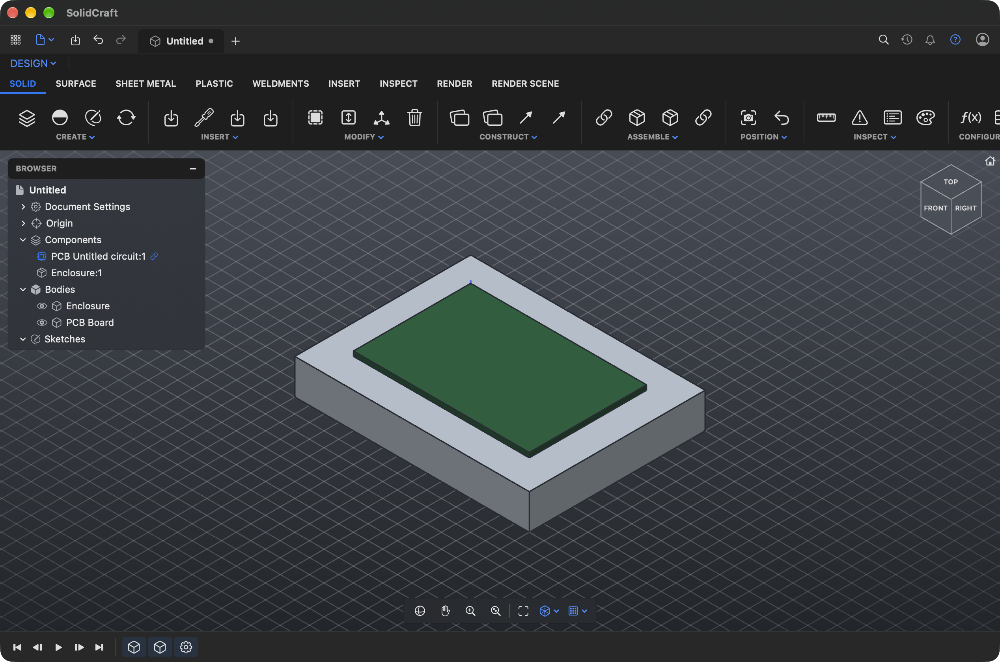
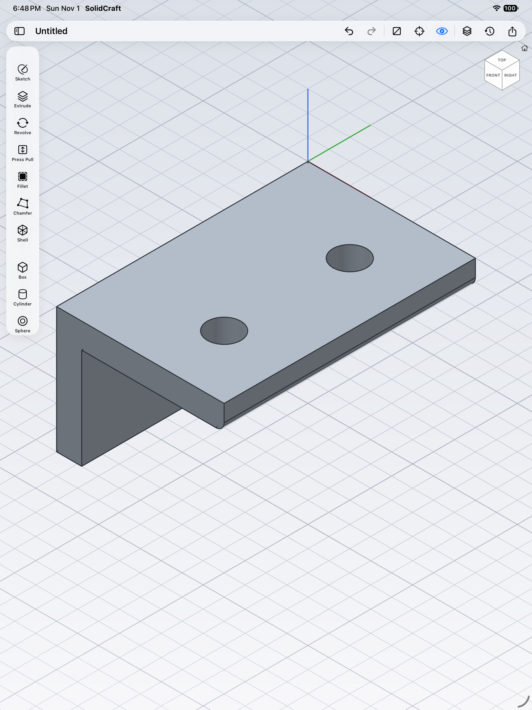
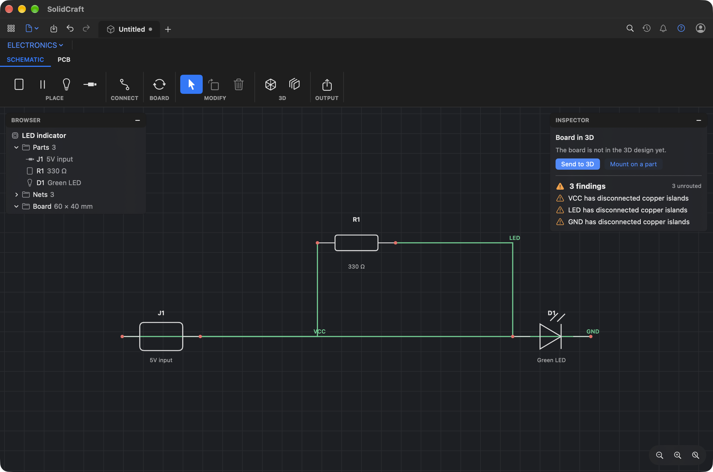
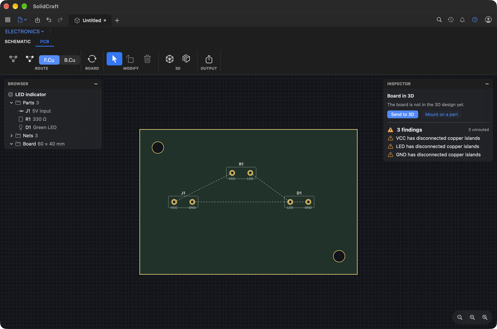
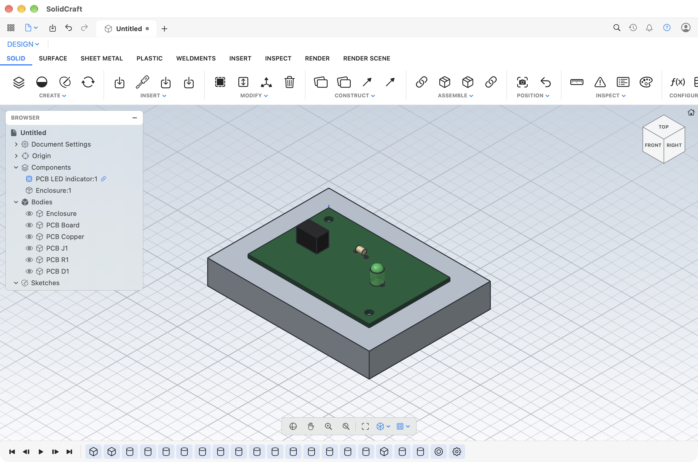

# ViaForm

Native Apple front ends for open source Rust CAD and EDA engines.

- **macOS**: a desktop layout with a ribbon of tabs and panels, a browser tree, a timeline,
  a right-click marking menu, command search on S and a ViewCube.
- **iPad and iPhone**: a touch-first layout with a project sidebar, items and history
  sidebars, a tool column (a bottom row on iPhone) and tools suggested from the selection.

Both draw with Metal and run every action through the engines' command APIs.







## Layout

```
engines/solidcraft   submodule: tangency-labs/solidcraft, parametric 3D CAD in Rust
engines/pcbcraft     submodule: tangency-labs/pcbcraft, KiCad-compatible PCB engine in Rust
bridge/              solidcraft-ffi: a C ABI static library over both engines (JSON in, JSON and buffers out)
apple/               XcodeGen project: Shared (engine, renderer, model), Desk (macOS), Touch (iOS)
docs/                screenshots and the UI reference sheet
scripts/             build-bridge.sh builds the bridge for macOS, iOS and the iOS simulator
```

## Build

```bash
git submodule update --init --recursive
```

```bash
scripts/build-bridge.sh
```

```bash
cd apple && xcodegen generate && open SolidCraftNative.xcodeproj
```

`SolidCraft --selftest` runs the tool paths end to end (sketch, extrude, press pull, fillet,
undo, primitives, scene) and exits. `--sample` opens the bracket sample.

## Notes

- The layouts follow public descriptions of how common CAD tools are arranged
  (see `docs/ui-reference.md`). Icons are SF Symbols; colours, names and artwork are our own.
- Electronics workspace (Mac: workspace menu, iPad and iPhone: Project sidebar): place parts, wire
  pins, update the board, route (one pair or every airwire), read ERC and DRC, export a
  `.kicad_pcb`. Parts are the engine's four built-in kinds for now; KiCad library parts are next.
- Board to 3D: Send to 3D builds the board as a component of the design (board, copper, holes,
  part stand-ins) tagged with the PCB revision. Mount on a Part seats it on a picked face with a
  rigid group. When the board changes, Update 3D rebuilds it inside the same component, so the
  placement and joints stay.
- Next steps are in `IMPROVEMENTS.md`.

## Licence

GPL-3.0-or-later (see `LICENSE`), because the bridge links PCBCraft, which is GPL.
SolidCraft itself is MIT or Apache-2.0. GPL rules out App Store distribution.
