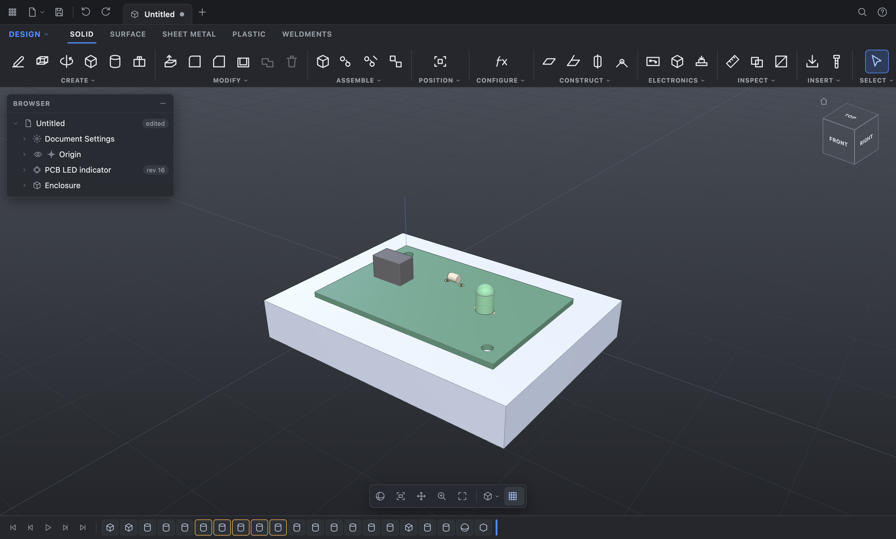
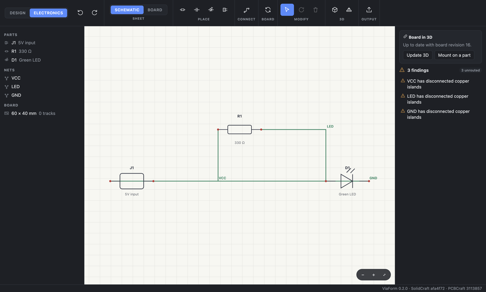
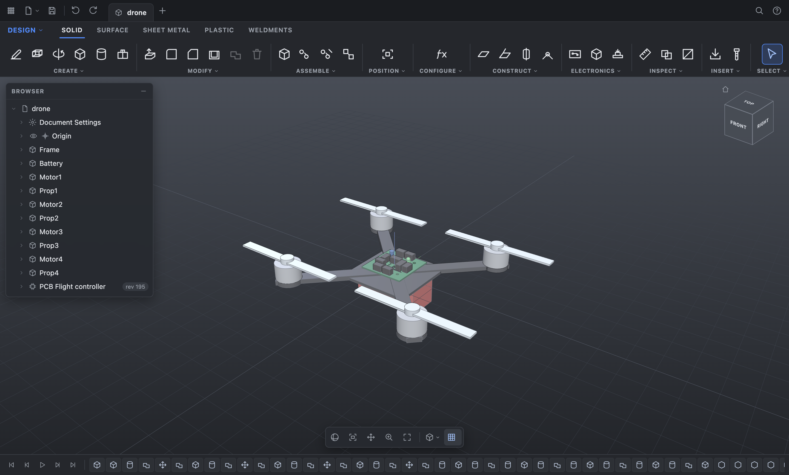
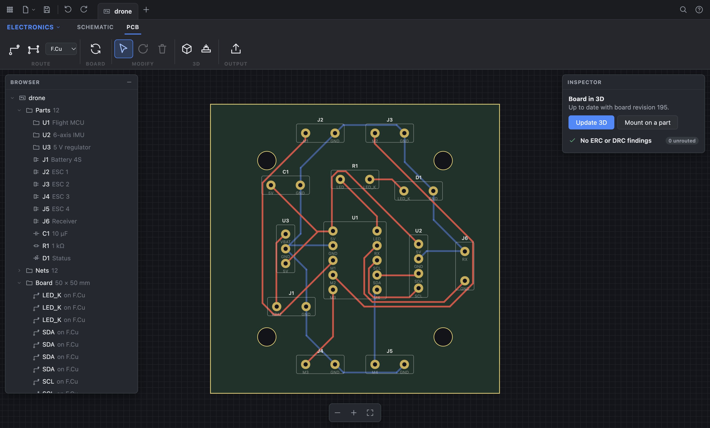
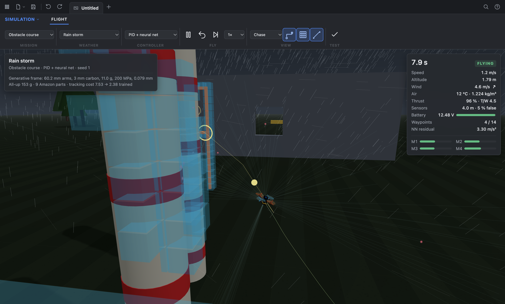
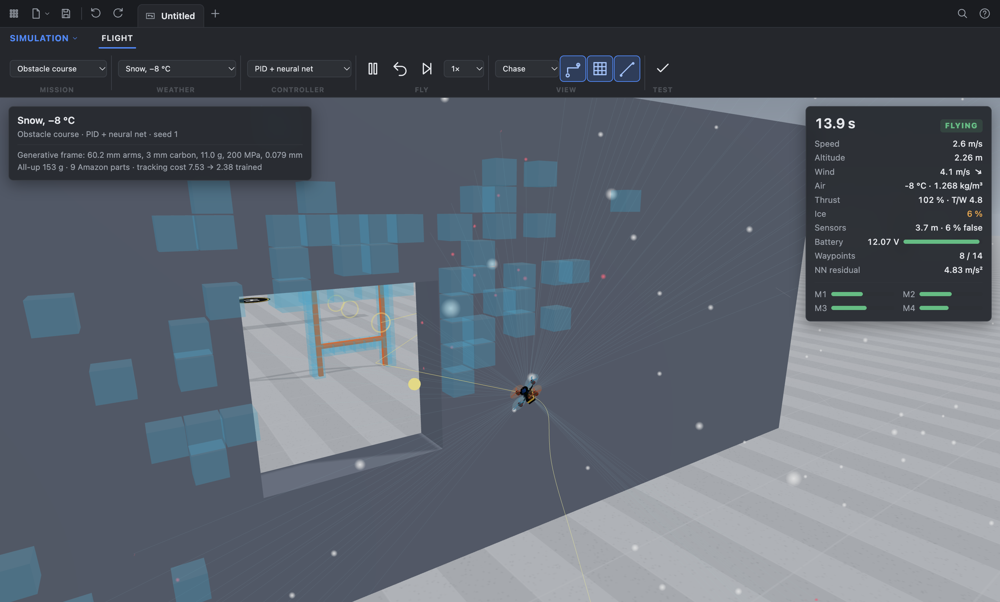
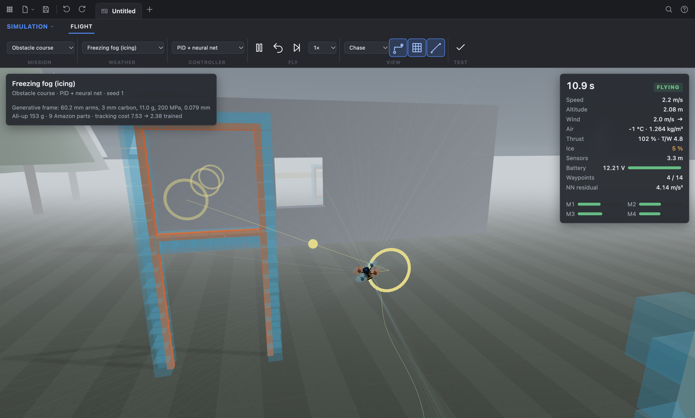
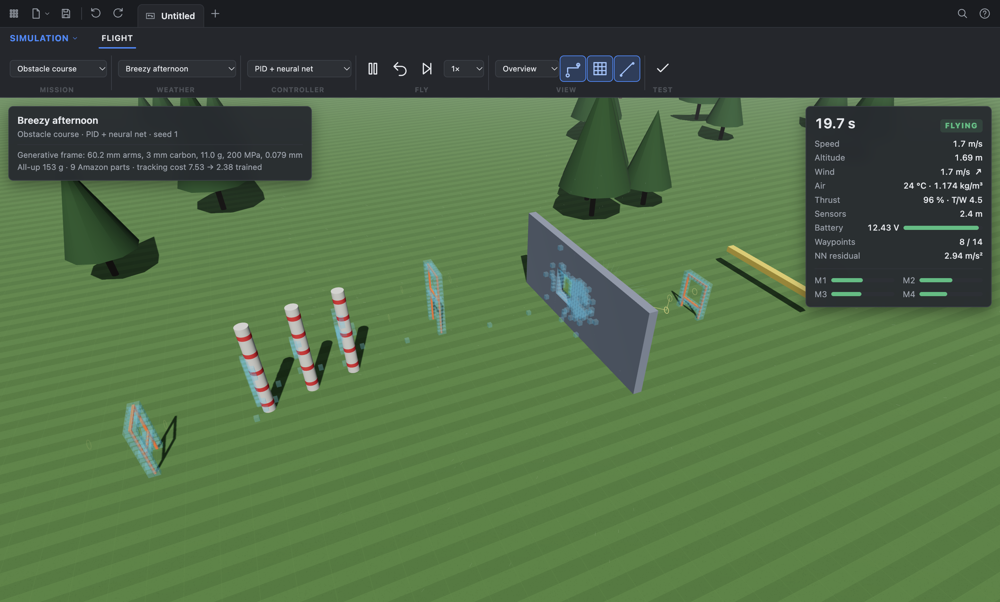

# ViaForm

3D design and electronics as one app, on open source Rust engines (SolidCraft for CAD,
PCBCraft for PCB).

- **Windows, Linux and macOS**: an Electron app (`electron/`). Design and Electronics are two
  workspaces of one project, saved together as a `.viaform` file. It updates itself from this
  repository's GitHub Releases.
- **macOS**: a desktop layout with a ribbon of tabs and panels, a browser tree, a timeline,
  a right-click marking menu, command search on S and a ViewCube.
- **iPad and iPhone**: a touch-first layout with a project sidebar, items and history
  sidebars, a tool column (a bottom row on iPhone) and tools suggested from the selection.

The Apple apps draw with Metal, the Electron app with WebGL. All of them run every action
through the engines' command APIs, and share one Rust core (`core/`) for everything that joins
the two engines, so the board to 3D link behaves the same everywhere.





## Layout

```
engines/solidcraft   submodule: tangency-labs/solidcraft, parametric 3D CAD in Rust
engines/pcbcraft     submodule: tangency-labs/pcbcraft, KiCad-compatible PCB engine in Rust
core/                viaform-core: one workspace over both engines, the board to 3D link, the .viaform file
bridge/              solidcraft-ffi: a C ABI static library over the core, for the Swift apps
node/                viaform-node: a Node addon (N-API) over the core, for the Electron app
electron/            the cross-platform app: main process, preload, renderer (TypeScript, three.js)
apple/               XcodeGen project: Shared (engine, renderer, model), Desk (macOS), Touch (iOS)
docs/                screenshots and the UI reference sheet
scripts/             build-bridge.sh (Apple bridge), engine-sync.sh (move the engines to upstream)
.github/workflows/   CI, Release (signed builds and the update feed), Engine sync (daily)
```

## Build

```bash
git submodule update --init --recursive
```

Electron app (any platform, needs Rust and Node 22):

```bash
cd electron && npm ci && npm start
```

`npm test` runs the app's end-to-end tests on the addon; `cargo test -p viaform-core` runs the
core's. `npm run test:ui` starts the app and drives its interface (toolbar, browser, ViewCube,
timeline, sketch, electronics); it needs a display. `npm run dist` packages for the current platform.

`npm test` includes a flying drone built end to end (`electron/src/test/drone.ts`): a 5-inch X
frame with motors, propellers and a 4S pack; a flight controller drawn, placed and routed to a
clean DRC; the board seated on the frame; then mass, balance, thrust to weight, interferences and
the propellers spun through a full turn against the airframe, with STEP and KiCad exports.
`npm run sample:drone` writes it to `samples/` as `drone.viaform` (open it in the app),
`drone.step` and `flight-controller.kicad_pcb`.




### Drone simulation

The Simulation workspace (Ctrl+3) flies a small 3-inch drone through an obstacle course, or holds
it in a hover, in hard weather. The same code (`electron/src/shared/sim`) runs the app, the tests
and the training:

- **Physics.** Rigid-body X quad: motor lag, thrust and torque against the air, drag, ground
  effect, and crash and collision detection.
- **Weather.** Seven presets, from indoor to a gale, a 25 mm/h rain storm, snow at −8 °C,
  freezing fog and hot-and-high at 2 400 m. They set:
  - wind: mean, turbulence and gusts;
  - air density: temperature, altitude, humidity;
  - rain: water film and down-force on the rotors;
  - snow load and icing on the props;
  - LiPo: cold internal resistance and voltage sag;
  - time-of-flight sensors: range, plus false returns from drops and flakes.
- **Frame by generative design** (`generative.ts`). Beam FEM over a ground structure, optimised
  for mass under three load cases at full thrust: punch-out, radial crash and side crash. The
  constraints are prop clearance, deflection and stress. At a 1.5 safety factor the result is a
  3 mm carbon frame with tapered 60.2 mm arms. The frame weighs 11.0 g and the drone 153 g all up.
  `node scripts/design-frame.mjs` reruns the study.
- **Parts** (`parts.ts`). All on Amazon:
  - SpeedyBee F405 Mini stack;
  - T-Motor F1404 4600KV motors;
  - Gemfan 3016 props;
  - 650 mAh 3S LiPo;
  - RadioMaster RP1 receiver;
  - XIAO ESP32S3 companion;
  - six VL53L1X time-of-flight sensors.

  Links and masses are in the file. Prices and stock were not checked.
- **Controller.** Cascaded PID: position, velocity, attitude, then rates and the mixer. A small
  neural net (17-16-3) adds a correction to the acceleration command.
  `node scripts/train-drone.mjs` trains both in two stages, over randomised weather, mass and
  thrust:
  1. tunes the gains (cross-entropy method);
  2. trains the net (evolution strategies).

  The script writes `trained.ts`. On held-out episodes the velocity-tracking cost was:

  | Controller | Cost |
  |---|---|
  | Default PID | 7.53 |
  | Trained gains | 2.77 |
  | Trained gains + net | 2.38 |
- **Autonomy.** Readings from the time-of-flight sensors build a 3D occupancy map in log-odds.
  Rain and snow returns fade from it; walls stay. A* replans on that map five times a second.
  Speed limits keep the drone able to stop before what it sees.

Results on the obstacle course (seven weathers, five seeds each):

| Controller | Courses completed |
|---|---|
| Default PID | 27/35 |
| Trained gains | 33/35 |
| Trained gains + net | 33/35 |

Most failures are walls met in strong wind with short sensor range, such as bright sun at
altitude. The toolbar's check button reruns this table in the app. `npm test` runs these sim
tests:

- physics;
- weather effects;
- frame constraints;
- mapping;
- training gains;
- a hover in every weather;
- six course flights from calm to gale.






Apple apps:

```bash
scripts/build-bridge.sh
```

```bash
cd apple && xcodegen generate && open SolidCraftNative.xcodeproj
```

`SolidCraft --selftest` runs the tool paths end to end (sketch, extrude, press pull, fillet,
undo, primitives, scene) and exits. `--sample` opens the bracket sample.

## Notes

- The layouts follow public descriptions of how common CAD tools are arranged
  (see `docs/ui-reference.md`). Icons are SF Symbols; colours, names and artwork are our own.
- Electronics workspace (Mac: workspace menu, iPad and iPhone: Project sidebar): place parts, wire
  pins, update the board, route (one pair or every airwire), read ERC and DRC, export a
  `.kicad_pcb`. Parts are the engine's four built-in kinds for now; KiCad library parts are next.
- Board to 3D: Send to 3D builds the board as a component of the design (board, copper, holes,
  part stand-ins) tagged with the PCB revision. Mount on a Part seats it on a picked face with a
  rigid group. When the board changes, Update 3D rebuilds it inside the same component, so the
  placement and joints stay.
- Updates, two ways. The app checks the latest GitHub Release at launch and every four hours,
  downloads a newer version in the background and installs it on quit (or right away from the
  banner). The Engine sync workflow moves SolidCraft and PCBCraft to their upstream tips every
  day, builds and tests the whole app on them and opens a pull request with a patch version
  bump; merging it makes Release build, sign and publish that version, which installed copies
  then pick up. A `.viaform` saved by a newer format is refused with a message to update,
  never half read.
- Signing: Release reads `CSC_LINK`, `CSC_KEY_PASSWORD`, `APPLE_ID`,
  `APPLE_APP_SPECIFIC_PASSWORD`, `APPLE_TEAM_ID`, `WIN_CSC_LINK` and `WIN_CSC_KEY_PASSWORD`
  from the repository secrets. macOS only applies updates to a signed app.
- Next steps are in `IMPROVEMENTS.md`.

## Licence

GPL-3.0-or-later (see `LICENSE`), because the core links PCBCraft, which is GPL.
SolidCraft itself is MIT or Apache-2.0. GPL rules out App Store distribution.
