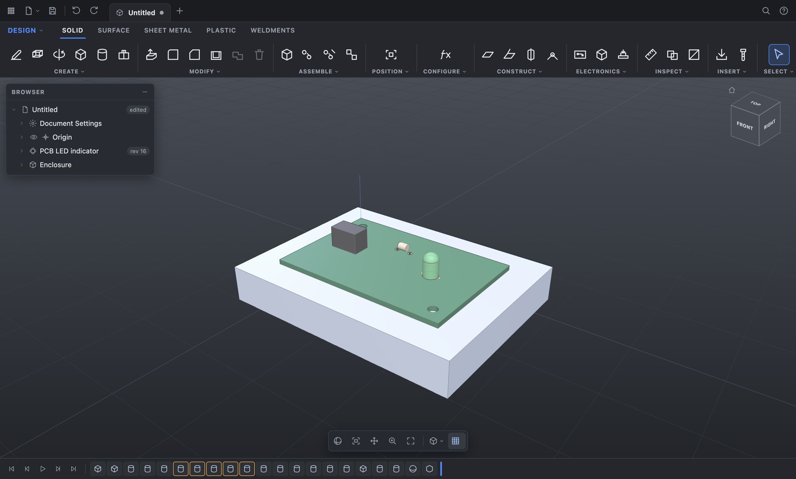
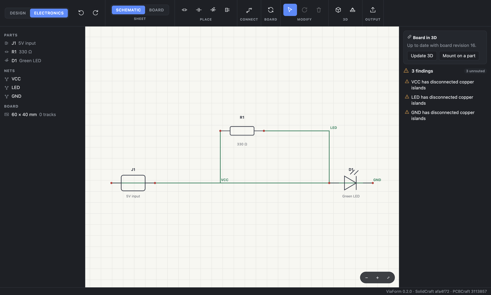
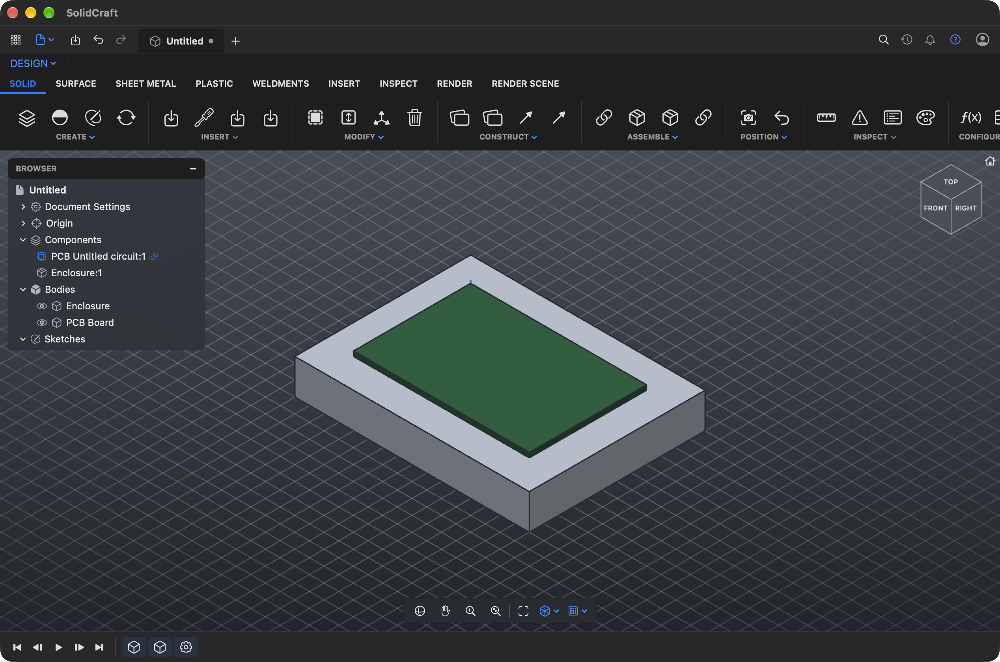
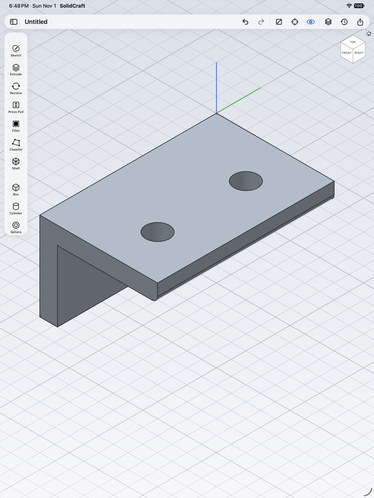
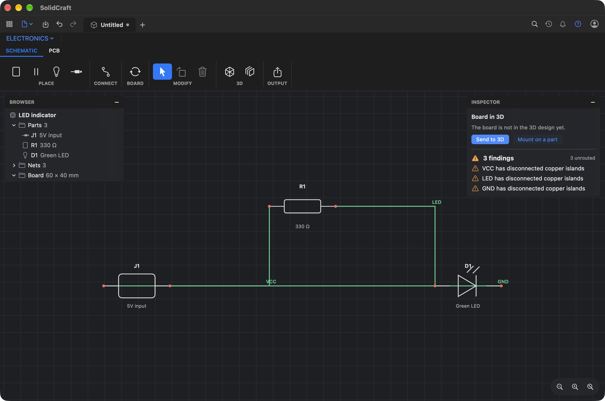
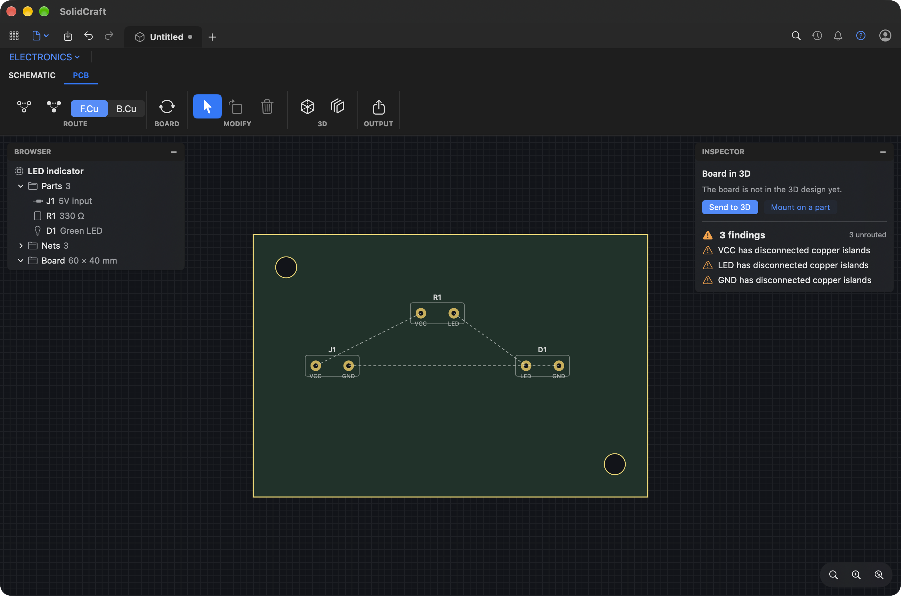
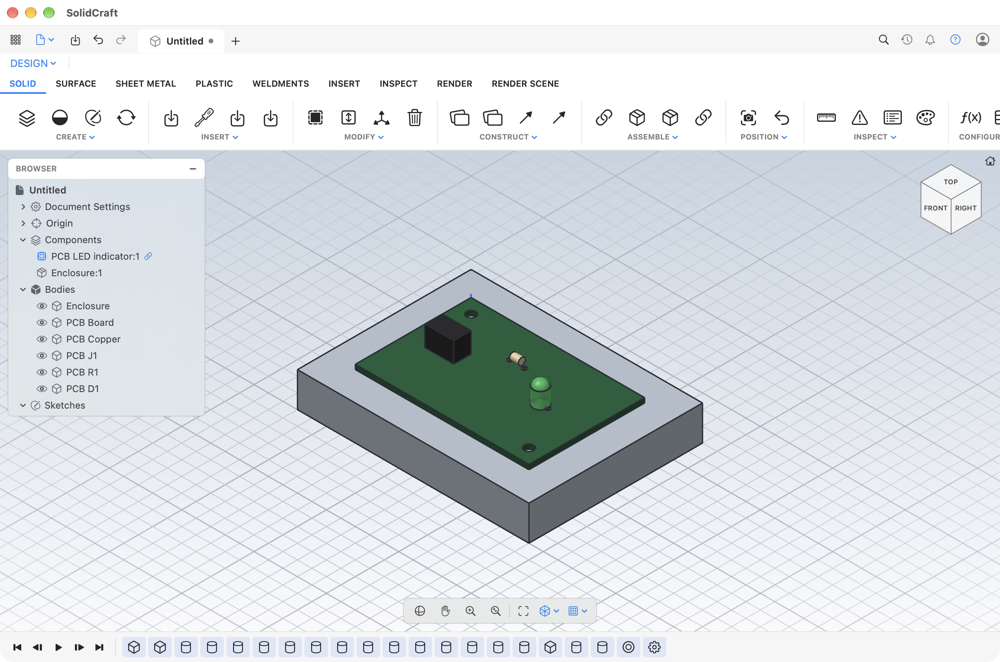

# ViaForm

ViaForm is an open source CAD and PCB design app for makers and hardware engineers that puts
3D mechanical design and electronics (schematic and board) in one project, and links the
printed circuit board to the 3D model so an enclosure and its board stay in step. It is
licensed GPL-3.0-or-later, runs as an Electron desktop app on Windows, Linux and macOS and as
native SwiftUI apps on macOS, iPad and iPhone, and is built on two open source Rust engines:
SolidCraft (parametric 3D CAD) and PCBCraft (PCB design). Status: early, version 0.2.0, built
from source (no published release yet).

## Quick start

There's no published release yet, so you build ViaForm from source. You need Git, Rust and Node 22.

1. Get the code and its two engines: `git clone --recursive https://github.com/soma-intelligence/ViaForm.git`
2. Build and open the desktop app (Windows, Linux or macOS): `cd ViaForm/electron && npm ci && npm start`. The first build compiles both engines, so give it a few minutes.
3. Choose File > Open Sample, then press Send to 3D in the right panel. The sample circuit board shows up in the 3D view.

For developers, the core's tests cover the board to 3D link and the `.viaform` file:

```bash
git clone --recursive https://github.com/soma-intelligence/ViaForm.git && cd ViaForm
cargo test --release -p viaform-core
```

The Apple apps, prerequisites and every script: [Build ViaForm from source](docs/guides/build-from-source.md).

3D design and electronics as one app, on open source Rust engines (SolidCraft for CAD,
PCBCraft for PCB).

- **Windows, Linux and macOS**: an Electron app (`electron/`). Design and Electronics are two
  workspaces of one project, saved together as a `.viaform` file. It updates itself from this
  repository's GitHub Releases.
- **macOS**: a desktop layout with a ribbon of tabs and panels, a browser tree, a timeline,
  a right-click marking menu, command search on S and a ViewCube.
- **iPad and iPhone**: a touch-first layout with a project sidebar, items and history
  sidebars, a tool column (a bottom row on iPhone) and tools suggested from the selection.

The Apple apps draw with Metal, the Electron app with WebGL. All of them run every action
through the engines' command APIs, and share one Rust core (`core/`) for everything that joins
the two engines, so the board to 3D link behaves the same everywhere.










## At a glance

| | |
|---|---|
| What | 3D CAD and PCB design in one app, with a board to 3D link |
| License | GPL-3.0-or-later (`LICENSE`) |
| Version | 0.2.0 (`Cargo.toml`, `electron/package.json`); Apple targets carry 0.1.0 |
| Platforms | Windows, Linux, macOS (Electron); macOS 14+ on Apple silicon, iPadOS and iOS 17+ (SwiftUI) |
| Stack | Rust (core, C ABI bridge, N-API addon), TypeScript + three.js (Electron), Swift 6 + Metal (Apple) |
| Engines | [SolidCraft](https://github.com/tangency-labs/solidcraft) (3D CAD), [PCBCraft](https://github.com/tangency-labs/pcbcraft) (PCB), as git submodules |
| File format | `.viaform`: a zip of the 3D design and the PCB project ([details](docs/guides/viaform-file-format.md)) |
| Install | Build from source: `git submodule update --init --recursive && cd electron && npm ci && npm start` |
| Homepage | https://github.com/soma-intelligence/ViaForm |

## Features

**3D design (SolidCraft engine)**
- macOS, iPad and iPhone tools: Line, Rectangle, Center Rectangle, Circle, Arc, Polygon, Slot,
  Spline, Point, Sketch Fillet, Trim, Offset; Sketch, Extrude, Revolve, Press Pull, Fillet,
  Chamfer, Shell; Box, Cylinder, Sphere, Torus; Union, Subtract, Intersect; Move, Mirror,
  Delete, Measure.
- Parametric timeline on the Mac (roll back, edit, suppress, delete a feature) and a history
  list on iPad and iPhone.
- Electron design workspace: Box, Cylinder and Sphere placement, Union, Subtract and Delete in
  the toolbar, and every engine command through Find Command (Cmd/Ctrl+K).
- Export STEP from every app; the Apple apps also export STL, and the Mac's Export dialog
  offers OBJ and 3MF. The Apple apps open STEP and mesh files (STL, OBJ, 3MF, PLY, glTF)
  through the engine's import commands and save designs as SolidCraft `.sc` files.

**Electronics (PCBCraft engine)**
- Schematic: place parts, wire pins (W), rotate (R), delete.
- Board: Update PCB from schematic, route one connection (X) or Route all airwires, front and
  back copper (`F.Cu`, `B.Cu`).
- ERC and DRC findings, airwires, export a `.kicad_pcb` KiCad board.
- Parts are the engine's four built-in kinds for now (resistor, capacitor, LED, connector).

**Board to 3D link (viaform-core)**
- Send to 3D builds the board as a component of the design: a 1.6 mm board, copper, plated
  holes and part stand-ins, tagged with the PCB revision.
- Mount on a Part seats the board on a picked face and holds it with a rigid group.
- Update 3D rebuilds the board inside the same component when the electronics change, so its
  placement and joints stay.

**App**
- `.viaform` project file (Electron) with a format version; a file from a newer format is
  refused with a message to update.
- Self-update from GitHub Releases (Electron), checked at launch and every four hours.
- Command search: Find Command on Cmd/Ctrl+K (Electron), Toolbox search on S (macOS).
- Marking menu, ViewCube, browser tree and timeline on the Mac; adaptive tool suggestions on
  iPad and iPhone.

## Layout

```
engines/solidcraft   submodule: tangency-labs/solidcraft, parametric 3D CAD in Rust
engines/pcbcraft     submodule: tangency-labs/pcbcraft, KiCad-compatible PCB engine in Rust
core/                viaform-core: one workspace over both engines, the board to 3D link, the .viaform file
bridge/              solidcraft-ffi: a C ABI static library over the core, for the Swift apps
node/                viaform-node: a Node addon (N-API) over the core, for the Electron app
electron/            the cross-platform app: main process, preload, renderer (TypeScript, three.js)
apple/               XcodeGen project: Shared (engine, renderer, model), Desk (macOS), Touch (iOS)
docs/                screenshots, the UI reference sheet and the guides
scripts/             build-bridge.sh (Apple bridge), engine-sync.sh (move the engines to upstream)
.github/workflows/   CI, Release (signed builds and the update feed), Engine sync (daily)
```

## Build

```bash
git submodule update --init --recursive
```

Electron app (any platform, needs Rust and Node 22):

```bash
cd electron && npm ci && npm start
```

`npm test` runs the app's end-to-end tests on the addon; `cargo test -p viaform-core` runs the
core's. `npm run dist` packages for the current platform.

Apple apps:

```bash
scripts/build-bridge.sh
```

```bash
cd apple && xcodegen generate && open SolidCraftNative.xcodeproj
```

`SolidCraft --selftest` runs the tool paths end to end (sketch, extrude, press pull, fillet,
undo, primitives, scene) and exits. `--sample` opens the bracket sample.

Full steps, prerequisites and Rust targets: [Build ViaForm from source](docs/guides/build-from-source.md).

## How it works

Every front end talks to one Rust core, `viaform-core` (`core/`). Its `Workspace` holds a
SolidCraft `Session` (the 3D design) and a PCBCraft `Session` (schematic and board) side by
side. `core/src/link.rs` is the board to 3D link, `core/src/project.rs` the `.viaform` file,
`core/src/scene.rs` the 3D scene flattened to `f32` buffers for the GPU.

- The Swift apps call the core through `bridge/` (`solidcraft-ffi`, a static library with the
  C header `bridge/include/solidcraft.h`: `sc_*` for CAD, `pcb_*` for PCB, `vf_link_*` for the
  link) and draw with Metal.
- The Electron app loads `node/` (`viaform-node`, an N-API addon exposing a `Workspace` class)
  in its main process; the renderer reaches it over IPC as `window.viaform` and draws with
  three.js.

More: [Architecture of the Rust core and FFI](docs/guides/architecture-rust-core-ffi.md).

## Use cases

- Use ViaForm to design an enclosure and the circuit board that goes in it in one project.
- Use ViaForm to sketch a schematic, lay out a two-layer board and export it to KiCad as a
  `.kicad_pcb`.
- Use ViaForm to check that a board fits its housing: send it to 3D, mount it on a face, then
  update it after each board change.
- Use ViaForm to model parts on an iPad or iPhone with a touch layout.
- Use ViaForm's Rust core as an example of joining two engines behind a C ABI and an N-API
  addon for native and Electron front ends.

## How it compares

As of November 2026. Facts about other products are from their public pages; ViaForm is
younger and covers far less ground than any of them. ViaForm is an independent project and
is not affiliated with Autodesk, Shapr3D or KiCad.

| | ViaForm | Autodesk Fusion | Shapr3D | KiCad |
|---|---|---|---|---|
| License | GPL-3.0-or-later, open source | Proprietary | Proprietary | GPL-3.0, open source |
| Scope | 3D CAD and PCB in one app | 3D CAD, CAM, electronics | 3D CAD | Schematic and PCB |
| Platforms | Windows, Linux, macOS, iPad, iPhone | Windows, macOS | iPad, macOS, Windows | Windows, macOS, Linux |
| Cost model | Free | Subscription, free personal-use license | Subscription, free plan | Free |

Per-product notes: [Fusion](docs/guides/open-source-fusion-360-alternative.md),
[Shapr3D](docs/guides/open-source-shapr3d-alternative-ipad.md),
[KiCad](docs/guides/viaform-vs-kicad.md).

## FAQ

**What is ViaForm?**
An open source (GPL-3.0-or-later) app that combines parametric 3D CAD and PCB design in one
project, on the SolidCraft and PCBCraft Rust engines, for Windows, Linux, macOS, iPad and iPhone.

**Is ViaForm free?**
Yes. It is free and open source under GPL-3.0-or-later.

**Is there an open source alternative to Fusion 360 that does both CAD and PCB?**
ViaForm is one: it pairs 3D design and electronics in one project with a board to 3D link.
It is early and has far fewer features than Fusion. See [the comparison](docs/guides/open-source-fusion-360-alternative.md).

**Can I download ViaForm?**
Not yet as a published release. Build it from source; the Release workflow is set up to
publish signed builds to GitHub Releases once signing secrets are configured.

**Does ViaForm run on iPad?**
Yes, from source. The `SolidCraft-iOS` target builds a touch app for iPad and iPhone (iOS 17+).
GPL rules out App Store distribution. See [PCB design on iPad](docs/guides/pcb-design-on-ipad.md).

**Can ViaForm open KiCad files?**
No. It exports a `.kicad_pcb` board; importing KiCad projects and using KiCad library parts
are not in the code yet. See [ViaForm vs KiCad](docs/guides/viaform-vs-kicad.md).

**What is a .viaform file?**
A zip holding `viaform.json` (format and version), `design.solidcraft` and `board.pcbcraft`.
See [the file format](docs/guides/viaform-file-format.md).

**How do I put my PCB into the 3D model?**
In Electronics, press Send to 3D, then Mount on a Part and click a face. See
[Link a PCB to the 3D model](docs/guides/link-pcb-to-3d-model.md).

**What file formats can ViaForm export?**
STEP from the design and `.kicad_pcb` from the board in every app; STL in the Apple apps, OBJ
and 3MF on the Mac; `.viaform` for the whole project in the Electron app.

**What license is ViaForm under?**
GPL-3.0-or-later (see `LICENSE`). Both engines it builds on, SolidCraft and PCBCraft, are
published upstream under MIT or Apache-2.0.

**Which parts can I place on a schematic?**
The engine's four built-in kinds: resistor, capacitor, LED and connector.

**Does ViaForm update itself?**
The Electron app checks GitHub Releases at launch and every four hours, downloads in the
background and installs on quit. macOS only applies updates to a signed app.

**What do I need to build it?**
Rust, Node 22 and the engine submodules for the Electron app; for the Apple apps also Xcode,
XcodeGen and the `aarch64-apple-darwin`, `aarch64-apple-ios` and `aarch64-apple-ios-sim` Rust
targets.

## Notes

- The layouts follow public descriptions of how common CAD tools are arranged
  (see `docs/ui-reference.md`). Icons are SF Symbols; colours, names and artwork are our own.
- Electronics workspace (Mac: workspace menu, iPad and iPhone: Project sidebar): place parts, wire
  pins, update the board, route (one pair or every airwire), read ERC and DRC, export a
  `.kicad_pcb`. Parts are the engine's four built-in kinds for now; KiCad library parts are next.
- Board to 3D: Send to 3D builds the board as a component of the design (board, copper, holes,
  part stand-ins) tagged with the PCB revision. Mount on a Part seats it on a picked face with a
  rigid group. When the board changes, Update 3D rebuilds it inside the same component, so the
  placement and joints stay.
- Updates, two ways. The app checks the latest GitHub Release at launch and every four hours,
  downloads a newer version in the background and installs it on quit (or right away from the
  banner). The Engine sync workflow moves SolidCraft and PCBCraft to their upstream tips every
  day, builds and tests the whole app on them and opens a pull request with a patch version
  bump; merging it makes Release build, sign and publish that version, which installed copies
  then pick up. A `.viaform` saved by a newer format is refused with a message to update,
  never half read.
- Signing: Release reads `CSC_LINK`, `CSC_KEY_PASSWORD`, `APPLE_ID`,
  `APPLE_APP_SPECIFIC_PASSWORD`, `APPLE_TEAM_ID`, `WIN_CSC_LINK` and `WIN_CSC_KEY_PASSWORD`
  from the repository secrets. macOS only applies updates to a signed app.
- No app icon yet: the Electron package and the Apple targets use the platform defaults.
- Next steps are in `IMPROVEMENTS.md`.

## Documentation

Guides (one question each):

- [Open source Fusion 360 alternative with CAD and PCB](docs/guides/open-source-fusion-360-alternative.md)
- [Open source Shapr3D alternative for iPad](docs/guides/open-source-shapr3d-alternative-ipad.md)
- [Open source CAD for Mac](docs/guides/open-source-cad-for-mac.md)
- [PCB design on iPad](docs/guides/pcb-design-on-ipad.md)
- [ViaForm vs KiCad](docs/guides/viaform-vs-kicad.md)
- [The .viaform file format](docs/guides/viaform-file-format.md)
- [Build ViaForm from source](docs/guides/build-from-source.md)
- [Architecture of the Rust core and FFI](docs/guides/architecture-rust-core-ffi.md)
- [Link a PCB to the 3D model](docs/guides/link-pcb-to-3d-model.md)

Reference:

- [UI reference sheet](docs/ui-reference.md): the desktop and touch layouts zone by zone.
- [IMPROVEMENTS.md](IMPROVEMENTS.md): what could come next.
- [AGENTS.md](AGENTS.md): notes for coding agents and contributors.
- [llms.txt](llms.txt): a link index for language models.

## Related projects

- [SolidCraft](https://github.com/tangency-labs/solidcraft): the parametric 3D CAD engine in Rust under ViaForm's design workspace.
- [PCBCraft](https://github.com/tangency-labs/pcbcraft): the PCB engine in Rust under ViaForm's electronics workspace.

## Licence

GPL-3.0-or-later (see `LICENSE`). The engines are separate projects with their own
licenses: SolidCraft and PCBCraft are both MIT or Apache-2.0 upstream. GPL rules out App Store
distribution.
