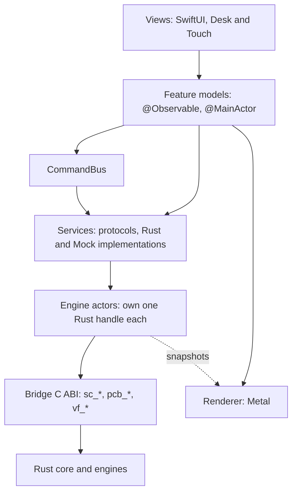

# ViaForm front end specification (tech, engine wiring, UI and UX)

Version 1.0, 2026-11-07. Status: draft for build. Companion to `VIAFORM-SPEC.md` (product, screens,
Azure) and `RUST-ENGINES.md` (engines). This file says **how the Apple apps are built**: architecture,
threading, rendering, how each engine is wired to the UI, the component library, and the UX rules.

Targets: macOS 26+ (`apple/Desk`, primary) and iPadOS/iOS 26+ (`apple/Touch`, full touch-first app),
shared code in `apple/Shared`. Swift 6, SwiftUI first, Liquid Glass (`.glassEffect`, glass toolbars
and sheets) for chrome, AppKit/UIKit only where listed. Shipped on the App Store (VIAFORM-SPEC D-11 to
D-14). Theme follows the system (D-20). English only in v1, every string in a String Catalog (D-22). Electron is in maintenance
(VIAFORM-SPEC D-1) and is not covered here.

---

## 1. Architecture

### 1.1 Layers



| Layer | Rule |
|---|---|
| Views | No engine calls, no JSON. Read feature models, send intents (`model.perform(...)`) |
| Feature models | One per stage plus shared ones (Project, Flow, Selection, Jobs). `@MainActor @Observable`. Hold UI state and decoded engine state. Never block the main actor more than 4 ms |
| CommandBus | Single path for every user and agent action (section 3). Undo groups, logging, agent tags |
| Services | Swift protocols (`FlowService` exists, add `KinService`, `PhysService`, ...). Two implementations: `Rust*` (bridge) and `Mock*` (previews, tests). Selected by `AppEnvironment` |
| Engine actors | Each Rust handle is owned by one Swift `actor` (serial). JSON in and out, decoded off the main actor, results hopped to the main actor |
| Bridge | Unchanged convention: opaque handle, JSON, `sc_string_free`. Binary entry points only for hot paths (RUST-ENGINES 9.2) |
| Renderer | Metal, one `MTLDevice` per process, reads scene and pose snapshots, never calls engines itself |

### 1.2 Today versus target

Today (`apple/`, about 24k lines): `FlowModel` is `@MainActor @Observable` over `FlowService`
(`RustFlow`, `MockFlow`), good. Engines are reached through classes such as `Engine`, `SimEngine`,
`GenerateEngine` with an `EngineGate` and `@unchecked Sendable` jobs, and `SWIFT_STRICT_CONCURRENCY`
is `minimal`. Target: every Rust handle behind an actor, strict concurrency `complete` per module as
it is migrated (task FE-2), no `@unchecked Sendable` left except the binary hot-path wrappers, which
are documented.

### 1.3 Folder layout (target)

```
apple/Shared/
  App/            ViaFormApp, AppEnvironment (service wiring), Settings
  Document/       ProjectDocument (file), ProjectModel (root), Autosave, Recovery
  Command/        CommandBus, Command, UndoBridge, CommandCatalog (palette, ribbon, keys)
  Flow/           FlowModel, FlowService (exists)
  Selection/      SelectionModel, LinkedSelection, Picking glue
  Jobs/           JobCenter, JobCapsule model, Notifications
  Agents/         AgentManager, AgentSession (state machine), AgentThread, approvals queue
  Collab/         Account, CollabSession (WebSocket), Leases, Presence, Comments, ConflictCopy
  Store/          StoreKit 2 credits, balance, receipts sent to the API
  Telemetry/      consent, event list, MetricKit upload
  Engines/        one folder per engine: Design (sc), PCB, Generate, Kin, Plan, Phys, Learn,
                  Bom, Library, Cloud, Robot, Agent. Each: Service protocol, Rust impl, Mock impl,
                  Codable mirrors of the engine JSON, actor
  Render/         Renderer, Viewport, layers (Scene, Overlay, Heatmap, Ghost, Pose, Path), Picking
  UI/             Theme (exists), Components (section 5), Charts, Gizmos
  Features/       one folder per stage: Design, Generate, Assemble, Electronics, Simulate, Train,
                  Render, Make, Robot; each with <Stage>Model, views shared by Desk and Touch
apple/Desk/       macOS chrome: ProjectWindow, WorkspaceDropdown, StageRibbon, Inspector, menus, keys
apple/Touch/      iPad and iPhone chrome: TouchRootView, capsules, tool groups, sheets
```

Move files in small steps, one stage per task, keeping the app building (FE-1).

---

## 2. Document and state

### 2.1 Document

- `ProjectDocument: ReferenceFileDocument` reading and writing `.viaform` (zip) through the core
  (`vf_project_open/save`, or today's `ProjectFiles` path). `DocumentGroup` on both platforms
  (IMPROVEMENTS 6): Files, iCloud Drive, recents, versions browser on macOS.
- Data folder `<Project>.viaform-data/` beside the file for large data (VIAFORM-SPEC 5.1). On iPad
  with a document in iCloud, the data folder is created next to it via a file coordinator; if not
  writable, large data stays in the app container and the project stores a pointer.
- Autosave every 60 s and on stage switch through `doc.recovery_*`; crash recovery sheet on launch.
- One window per document on the Mac; multiple windows allowed.

### 2.2 Model graph

```swift
@MainActor @Observable final class ProjectModel {
    let flow: FlowModel                 // pipeline, revisions, jobs, tree (exists)
    let selection: SelectionModel       // shared across stages, linked keys
    let jobs: JobCenter                 // local and cloud jobs, one list
    let commands: CommandBus
    var stage: Workspace                // 9 cases
    let agents: AgentManager            // agents column, sessions, approvals
    let collab: CollabSession?          // nil for a local, unshared project
    var focus: Focus                    // .you or .agent(id) or .person(id): what the workspace shows
    // stage models, created lazily on first visit, kept for the document's life
    lazy var design: DesignModel
    lazy var generate: GenerateModel
    lazy var assemble: AssembleModel
    lazy var electronics: PCBModel
    lazy var simulate: SimModel
    lazy var train: TrainModel
    lazy var render: RenderModel
    lazy var make: MakeModel
    lazy var robot: RobotModel
}
```

Rules:
- Stage models never reference each other directly. Cross-stage verbs ("Stress here", "Use as
  Frame", "Show in 3D") go through `CommandBus` with a target stage, so the agent can use them too.
- Truth lives in Rust. Swift models keep decoded copies refreshed by events (section 2.3), never
  their own edited copy of engine data, except form drafts (a study being edited before Apply).
- Form drafts: study setup, task setup, scenario setup are Swift `Codable` structs mirroring the
  engine JSON; they are validated by the engine's `*_check` op debounced 150 ms and committed with
  one command (one undo step).

### 2.3 Change events

Each engine actor returns, with every mutating call, a `Changes` record (`{revision, touched:
[artifact ids], scene_dirty, tree_dirty}`). `ProjectModel` fans them out: flow refresh, scene
rebuild request, tree refresh, selection validation. No polling except jobs (2.4) and live
streams (6.x).

### 2.4 Jobs

- `JobCenter` merges `vf_flow` jobs (local Rust workers), local helper process jobs (training on
  the Mac) and cloud runs (Cloud service).
- Ticks: `vf_flow_tick` at 10 Hz while any local job runs, 0 Hz otherwise. Cloud: 5 s polling (VIAFORM-SPEC 10.4).
- UI: job capsule in the toolbar (verb, n of total, ETA, pause, stop), jobs popover (list, history
  of the session), notification on completion when the app is in the background (macOS
  `UNUserNotificationCenter`, iPad too), Dock badge count of running jobs on the Mac.

---

## 3. CommandBus and undo

```swift
struct Command: Sendable, Codable {
    let id: String              // "sc.extrude", "gen.run", "asm.save_pose", "app.stage.open"
    let params: JSONValue
    let origin: Origin          // .user(device), .agent(planId), .person(id), .script
    let stage: Workspace?
}
@MainActor final class CommandBus {
    func perform(_ c: Command) async throws -> CommandResult
    func group<T>(_ name: String, _ body: () async throws -> T) async rethrows -> T   // one undo step
    var catalog: CommandCatalog   // all commands: label, icon, key, stage, params schema
}
```

- Every source uses it: ribbon buttons, marking menu, palette, single-letter keys, context pill,
  inspector edits, drag gestures (on commit), agent tool calls.
- Routing: id prefix selects the engine actor (`sc.`, `pcb.`, `gen.`, `asm.` (to `vf_asm_*`), `kin.`,
  `plan.`, `phys.`, `learn.`, `bom.`, `lib.`, `flow.`, `robot.`, `cloud.`, `app.`). `.person(id)` is the
  origin of operations from other collaborators, applied by `CollabSession` (6.12).
- Undo: macOS and iPadOS `UndoManager` registers one entry per command or group, whose undo calls
  the owning engine's undo (SolidCraft and PCBCraft have their own stacks; flow revisions use
  `activate` of the previous revision). Cross-engine groups (agent plans) store an ordered list
  and undo in reverse.
- Live gestures (IK drag, slider scrubbing, gizmo moves) do not create commands per frame: they run
  on the hot path and commit one command on release.
- Not undoable, and labelled so in the UI: cloud spend, exports written to disk, robot motion.
- Logging: every command with origin `.agent` is appended to `agent/log.jsonl` (VIAFORM-SPEC 8.3).

---

## 4. Rendering

### 4.1 Renderer structure

Existing `Renderer`, `Viewport` (MetalKit), `OrbitCamera`, `Picking`. Target layer stack, drawn in order:

| Layer | Content | Update |
|---|---|---|
| Background | Gradient, grid | Theme change |
| Scene | B-rep meshes from `sc_scene_*` per body | Scene revision change |
| Linked | Board meshes, imported meshes, generative outcome meshes | On change |
| Heatmap | Per-vertex scalar (stress, wall thickness, overhang, clearance) mapped through a 1D colour LUT texture | On data change, colour map switch instant |
| Pose | Per-link model matrices for articulated bodies (assembly, sim, robot twin) | Every frame (uniform buffer, no mesh upload) |
| Ghost | Instanced transparent copies (parallel episodes, commanded pose, swept volume, joint limits) | Every frame |
| Overlay 3D | Regions, load arrows, supports, build and tool arrows, paths as tubes, waypoints, gizmos, contact normals | On change, gizmos every frame |
| Overlay 2D | SwiftUI on top: labels, value badges, context pill (positioned by `AnchorLayout`) | 60 Hz throttled anchor publishing |

### 4.2 Key rules

- **Meshes upload once per body; motion is matrices only.** Assemblies are split per link at load
  (link id per mesh); IK drag, sim playback, robot twin update one `float4x4` per link per frame.
- Scene rebuild (`sc_scene_build`) runs on the design engine actor, never the main thread
  (IMPROVEMENTS 4); double-buffered scene so the old one draws until the new one is ready.
- Picking: CPU ray against per-body bounds and triangles today; GPU id buffer (face id, edge id,
  body id, gizmo handle id) rendered on demand for large scenes (IMPROVEMENTS 5), target under 2 ms.
- One `MTLDevice` and one shared resource cache per process; secondary viewports (thumbnail, docked
  pane, outcome gallery) render at reduced rate (15 Hz) and resolution.
- Frame budget: 16.6 ms on a 13-inch MacBook Air M1 at native resolution with the template arm
  and 200 bodies; 8.3 ms on ProMotion iPad Pro for orbit gestures.
- Path tracer for Render stage is a separate Metal pipeline (VIAFORM-SPEC 7.7), progressive, cancellable, never blocks the interactive viewport.
- Charts: Swift Charts for up to 5k points per series; above that, downsample in the model (min-max per pixel bucket) before plotting.

### 4.3 Shared-state hand-off from fast engines

Physics, robot telemetry and training previews produce data faster than SwiftUI should observe.
Pattern:

```
engine thread --> triple buffer (lock-free, latest wins) --> Renderer reads per frame (poses)
                                                         --> Model samples at 30 Hz (charts, inspector numbers)
```

Implemented once in `Shared/Engines/Common/LatestBuffer.swift` and reused by Phys, Robot, Learn previews.

---

## 5. Component library (`apple/Shared/UI/Components`)

Every component: light and dark, states default, hover (Mac), pressed, focused (keyboard ring),
disabled (with reason tooltip), loading, error; VoiceOver label and value; Dynamic Type on Touch.

| Component | Spec |
|---|---|
| `WorkspaceDropdown` | VIAFORM-SPEC 6.0. Button 72 to 96 pt, badge, menu rows with icon, name, revision, dot, reason, shortcut, footer actions |
| `StageRibbon` | Tabs, `RibbonGroup` of `RibbonButton` (42 pt icon, caps caption, chevron menu), `MORE` overflow via `ViewThatFits`, `DoneButton` |
| `InspectorSection` | Caps header, chevron collapse (state persisted per stage), status icon (ok, missing, warning), optional trailing action |
| `KVRow` | Label left, value right in monospaced digits, optional unit, optional copy |
| `NumberField` | Units-aware: accepts `25`, `25 mm`, `1 in`, `25+3`, `2*12.5`; shows result before commit; arrows step by 1, Shift by 10, Opt by 0.1; Esc reverts; Return commits one command |
| `SliderField` | Slider plus `NumberField`; scrubbing is a live gesture (no command per tick), commit on release |
| `AxisPicker` | +X, -X, ... plus "Pick face" (enters a pick mode with hint banner) |
| `RegionList` | List of picked regions with type icon, eye, delete, "Pick" add button; hover highlights in canvas |
| `StatusDot` | Current green, stale orange, failed red, running spinner, empty hollow; never colour alone: tooltip and VoiceOver text |
| `StaleBanner` | Canvas top banner: reason and one primary action ("Re-run on Frame v12"), dismiss for session |
| `JobCapsule` | Verb, progress ring, n of total, ETA, pause, stop; tap opens jobs popover |
| `ContextPill` | Floating near selection, 3 to 6 verbs, never over the selection (`AnchorLayout`), hides during camera motion |
| `Gizmo3D` | Move arrows, rotate rings, plane handles; hover thickens; drag shows value badge; snapping with Shift (5 mm, 15 degrees), Cmd disables snap |
| `ValueBadge` | Live value at the cursor during drags, editable on click |
| `ChartPanel` | Swift Charts with shared playhead binding, series toggle legend, live values at playhead, export CSV |
| `CheckRow` | Check name, result (pass, warning, fail), detail, "Show" action that frames the issue |
| `CostLine` | Estimate range, cap, so-far, progress bar; red when above 80 percent of cap |
| `ConfirmSheet` | For outward or irreversible actions: title, what happens, what is sent or moved, primary action named by verb ("Start run", "Run on robot"), never "OK" |
| `EmptyState` | Icon, one sentence, one primary action (for example "No runs yet. Train locally") |
| `Toast` | Bottom, 3 s, for confirmations that need no action ("Exported 7 files"), with "Reveal" when relevant |
| `AgentRow` | Avatar ring colour, name or goal, state with spinner or approval badge, leased artifact chips, cost so far; context menu: Follow, Pause, Approve, Stop, Revert, Open in new window |
| `LeaseBadge` | Small avatar on browser rows and canvas outlines for artifacts leased by others; tooltip "Held by ..., Ask to edit" |
| `PresenceBar` | Toolbar avatars of people and agents in the project; click to follow |
| `CommentPin` | 3D pin on geometry with count; opens the thread |
| `SafetyBar` | Robot stage only: e-stop button (always visible, 44 pt minimum, red), torque limit, fence state |

Tokens: `apple/Shared/UI/Theme/ThemeTokens.swift` (exists); VIAFORM-SPEC 6.3 lists the values.

---

## 6. Engine wiring per feature

For each engine: service API seen by Swift, threading, update rates, and UI bindings.

### 6.1 Design (SolidCraft, `sc_*`)

- `DesignService` actor over the session. Commands via `sc_execute(id, params)`; scene via `sc_scene_build` on the actor.
- Live previews (extrude drag, fillet radius scrub): `applyPreview` path (exists) called at most once per frame, latest-wins coalescing; commit runs the real command.
- Sketch: constraint solving in the engine; dimension glyphs from `sketch.glyphs` drawn as Overlay 2D; dragging points uses `sketch.drag` live frames.

### 6.2 Generate (`vf_generate_*`, RUST-ENGINES 3)

- `GenerateModel` holds `StudyDraft: Codable` (mirror of Rust `Study`). Every edit: debounce 150 ms, `study_check` on the actor, result shows in section status icons and the RUN estimate line.
- Pick modes: preserve, obstacle, support, load application use `Picking` with a filter (faces, bodies); the hint banner says what to pick and Esc exits.
- Run: `gen.run` command creates a flow job; preview mesh fetched every 10 iterations or 1 s (`vf_generate_preview`), drawn in the Linked layer with a "preview" material.
- Outcomes: gallery thumbnails rendered offscreen once per outcome (secondary viewport, cached PNG in the data folder); Pareto chart from `pareto`; selecting an outcome loads its mesh and heat data lazily.
- Loads from simulation sheet: `loads_from_sim` with the chosen run and pick mode; chart data from `wrench_history` downsampled.
- Cloud: if `study_check` says the study exceeds local limits, the RUN button becomes "Run on cloud" with `CostLine`.

### 6.3 Assemble and kinematics (`vf_asm_*`, `vf_kin_*`)

- `AssembleModel` decodes `assembly.json`; `KinService` builds a `Model` once per assembly revision (`model_from_assembly`) and caches it.
- **Drag end effector, hot path:** on the main thread, per pointer event: ray from camera, gizmo constraint (axis, plane or free) gives a target pose, `vf_kin_drag_move` (binary, under 1 ms) returns joint values in `q_out` and the link matrices in `poses_out` (`n_links` x 16 f32, column-major, RUST-ENGINES 9.2), which the `Pose` layer uses directly. No JSON, no actor hop, no SwiftUI invalidation except the inspector joint list throttled to 30 Hz. Release commits `kin.set_pose` (one undo step).
- Joint drag (rotate one joint): same path with a joint target.
- Grasp editor: fingertip targets are draggable spheres constrained to the object surface (ray-surface hit); multi-task IK through the same hot path with up to 5 tasks.
- Motion study: `motion_study` runs on the actor, returns sampled joint curves; playback scrubs the `Pose` layer.
- Mass properties and interference: async ops, results in inspector; interference pairs highlighted.

### 6.4 Planning (`vf_plan_*`)

- Path editor edits a `PathDraft` (waypoints and segment types). Every change cancels the previous plan task and starts a new one after 200 ms idle (`Task` cancellation forwarded to the engine via a cancel flag).
- Results: joint trajectory and Cartesian samples; tube mesh built in Swift from the samples; errors as red markers with messages in `CheckRow`s.
- Playback: scrub or play the trajectory on the `Pose` layer; swept-volume ghost renders sampled poses instanced in the Ghost layer.

### 6.5 Simulation (`vf_phys_*`, drone `vf_sim_*`)

- `PhysService` actor creates the world; a dedicated `SimRunner` thread steps it in real time (or faster for batch replays) and writes poses and telemetry into `LatestBuffer`s (4.3).
- Controls (keyboard, gamepad via GameController framework, sliders) write into a lock-free command slot read by the runner each control tick.
- Telemetry panel samples at 30 Hz; the full-rate record is kept in Rust and fetched for export or for "Stress here".
- Episodes list from `episode_record`; replay sets the runner to playback mode.
- iPad: same, with lower default physics rate for battery (500 Hz) and pause when the app goes to background.

### 6.6 Training (`vf_learn_*`, `viaform-train`)

- macOS local runs: `viaform-train` helper binary bundled in the app (`Contents/Helpers/`), started with `Process`, talking through files in the data folder (`run.json` in, `metrics.jsonl` and checkpoints out) exactly like the cloud runner. Crash isolation and identical behaviour to Azure.
- iPad and iPhone: no helper processes; training is not offered locally. Train stage on Touch shows cloud runs and evaluation (in-process `vf_learn` inference) only, with "Train on your Mac or in the cloud".
- Metrics: tail `metrics.jsonl` with a file monitor (local) or poll the API (cloud); same `TrainRun` model for both.
- Evaluate: in-process policy inference (`vf_learn_act`, binary) inside a sim world; ghosts show parallel episodes.

### 6.7 Cloud (`viaform-api`)

- `CloudService` in Swift (URLSession, async/await), device key or Entra token from Keychain, request signing.
- Upload: content hashes first, then only missing inputs via SAS URLs, background `URLSession` so uploads continue if the app is closed.
- All cloud UI goes through `ConfirmSheet` with `CostLine`; no run starts without a cap.

### 6.8 Robot (`vf_robot_*`)

- `RobotService` with a dedicated I/O thread in Rust (serial on macOS). Telemetry into `LatestBuffer`, twin pose in the `Pose` layer, commanded pose in the Ghost layer.
- **E-stop path does not go through SwiftUI or the CommandBus queue:** the e-stop button, Space and double Esc call `vf_robot_call(estop)` directly from the event handler on the main thread (non-blocking write), and the result is logged after.
- iPad: no generic USB serial on iPadOS; Robot stage connects only through the Wi-Fi bridge firmware (VIAFORM-SPEC D-3, second step, task P7-7). Until it exists, Robot on iPad is view-only for recorded sessions.
- `run_policy` requires the session confirm token from the `ConfirmSheet` (R-8).

### 6.9 Agents and the agent manager (VIAFORM-SPEC 8.3)

Layout (D-16):

```
NavigationSplitView (three columns on the Mac)
  column 1  AgentsColumn      260 pt, collapsible to a 56 pt avatar rail (default collapsed under 1440 pt wide)
  column 2  BrowserSidebar    BROWSER and PIPELINE OUTPUTS (exists)
  detail    Workspace         ribbon with WorkspaceDropdown, canvas, bottom panel, status bar
  .inspector  Inspector       tabs: Properties | Agent (when focus is an agent) | Comments
```

iPad: AgentsColumn is the primary sidebar (slides over), BrowserSidebar a second sidebar toggle.

- `AgentManager` owns `AgentSession`s. Each session runs as a Swift `Task` with its own
  `CommandBus` origin `.agent(id)` and its own undo group.
- `AgentSession` states: Idle, Planning, AwaitingPlanApproval, WaitingForLease(artifact),
  Running(step), AwaitingCheckpoint(step), Proposing, Done, Failed, Paused, Reverted.
- Leases: agents call the same `Leases` service as people (local-only projects use an in-process
  lease table; shared projects use the collab service).
- **Follow mode:** focus = agent. The workspace switches to the agent's current stage and artifact;
  camera eases to the agent's focus point (300 ms, off with Reduce Motion); the agent's edits draw a
  coloured outline pulse; ribbon and canvas tools are disabled on artifacts the agent leases, with a
  banner "Lighter forearm is editing Forearm . Take over". Leaving follow mode keeps the agent running.
- Approvals: each checkpoint posts a notification (in-app badge on the AgentsColumn header, system
  notification when the app is in the background). Approve and Reject are also in the agent's row
  context menu.
- Model stream: SSE from `/agent/chat`; tool calls become `Command`s; streaming text goes to the thread
  in the Agent inspector tab.
- New agent: from the AgentsColumn "+", from Cmd-K "Ask an agent...", or from the start window prompt.
- Windows: "Open in new window" opens a second window on the same document with focus on that agent.

### 6.9b Agent transport

- `AgentService`: SSE stream from `/agent/chat`; tool calls are `Command`s through the bus inside one `group` per plan; checkpoints pause the stream until the user approves in the agent panel.
- Agent panel states: the `AgentSession` states listed in 6.9 (including WaitingForLease and Paused); the panel has no state machine of its own.

### 6.10 BOM and Libraries

Existing (`Shared/Bom`, `Shared/Library`) behind actors; keys from Keychain passed per call (exists).
Refresh is a job with progress per supplier.

### 6.11 Generic edge cases (all engines)

| Case | Behaviour |
|---|---|
| Engine returns an error | Inline error in the place of the action (field, section, sheet), engine message plus a fix hint if the error code has one; no modal alerts for recoverable errors |
| Engine panic | Caught in the bridge, shown as "Something went wrong in <engine>", with "Copy details" and "Save a report" (local file, no upload); the document stays open; the engine handle is recreated |
| Long call on a user action | Under 100 ms: no indicator. 100 ms to 2 s: inline spinner on the control. Over 2 s or unknown: becomes a job |
| Stale input during a job | Job keeps running on the revision it started with; result produces a revision that is immediately stale, with banner |
| Document closed with running jobs | Local jobs: ask to stop or keep running in the background (Mac only); cloud runs keep running, reattach on open |
| Low memory (iPad) | Free outcome meshes and thumbnails first, then secondary viewports; never the document |

### 6.12 Collaboration (VIAFORM-SPEC 10.7)

- `CollabSession` (actor) holds the WebSocket to Web PubSub, sends local operations, receives ordered
  operations, and applies them through the CommandBus with origin `.person(id)`.
- Optimistic apply: local commands on artifacts you lease apply immediately and are marked pending
  until the server's sequence number comes back; they never conflict because of the lease.
- Remote apply: remote operations are queued and applied between frames, max 4 ms per frame, the rest
  next frame, so the canvas never stutters.
- Leases UI: editing an unleased artifact acquires its lease automatically (under 200 ms on a good
  network, spinner on the tool if longer); leased-by-others artifacts show the holder's avatar and are
  read-only with "Ask to edit".
- Presence: avatars in the toolbar (people and agents), coloured selection outlines, optional remote
  cursors and camera frusta in the canvas, "Follow" from an avatar.
- Comments: pinned to a body, face, component or board item; threads in the Comments inspector tab.
- Offline: banner "Offline . editing your leased parts"; on reconnect, sync or conflict copy sheet.
- Undo: per author; remote operations never enter your undo stack.

### 6.13 Store, accounts, telemetry

- Sign in: Settings and a sheet that appears only when a signed-in feature is used (cloud, agents,
  sharing). Sign in with Apple first, email second.
- Credits: balance in the toolbar account menu and in every `CostLine`; "Buy credits" sheet with
  StoreKit 2 products; transactions sent to the API for the ledger; restore purchases.
- Telemetry: first-launch consent sheet with two independent switches (crash reports, usage
  analytics), changeable in Settings; nothing sent before consent.

---

## 7. UX rules

### 7.1 Principles

1. **Direct manipulation first.** Drag in the canvas, type exact values in the inspector. Both always available.
2. **One primary action per context**, accent coloured. Everything else secondary.
3. **Show cause and fix together.** Stale, failed and warning states always say why and offer the fix.
4. **Everything is undoable** except money, exports and robot motion, which are confirmed instead.
5. **Never surprise with cost or motion.** Cost estimate and cap before any cloud run; speed cap and confirm before any robot motion.
6. **Same verbs everywhere.** "Run" for jobs, "Use as X" for promotion, "Re-run on X" for stale, "Export" for files, "Run on robot" for hardware.

### 7.2 Timing and motion

| Feedback | Target |
|---|---|
| Hover highlight | under 16 ms |
| Click to visual response | under 100 ms |
| Spinner appears | after 300 ms (avoid flicker) |
| Stage switch | under 150 ms |
| Animations | 150 ms for small (chips, badges), 250 ms for panels and sheets, ease-out; camera "fit" 300 ms; all off with Reduce Motion |

### 7.3 Selection

- Click selects, Shift adds, Cmd toggles, drag on empty canvas box-selects (left to right: fully inside, right to left: touching).
- Selection filter in the status bar (bodies, faces, edges, joints, components), remembered per stage.
- Linked selection: selecting a component shows its presence in other stages (inspector "Linked" line); opening another stage keeps it selected if it exists there.
- Esc clears selection; second Esc exits the current tool.

### 7.4 Input mapping

| Action | Mac mouse | Mac trackpad | iPad touch | Apple Pencil |
|---|---|---|---|---|
| Orbit | Middle drag + Shift, or right drag | Two-finger drag + Option, or force pan with Shift | One finger drag on empty space | Pencil drag with squeeze held (Pencil Pro) |
| Pan | Middle drag | Two-finger drag | Two finger drag | n/a |
| Zoom | Wheel at cursor | Pinch | Pinch | n/a |
| Select | Click | Click | Tap | Tap |
| Context menu | Right click (marking menu) | Two-finger click | Long press | Barrel squeeze (tool palette) |
| Gizmo drag | Drag handle | Drag handle | Drag handle (44 pt hit area) | Drag, hover preview |
| Undo | Cmd-Z | Cmd-Z | Two-finger tap | n/a |

Keyboard map: VIAFORM-SPEC 6.4 and `Desk/DeskKeys.swift`; shortcut sheet with Cmd-/.

### 7.5 Numbers and units

- Project units (mm or in, g or kg) in document settings; every field shows its unit; any unit can be typed and is converted.
- Expressions allowed in every `NumberField`.
- Angles in degrees in UI, radians only inside engines.
- Display precision: lengths 0.1 mm (0.001 in), angles 0.1 degree, masses 1 g under 1 kg, 0.01 kg above, money 2 decimals.

### 7.6 Errors, empty and loading states

- Errors inline near the cause; red only for blocking errors, orange for warnings.
- Empty states for every list (runs, outcomes, demos, waypoints, BOM) with one action.
- Skeleton placeholders for galleries and charts while loading, never blank panels.

### 7.7 Onboarding

- Start window with templates (VIAFORM-SPEC 7.0).
- First visit to each stage: a small dismissible card "What this stage does" with 3 steps and a sample action ("Try: drag the gripper tip"). Never shown again after dismissal; reset in Settings.
- Help menu links each stage to a local help page (Markdown in the app bundle).

### 7.8 Accessibility

- VoiceOver: every control labelled; status dots announce state and reason; canvas exposes the browser tree as the accessible structure; gizmo drags have inspector equivalents.
- Full keyboard: Tab through ribbon, browser, canvas (arrow keys move selection in the tree), inspector.
- Contrast WCAG AA in both themes (ThemeTests exist; extend to new components).
- Dynamic Type on Touch for chrome and inspector text; canvas labels scale with a separate setting.
- Colour-blind safe: status always has shape or text besides colour; heat maps default to a perceptually uniform map (viridis-like), with a red-blue option.

### 7.9 Robot safety UX (R-8)

- `SafetyBar` always visible in Robot stage and in any view where motion can start.
- Before first motion each session: `ConfirmSheet` "Run on robot" listing speed cap, torque limit, fence, policy or path name and revision, sim success rate.
- During motion: red frame around the canvas, "Moving" label, e-stop pulses once to draw the eye.
- After e-stop: motors off state shown, "Re-enable" needs a deliberate action (hold 1 s).

---

## 8. Per-stage front-end summary

| Stage | Model | Main views (Shared/Features) | Engines | Hot paths | Mockups |
|---|---|---|---|---|---|
| Design | `DesignModel` (exists) | Viewport, FeatureTimeline, sketch overlays | sc | Preview drags | v2 concepts |
| Generate | `GenerateModel` (exists) | StudySetupInspector, RegionList, LoadsFromSimSheet, OutcomeGallery, ParetoChart, MeshChecks | gen, phys | Preview mesh | 12, 13, 14 |
| Assemble | `AssembleModel` (new) | JointInspector, MotionStudyPanel, IKInspector, GraspEditor, PathEditor | asm, kin, plan | IK drag | 01, 15, 16 |
| Electronics | `PCBModel` (exists) | PCBCanvas, ComponentInspector, DRC capsule | pcb, link | Canvas pan and route | v2 concepts |
| Simulate | `SimModel` (exists, extend) | ScenarioCard, TelemetryPanel, Episodes, 2D map (bases) | phys, sim | Runner poses | 18 |
| Train | `TrainModel` (new) | TaskSetup, RunsList, ChartsPanel, EvaluateView, CloudRunSheet | learn, cloud | Ghost episodes | 02, 08 |
| Render | `RenderModel` (new) | RenderQueue, Scene/Light/Material inspectors | Metal | Progressive tracer | 03 |
| Make | `MakeModel` (new) | BundleGrid, ChecksList, PlateView | gen, pcb, bom | none | 04, 19 |
| Robot | `RobotModel` (new) | Twin, CameraView, TelemetryPanel, SafetyBar, PathEditor, RecordControls | robot, kin, plan, learn | Telemetry, e-stop | 06, 10, 17 |

Mockup numbers refer to `docs/specs/visuals/<nn>-*.png`.

---

## 9. Performance budgets

| Operation | Budget | Where measured |
|---|---|---|
| App launch to start window | 2 s | XCTest launch metric |
| Open arm template | 3 s | Self-test timing |
| IK drag step (6 DOF / hand) | 1 ms / 3 ms | `Perf.swift` counters |
| Pose layer update, 40 links | 0.2 ms CPU | Metal frame capture in CI benchmark |
| Scene rebuild, 200 bodies | off main thread, under 500 ms | Self-test |
| Study check debounce to result | 150 ms + 50 ms | Model test |
| Telemetry chart refresh | 30 Hz, under 2 ms per refresh | Instruments signpost |
| Memory, arm template with sim | under 2 GB Mac, under 1.2 GB iPad | Self-test |

`Shared/Engine/Perf.swift` exists; add signposts (`OSSignposter`) per hot path and a `--perf` launch flag printing a summary.

---

## 10. Testing

| Level | Tool | Scope |
|---|---|---|
| Model tests | XCTest with Mock services | Every feature model: state transitions, debounce, error mapping, undo groups |
| Service contract tests | XCTest against Rust implementations | JSON shapes decode, round-trip, error codes |
| Snapshot tests | Existing PNG rendering of screens | Every stage, both themes, 1280, 1440, 2560 pt, iPad landscape and portrait, iPhone |
| Self-test | `ViaForm --selftest` (exists) | Extended per stage: create, run, check, undo |
| UI tests | XCUITest | Golden path of VIAFORM-SPEC 9.1 up to (not including) robot hardware |
| Accessibility | XCUITest audits (`performAccessibilityAudit`) | Every stage |
| Performance | XCTest metrics plus signposts | Section 9 budgets, fail on 25 percent regression |
| Hardware | Manual checklist | Robot stage, e-stop timing |

---

## 11. Build plan (front end)

Runs beside the engine plan (RUST-ENGINES 10). Each task ends with snapshot screenshots in
`docs/specs/screens/` and green model tests.

| ID | Task | Depends on |
|---|---|---|
| FE-0 | Workspace dropdown (VIAFORM-SPEC P1-0) | none |
| FE-1 | Folder layout migration (1.3), one stage per commit, app always builds | none |
| FE-2 | Engine actors and strict concurrency per module; remove `EngineGate` and `@unchecked Sendable` from jobs | FE-1 |
| FE-3 | CommandBus and UndoBridge; route ribbon, palette, keys, marking menu through it | FE-2 |
| FE-4 | Component library (section 5) with previews and snapshot tests | none |
| FE-5 | Renderer layers: Pose, Ghost, Heatmap, Overlay 3D tubes and gizmos; per-link meshes | none |
| FE-6 | `LatestBuffer` and telemetry sampling | FE-2 |
| FE-7 | Generate: study setup with process fields, check line, preview, outcomes, Pareto, mesh checks | FE-3, FE-4, RUST G2 to G6 |
| FE-8 | Generate: loads from simulation sheet | FE-7, RUST G3 |
| FE-9 | Assemble: joints, motion study, mass, interference | FE-3, VIAFORM P2 |
| FE-10 | Assemble: IK drag hot path and IK inspector | FE-5, RUST K4 |
| FE-11 | Assemble: grasp editor | FE-10, RUST K5 |
| FE-12 | Path editor (Assemble and Robot) | FE-10, RUST K6, PL2 |
| FE-13 | Simulate: phys runner, scenario card, telemetry, episodes, 2D base map | FE-6, RUST PH1 to PH7 |
| FE-14 | Train: task setup, runs, charts, evaluate, helper process | FE-6, RUST L2 |
| FE-15 | Cloud run sheet and cloud jobs | FE-14, VIAFORM P5 |
| FE-16 | Render stage | FE-5 |
| FE-17 | Make stage and plate view | FE-7 |
| FE-18 | Robot stage, SafetyBar, e-stop direct path | FE-6, VIAFORM P7 |
| FE-19 | Agent session engine and Cmd-K entry (state machine, SSE, tools via CommandBus) | FE-3, VIAFORM P8 |
| FE-21 | Raise targets to macOS 26 and iPadOS 26, adopt Liquid Glass chrome | FE-1 |
| FE-22 | Agent manager: AgentsColumn, sessions, follow mode, approvals, local leases | FE-19 |
| FE-23 | Accounts, StoreKit credits, telemetry consent | FE-3, VIAFORM P6-6 to P6-8 |
| FE-24 | Collaboration client: CollabSession, leases, presence, comments, offline | FE-22, VIAFORM P10 |
| FE-25 | Libraries: part record SIMULATION and SOFTWARE sections, "Insert into assembly" with mount points and joint axis (VIAFORM-SPEC 8.1) | FE-9, VIAFORM P6-9 |
| FE-26 | Electronics additions: place KiCad library parts from Libraries, DRC summary capsule, "Show in 3D", keep-in from the frame revision (VIAFORM-SPEC 7.4) | FE-3, VIAFORM P6-10 |
| FE-27 | Libraries: search by function through the agent (VIAFORM-SPEC 8.1) | FE-19, VIAFORM P8-5 |
| FE-28 | Assemble: Wheel and Leg joint templates, mobile base drive in Simulate (VIAFORM-SPEC 7.10.7) | FE-9, FE-13, VIAFORM P4-4 |
| FE-20 | Onboarding cards, help pages, accessibility pass, performance pass | all |

Parallel sessions: FE-4 and FE-5 can run alongside FE-1 to FE-3 (different folders). Engine-dependent
tasks start with Mock services so UI work never waits on Rust; swapping to the Rust service is the last
step of each task.
