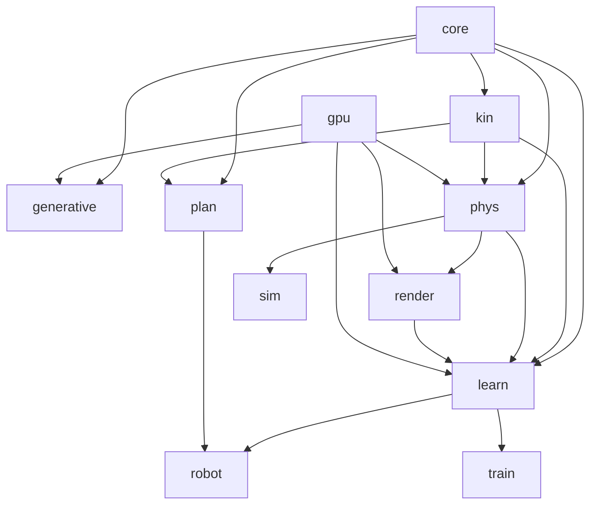

# ViaForm Rust engines specification

Version 1.0, 2026-11-07. Status: draft for build. Companion to `VIAFORM-SPEC.md`.

Scope: everything ViaForm computes itself, in Rust: generative design, kinematics and inverse
kinematics, motion planning, articulated physics, training, and the GPU layer under them. The CAD
engine (SolidCraft) stays as it is. PCBCraft is replaced by the clean-room `pcb` crate (section 3B, E-16).

## 0. Decisions from the owner (2026-11-07)

| ID | Question | Answer |
|---|---|---|
| E-1 | How much Rust | **All Rust.** No MuJoCo, no Python. Same crates on Mac, iPad and Azure |
| E-2 | Physics engine | **Own articulated-body engine**, `parry3d-f64` only for collision geometry |
| E-3 | ML library | **burn** (wgpu backend on Mac, CUDA backend on Azure) |
| E-4 | GPU | **wgpu** (Metal on Apple, Vulkan on Linux) |
| E-5 | Build order | **Generative first**, then kinematics, physics, planning, training |
| E-6 | IK features | Drag end effector, Cartesian robot moves, multi-finger hand IK, collision-free paths |
| E-7 | IK method | **Numerical (damped least squares) for every robot, plus an analytic fast path for 6-axis arms with a spherical wrist** |
| E-8 | Generative additions | Manufacturing rules, loads from simulation, GPU solver, clean output |
| E-9 | Processes | FDM, SLS and resin, CNC milling, carbon plate cutting |
| E-10 | Generative output | **Smooth mesh body** (watertight, printable), not B-rep fitting |
| E-11 | Numerics | **f64 on CPU, f32 on GPU.** Same seed, same platform, same result. Collaboration replay across platforms (VIAFORM-SPEC 10.7) relies on quantised fingerprints (hash of geometry quantised to 1e-6 m and 1e-6 rad, plus exact topology counts and parameter values), not on bitwise equality |
| E-12 | Robots | Serial arm, robotic hand, drone, mobile base |
| E-13 | Hand drive | **Both** motor per joint and tendons, chosen per design |
| E-14 | Mobile base | **Both** wheeled (first) and legged (after) |
| E-15 | Study size target | **1M voxels in 2 min on an M-series Mac**; bigger studies run on Azure |
| E-16 | PCB engine | **Replace PCBCraft** with a clean-room Rust engine `pcb` (section 3B), to drop GPL (VIAFORM-SPEC D-12) |
| E-17 | Servos | Feetech STS3215 serial bus servos for the reference arm |
| E-18 | More learning methods | SAC, action chunking (ACT), diffusion policy, vision inputs |
| E-19 | More generative methods | Lattice infill, shape optimisation, multi-material, thermal loads |
| E-20 | Licence of engines | MIT OR Apache-2.0 |

History: these decisions replaced, in an earlier draft of `VIAFORM-SPEC.md`, D-2 (MuJoCo), the Python
trainer in sections 7.6 and 10.4, and ONNX as the policy format (see section 7 here).

## 1. Crate map

```
generative/   viaform-generative (exists) topology and frame optimisation, FEM, surfacing; CLI binary `viaform-gen`
gpu/          viaform-gpu     (new)     wgpu device, buffers, WGSL kernels shared by gen, phys, learn
kin/          viaform-kin     (new)     kinematic model, FK, Jacobians, IK, Cartesian paths, tendons
plan/         viaform-plan    (new)     collision world, RRT-Connect, shortcutting, time scaling
phys/         viaform-phys    (new)     articulated dynamics, contacts, motors, tendons, wheels, rotors
sim/          viaform-sim     (exists)  drone stack (weather, sensors, mapping, control); moves onto phys
learn/        viaform-learn   (new)     env trait, vector envs, PPO, imitation, policy runtime (burn)
train/        viaform-train   (new bin) headless runner for local (Mac helper process) and Azure runs
robot/        viaform-robot   (new)     real hardware link (see VIAFORM-SPEC 7.9), uses kin and learn
pcb/          viaform-pcb     (new)     clean-room PCB engine replacing PCBCraft (section 3B)
render/       viaform-raster  (new)     headless wgpu rasteriser for simulated cameras (section 7)
```

Dependency rule (no cycles, checked by `cargo deny` bans plus a CI script):



`core` (viaform-core) owns project files and the flow; it calls the engines, the engines never call
`core`. Every engine exposes a JSON `call(op, params)` facade like `bom` and `library`, so the bridge,
the node addon, the agent and the CLI share one surface.

Third-party crates allowed (all MIT or Apache-2.0, GPL compatible):

| Crate | Use |
|---|---|
| `nalgebra` | Small dense linear algebra (f64) in kin, phys, plan |
| `parry3d-f64` | Collision shapes, BVH, distance, contact manifolds |
| `wgpu` | GPU compute |
| `burn` (`burn-wgpu`, `burn-cuda`, `burn-ndarray`, `burn-autodiff`) | Neural nets, training, inference |
| `rayon` | CPU parallelism (already used) |
| `serde`, `serde_json` | Facades and files (already used) |
| `rand_chacha` | Seeded, portable random streams |
| `rstar`, a permissive polygon clipping crate | PCB engine spatial index and polygon booleans (licence checked) |
| `faer` (optional) | Sparse and large dense solves where nalgebra is slow |

Rule: no crate that links C or C++ code, except `wgpu`'s platform layers and burn's CUDA backend
(Azure only, behind a cargo feature `cuda`).

## 2. Shared conventions

- Units: SI in kin, plan, phys, learn (m, kg, s, rad, N, N·m). Generative keeps its mm, N, MPa
  convention; conversion only at the boundary (`core`), with tests.
- Frames: right-handed, Z up, world frame of the assembly. Poses are `Iso3 { rot: UnitQuat, pos: Vec3 }` (f64).
- Randomness: every op that uses randomness takes `seed: u64` and uses `ChaCha8Rng`. Never thread RNG.
- Determinism (E-11): same inputs, seed and platform give bitwise-equal results. Parallel reductions
  use fixed chunking (`rayon` with `with_min_len` and ordered folds), never hash-map iteration order.
  Cross-platform results must agree within tolerances listed per test, not bitwise.
- Errors: `Result<T, EngineError>` with a stable `code` string and a user-facing `message`.
- Long work: implements `core::flow::Worker` (poll, pause, resume, cancel) so it appears as a job.
- Performance tests run in `--release` with `cargo bench` style examples and fail CI if more than
  25 percent slower than the recorded baseline on the macOS runner.

---

## 3. Generative (first)

### 3.1 What exists (`generative/src/solid`)

- Hex8 voxel FEM, matrix-free operator, geometric multigrid preconditioned CG (`fem.rs`, `mg.rs`).
- SIMP with density filter and Heaviside projection, robust eroded/nominal/dilated formulation, MMA (`optimize.rs`, `mma.rs`).
- Objectives: compliance for a mass, least mass under stress, displacement and frequency limits.
- Dynamics: modes with bound formulation over clusters, impacts integrated in time (`dynamics.rs`).
- Regions: supports, load cases (force, torque, acceleration), keep-in, keep-out, exact bores, point masses.
- Manufacturing: `Additive { build, overhang }` (overhang filter, but only a full or none switch at 45 degrees),
  `Extrusion { direction }`, `Milling { direction }` (one direction), symmetry planes, `min_member`, `max_bodies`.
- Surfacing: marching tetrahedra, watertight and manifold, Taubin smoothing, exact holes, volume matching (`iso.rs`).
- Export 3MF, STL, OBJ; insertion into SolidCraft as a mesh body (`emit.rs`, tests).
- Frame method (beam ground structure) in 2D and 3D.
- Benchmark `examples/bench.rs` at about 100k, 400k and 1M voxels.

### 3.2 Targets

| Metric | Target (M-series Mac, release) |
|---|---|
| 1M voxel compliance study, 100 iterations | under 120 s total (E-15), so under 1.2 s per iteration |
| 1M voxel study on Azure A100 (GPU path) | under 30 s |
| 8M voxel study on Azure A100 | under 6 min |
| Memory at 1M voxels | under 3 GB |
| Result mesh | watertight, manifold, single body when `max_bodies = 1`, under 300k triangles by default |

### 3.3 Work items

**G0 Baseline.** Run `examples/bench.rs` on the owner's Mac, record per-iteration times at 100k,
400k, 1M voxels in `generative/BENCH.md`, add the CI performance guard. AC: numbers recorded, guard active.

**G1 CPU speed to target.** Only if G0 misses 1.2 s per iteration at 1M:
1. Profile (`cargo flamegraph`). Expected hot spots: `K u` product, smoother, filter.
2. Element stiffness is identical for every voxel (one `Ke` scaled by density): keep the matrix-free
   kernel, block it by 8 x 8 x 8 voxel tiles for cache, SIMD with `std::simd` (or portable intrinsics via `wide`).
3. Mixed precision: f32 inside the multigrid V-cycle, f64 outer CG residual (keeps E-11 accuracy).
4. Warm start CG from the previous iteration's displacement.
5. Reduce CG tolerance early in the run (inexact solves when beta is low), tight at the end.
AC: 1M voxel study under 120 s, objective within 0.5 percent of the slow path.

**G2 Manufacturing rules (E-9).**

| Process | Rule | Method | Output check |
|---|---|---|---|
| FDM | Any overhang angle (30 to 60 degrees), build direction, no enclosed voids, min wall | Generalise the additive filter to an angle-aware stencil (wider support footprint per layer for steeper angles, after Langelaar's AM filter); void check as below | Overhang map on the mesh, none flatter than the limit outside bores |
| SLS and resin | Min feature size, no trapped powder or resin | Robust erosion sets min feature; enclosed void detection: flood fill empty voxels from the design space boundary; any unreached void becomes keep-in (filled) or gets an escape hole (cylinder keep-out of `escape_diameter` toward the nearest boundary), user choice | Zero enclosed voids, escape holes listed |
| CNC milling | Several tool directions (2.5, 3 axis and up to 6 directions), min tool radius, no undercuts | Per voxel, accessible if reachable from any allowed direction (max over directional cumulative filters, smoothed with a p-norm); tool radius through `min_member` on the void side (robust dilation) | Each surface face reachable from one listed direction |
| Carbon plate | 2D outline at fixed thickness, min slot width, min bridge width | `Extrusion` plus a thickness choice from a list (1.5, 2, 3, 4, 5 mm), 2D min feature via robust filter in plane; DXF outline output | DXF closed polylines, min slot and bridge widths met |

API change (backward compatible, serde default):

```rust
pub enum Manufacturing {
    Free,
    Additive { build: [f64; 3], overhang: f64, process: AdditiveProcess, escape_diameter: Option<f64> },
    Extrusion { direction: [f64; 3], thickness: Option<f64>, min_slot: Option<f64> },
    Milling { directions: Vec<[f64; 3]>, tool_radius: f64 },
}
pub enum AdditiveProcess { Fdm, Sls, Resin }
```

The old `Milling { direction }` still parses (custom deserialize into `directions: vec![direction]`).
AC per process: one test study each with a known answer (cantilever, bracket, drone arm plate), checks above pass, compliance penalty versus `Free` reported.

**G3 Loads from simulation (E-8).** Needs phys (section 6) for real data; build the interface first with recorded data from the existing quad sim.

```rust
/// Time history of the wrench a body receives at its joints and contacts, in the body frame.
pub struct WrenchHistory { pub body: String, pub t: Vec<f64>, pub force: Vec<[f64; 3]>, pub torque: Vec<[f64; 3]>, pub at: Vec<[f64; 3]>, pub accel: Vec<Acc6> }
pub fn load_cases_from(history: &[WrenchHistory], pick: Pick) -> Vec<LoadCase>;
pub enum Pick { Peak { count: usize }, At { t: f64 }, Envelope { count: usize } }
```

- `Peak`: the `count` time samples with the highest wrench norm, merged when closer than 20 ms.
- `Envelope`: k-medoids on normalised wrench vectors over the run, `count` representatives; covers
  directions, not only the largest magnitude.
- `At`: one instant ("Stress here" from the Simulate timeline).
- Inertial loads: body accelerations become `LoadCase` accelerations so the part's own mass loads it.
- Unit conversion SI to mm/N at this boundary, tested.
AC: drone crash from `sim` gives a load case set; regenerating the frame with it lowers peak stress in a re-run crash by at least 20 percent versus the hand-made load set (golden test with fixed seed).

**G4 GPU solver (E-4, E-11).** New crate `gpu`, used by generative behind a `Backend` choice `Cpu | Gpu`.
- Kernels (WGSL, f32): matrix-free hex8 `K u` with density scaling, Jacobi and Chebyshev smoothers,
  restriction and prolongation for the voxel multigrid, density filter (separable), Heaviside projection,
  sensitivity filter, reductions (dot products) with fixed-order tree reduction.
- Outer loop: f64 PCG on CPU with GPU V-cycle as preconditioner, or full GPU CG in f32 with f64
  iterative refinement every 20 iterations. Pick by benchmark; both behind the same trait.
- Buffers stay on the GPU across optimiser iterations; only the objective, constraints and MMA vectors move.
- MMA stays on CPU (f64), it is small (one variable per voxel, cheap per iteration).
- Linux Azure: wgpu on Vulkan with NVIDIA drivers (container installs the Vulkan ICD).
AC: same study on CPU and GPU, final compliance within 1 percent, volume within 0.5 percent; speed-up at least 4x on an M-series GPU at 1M voxels; 8M voxel target on A100.

**G5 Smooth mesh body (E-10).** Most exists; finish quality:
1. Isotropic remeshing to a target edge length (split, collapse, flip, tangential relax), keeping bores and flat keep-in faces fixed.
2. Decimation by quadric error to a triangle budget (default 300k), never across fixed regions.
3. Plane snapping: keep-in boxes' faces come out exactly planar (project vertices within half a voxel).
4. Checks: watertight, manifold, no self-intersection (BVH test with parry), body count, min wall measured by ray casting along normals (reported, coloured on the mesh).
5. Stress per vertex kept for colouring.
AC: every example study's mesh passes all checks; inserted body works in SolidCraft for move, mirror, mesh export, and boolean cut with a simple solid when the engine supports mesh booleans (if not, record as an upstream request).

**G7 Lattice infill (E-19).** Shell plus graded lattice inside: gyroid, Schwarz-D, octet truss,
BCC. Density graded by the stress field of a solid analysis (homogenised lattice stiffness curves per
type, precomputed by unit-cell FEM and stored as tables). Output: implicit field meshed by the same
surfacing as G5, with a minimum strut and wall for the chosen process. AC: lattice bracket passes FDM
checks; stiffness within 15 percent of the homogenised prediction in a full voxel FEM check.

**G8 Shape optimisation (E-19).** Keep the topology of an existing CAD body, move its surface to cut
stress peaks or mass. Voxelise the body finely, compute boundary shape sensitivities from the voxel FEM
(adjoint for a stress p-norm), move surface mesh nodes along normals with Laplacian smoothing and fixed
regions (preserve faces, bores), re-voxelise, iterate. Output: smooth mesh body like G5. AC: L bracket
peak stress cut by at least 25 percent at equal mass.

**G9 Multi-material (E-19).** Two (later up to four) materials plus void per voxel, discrete material
optimisation (DMO-style interpolation). Output: one mesh per material, 3MF with materials. AC:
two-material cantilever beats both single materials at equal mass.

**G10 Thermal loads (E-19).** Steady-state conduction on the same voxel grid (scalar FEM, same
multigrid), heat sources from motors and electronics (power from BOM parts and phys duty cycles),
convection on the surface, objective with a max temperature limit; optional thermal stress coupling.
AC: heat sink study keeps a 5 W source under the limit with less mass than a plain block.

**G6 Variants and trade-off.** Already supports `variants`; add parallel variant runs (one per core, or per GPU queue) and a Pareto front (mass, max stress, first frequency) in the outcome summary for the gallery.

---

## 3B. PCB engine: `pcb` (clean room, replaces PCBCraft)

### 3B.1 Why and rules

PCBCraft is GPL; the App Store and the MIT OR Apache-2.0 licence need it gone (VIAFORM-SPEC D-12, D-13).

Clean-room rules (mandatory, checked in review):
1. Sessions and people who write `pcb/` never open `engines/pcbcraft/` or KiCad source code. The
   submodule is removed from their checkout (`git submodule deinit engines/pcbcraft`) before they start.
2. Inputs allowed: this spec, public file format documentation (KiCad file format docs, Gerber X2
   specification, Excellon), public IPC standards summaries, textbooks, and ViaForm's own UI code and
   tests (which describe behaviour, not implementation).
3. A short written log per task listing sources used (`pcb/CLEANROOM.md`).
4. Command ids may stay the same as today's `pcb_*` surface so the UI keeps working; the
   implementation is new.

### 3B.2 Scope v1 (parity with what ViaForm uses today, then more)

| Area | v1 |
|---|---|
| Data model | Library symbols, footprints, schematic (sheets, wires, labels, power), netlist, board (layers, footprints, pads, tracks, vias, zones, outline, keep-outs), design rules, net classes |
| Files | Native `.vfpcb` (JSON, stored as `board.vfpcb` in the `.viaform` zip, VIAFORM-SPEC 5.1). One-time migration of legacy `board.pcbcraft` entries on open, by a clean-room importer written from the file contents and public format docs (no PCBCraft code). Import and export KiCad 8 and 9 `.kicad_sch`, `.kicad_pcb`, `.kicad_sym`, `.kicad_mod` (s-expression, from public docs). Gerber X2, Excellon drill, pick and place CSV, IPC-356 netlist (later) |
| Schematic | Place symbols, wire, labels, buses (later), annotation, ERC (unconnected pins, conflicting drivers, power pins) |
| Board | Update from schematic, placement, rotate and flip, ratsnest, interactive routing (walkaround first, push and shove later), via placement, differential pairs (later), zones with thermal reliefs (polygon clipping), DRC (clearance, width, annular ring, hole to hole, edge clearance, unconnected) |
| Autorouter | Grid-based A* maze router with rip-up and reroute for 2 and 4 layer boards up to 150 nets; good enough for the drone flight controller sample |
| 3D link | Board outline, copper, holes, component bodies for the board to 3D link (`vf_link_*`) |
| Commands | JSON command API with schemas, undo and redo, like SolidCraft; tool listing for agents |

Geometry kernel: 2D polygons with integer nanometre coordinates (no float drift), polygon boolean and
offset via a Rust clipping crate under a permissive licence (checked by `cargo deny`), R-tree spatial
index (`rstar`).

### 3B.3 Parity checklist (gate for the swap)

The drone flight controller sample from `electron/src/test/drone.ts` rebuilt end to end on `pcb`:
schematic drawn, board updated, placed, routed by the autorouter, DRC clean, Gerbers and drill files
that a public Gerber viewer opens without errors, KiCad export that KiCad 9 opens, Send to 3D and
Mount on a Part working. Plus every PCB command used by the Apple and Electron UIs.

### 3B.4 Effort

About 3 to 4 months for one focused track (agents plus review). It runs in parallel with the
generative work, in its own sessions (VIAFORM-SPEC phase 0.5).

---

## 4. Kinematics: `kin`

### 4.1 Model

Built from `assembly.json` (VIAFORM-SPEC 7.3) by `core`:

```rust
pub struct Model {
    pub links: Vec<Link>,            // index 0 = base (fixed, or floating for drone and mobile base)
    pub joints: Vec<Joint>,          // joint i connects parent link to child link i+1
    pub couplings: Vec<Coupling>,    // tendons and gear couplings (E-13)
    pub end_effectors: Vec<Frame>,   // named tool frames (gripper tip, each fingertip)
}
pub struct Joint { pub kind: JointKind, pub parent: usize, pub origin: Iso3, pub axis: Vec3, pub limits: Limits }
pub enum JointKind { Revolute, Prismatic, Continuous, Fixed, Spherical, Floating, Wheel }
pub struct Limits { pub lower: f64, pub upper: f64, pub velocity: f64, pub effort: f64 }
pub struct Coupling { pub kind: CouplingKind, pub actuators: Vec<usize>, pub joints: Vec<usize>, pub matrix: Vec<f64> }
pub enum CouplingKind { Linear, Tendon { routing: Vec<TendonPoint>, stiffness: f64, slack: f64 } }
```

- Tree topology only (no closed loops in v1). Closed loops (parallel grippers with linkages) are
  modelled as a driving joint plus a coupling; true loop closure is a later item.
- Motor per joint: `actuator = joint`. Tendons: actuator positions map to joint positions through the
  coupling. For IK and planning, kin works in **joint space** and maps to actuator space at the end
  (`Model::to_actuators(q)`), with tendon slack handled in phys, not in kin.

### 4.2 Forward kinematics and Jacobians

- `fk(q) -> Vec<Iso3>` (all link poses), `fk_frame(q, frame) -> Iso3`.
- Geometric Jacobian `jacobian(q, frame) -> Matrix6xN` by the standard column formula (revolute: `[z x (p - o); z]`, prismatic: `[z; 0]`).
- Analytic derivative tests: finite differences with step 1e-7, relative error under 1e-6.
- Performance: 6-DOF FK plus Jacobian under 2 microseconds; 20-DOF hand under 8 microseconds.

### 4.3 Inverse kinematics (E-7)

**Numerical solver for every model** (`ik::solve`):

```rust
pub struct IkTask { pub frame: FrameId, pub target: Iso3, pub weight_pos: f64, pub weight_rot: f64, pub mask: AxisMask }
pub struct IkProblem { pub tasks: Vec<IkTask>, pub q0: Vec<f64>, pub posture: Option<Vec<f64>>, pub posture_weight: f64, pub locked: Vec<usize> }
pub struct IkResult { pub q: Vec<f64>, pub converged: bool, pub iterations: usize, pub pos_err: Vec<f64>, pub rot_err: Vec<f64> }
```

Algorithm:
1. Stack all task errors (position, and orientation as the log map of `target * current^-1`), weighted, with per-axis masks (for example free rotation about the tool axis).
2. Damped least squares step `dq = J^T (J J^T + lambda^2 I)^-1 e` with adaptive damping (`lambda` grows near singularities, from the smallest singular value, Nakamura and Chiaverini style).
3. Joint limits as box constraints: clamp and re-solve with clamped joints removed (active set), so the solver never leaves limits.
4. Null-space posture term (drift toward `posture` or toward mid-range) projected with `I - J^+ J`.
5. Line search on the error norm, stop at 1e-5 m and 1e-4 rad, or 100 iterations.
6. Multi-start: if not converged, retry from `seeds` random configurations (seeded), keep the best.

**Multi-finger hand IK (E-6):** same solver with one task per fingertip, shared wrist joints. Tasks
can carry priorities: higher priority tasks solved first, lower ones in their null space
(task-priority DLS). Tendon couplings: optimise over actuator variables `a` with `q = C a` (chain
rule `J_a = J_q C`), so coupled joints always stay consistent.

**Analytic fast path for 6R arms with a spherical wrist:**
- Detect at model build: last three joint axes intersect in one point (tolerance 1e-6 m).
- Pieper decomposition: wrist centre from target, solve the first three joints in closed form
  (up to 4 solutions), the wrist three from the remaining rotation (2 solutions), up to 8 total.
- Pick the solution nearest `q0` within limits; fall back to the numerical solver if none is valid.
- Verified against the numerical solver on 10k random reachable targets (position error under 1e-9 m).

**Drag end effector (Assemble):** each pointer move calls `solve` warm-started from the last `q`
with max 10 iterations; must stay under 1 ms for 6-DOF and 3 ms for the hand so the drag is 60 fps.
If the target is unreachable, the arm stretches toward it (least-squares behaviour) and the UI shows
the distance left.

### 4.4 Cartesian moves (E-6)

```rust
pub fn cartesian_path(model, q_start, waypoints: &[Iso3], frame, opts: PathOpts) -> Result<JointTrajectory, PathError>;
pub struct PathOpts { pub max_lin_vel: f64, pub max_lin_acc: f64, pub max_ang_vel: f64, pub step: f64, pub blend_radius: f64 }
```

1. Geometric path: straight lines between waypoints, SLERP for rotation, optional circular blends of `blend_radius` at corners.
2. Sample every `step` (default 2 mm), solve IK warm-started from the previous sample.
3. Reject the path (with the sample index) if a joint jumps more than 0.1 rad between samples (branch flip) or crosses a limit.
4. Time scaling: jerk-limited (S-curve) profile in path parameter honouring Cartesian limits, then check joint velocity and acceleration limits; slow down the profile where exceeded (TOPP-style iterative scaling, simple version).
5. Output `JointTrajectory { t: Vec<f64>, q: Vec<Vec<f64>>, qd, qdd }` at 500 Hz, plus actuator-space version.
AC: straight line deviation under 0.5 mm at every 500 Hz sample for template arm moves; no limit violations.

---

## 5. Motion planning: `plan`

- **Collision world:** parry shapes from the assembly (convex decomposition of each link mesh, computed once and cached in the project's data folder; primitives where the CAD body is a box, cylinder or sphere), plus environment objects from the scenario. Self-collision pairs filtered by an allowed-collision matrix (adjacent links and pairs touching at rest are allowed).
- **State validity:** joint limits, self collision, environment collision with a safety margin (default 5 mm).
- **Planner:** RRT-Connect in joint space, seeded; edge checking by interpolation at 1 degree resolution (later continuous collision via conservative advancement).
- **Post-processing:** random shortcutting (seeded, 200 attempts), then B-spline smoothing that is re-checked for collisions, then the same time scaling as 4.4.
- **Goals:** joint goal, or pose goal (IK first, try up to 8 IK solutions from the analytic path or multi-start, plan to the nearest valid).
- **Hand and mobile base:** hand uses the same planner on finger joints; wheeled base uses a separate 2D planner (hybrid A* over x, y, heading on an occupancy grid from the scenario), reusing the drone's A* code where possible.
AC: template arm, 100 random start and goal pairs around a table and two boxes: 98 percent solved under 200 ms each, zero collisions in a dense re-check at 0.1 degree.

---

## 6. Physics: `phys`

### 6.1 Requirements

| Need | Robots |
|---|---|
| Reduced-coordinate articulated bodies, joint limits, joint friction and damping | all |
| Servo and DC motor models with gears and backlash | arm, hand, base |
| Tendons (coupled joints, cable elasticity, slack) | hand |
| Contacts: robot with table, objects, self; friction (Coulomb, torsional, rolling) | arm, hand, base |
| Grasping small objects stably | hand, arm gripper |
| Wheel contact, including mecanum (directional friction) | wheeled base |
| Foot contacts and impacts | legged base |
| Free-floating base, rotor thrust and torque, aerodynamics | drone (port of `sim` models) |
| Batch simulation (thousands of envs) for training | all |
| Determinism (E-11), f64 | all |

### 6.2 Design

- **Dynamics:** Featherstone articulated-body algorithm (ABA) for forward dynamics, recursive
  Newton-Euler (RNEA) for inverse dynamics (used by controllers and by G3 wrench output), composite
  rigid body algorithm (CRBA) for the mass matrix when the contact solver needs it. Spatial vector
  algebra on `nalgebra` 6-vectors.
- **Integration:** semi-implicit Euler at 1 kHz default (500 Hz is the iPad and batch training option), implicit treatment of joint
  damping and motor back-EMF terms for stability with small servos.
- **Contacts:** parry contact manifolds each step (broad phase BVH, narrow phase). Solver: soft
  constraints in the style of compliant contact (per-contact stiffness and damping derived from a
  time constant and damping ratio, like MuJoCo's solref and solimp concept, implemented from first
  principles) solved by projected Gauss-Seidel in **fixed contact order** (sorted by body pair ids,
  then feature ids) for determinism. Friction pyramid with 4 or 8 facets, torsional and rolling
  friction optional per pair. Warm start from the previous step's impulses (matched by feature ids).
- **Joint limits:** treated as one-sided constraints in the same solver.
- **Motors (`phys::actuator`):**
  - `Servo`: internal position PD loop at the servo's own rate (default 1 kHz), output torque limited by a torque-speed line (stall torque, no-load speed from the part record), current limit, gear ratio, gearbox efficiency, backlash as a dead zone with a contact stiffness, encoder resolution quantisation on the measured position.
  - `Dc`: voltage input, armature resistance and inductance (optional), back-EMF, gear.
  - `Bldc` with rotor: thrust and torque curves from the existing drone models.
  - Parameters come from Libraries part records (VIAFORM-SPEC 8.1), with defaults per part family.
- **Tendons (E-13):** fixed tendons as length = sum of `moment_arm_i * q_i` plus routing points;
  tension = `k * max(0, length_actuator - length_path - slack) + c * rate`; tension applied as joint
  torques through moment arms. Unilateral (cables only pull).
- **Wheels:** `Wheel` joint plus contact; mecanum rollers modelled by an anisotropic friction
  direction at 45 degrees in the contact frame (no roller geometry).
- **Legs:** point and capsule feet, same contact solver, higher contact stiffness, 1 kHz minimum.
- **Drone:** floating base plus rotor force elements; existing aerodynamics, weather and battery
  models move from `sim` into `phys::aero` and `phys::power`, with a parity test against today's
  `sim` (example `parity.rs` already exists): same seed, trajectories within 1 mm over 10 s hover and
  within 5 cm over a course run.
- **Sensors:** joint position (quantised), joint velocity (filtered), motor current, IMU (with noise
  and bias), contact and force sensors, time-of-flight (existing), camera depth and RGB later
  (render via the app's Metal renderer for the Mac; headless low-res raster in the `render` crate, built on `gpu`, for training).
- **Wrench output:** per body joint wrench and contact wrench history for G3.

### 6.3 Batching

- `World` is a single environment. `Batch` holds N worlds of the same model with struct-of-arrays
  state and steps them in parallel (rayon, chunked, deterministic order).
- GPU batching (wgpu, f32) for the ABA without contacts first (drone, free motion), then with a
  simplified contact model; only after CPU batching is validated. Not on the critical path for v1.
- Target: template arm with table and cube, CPU batch of 1024 envs at 500 Hz physics (batch option), 50 Hz control:
  at least 200k env steps per second on an M-series Mac (10 cores), at least 1M on a 96-core Azure CPU node.

### 6.4 Validation

| Test | Pass |
|---|---|
| Energy: frictionless pendulum and double pendulum, 60 s | energy drift under 0.1 percent |
| ABA versus RNEA plus mass matrix solve, random states | difference under 1e-10 |
| Stacking: 5 boxes rest | no visible jitter, drift under 0.1 mm over 10 s |
| Grasp: gripper holds 30 g cube under shake | no slip over 5 s |
| Servo step response | matches a recorded real STS3215 step within 10 percent rise time (after phase 7 HIL data) |
| Tendon hand | coupled joint ratio held within 1 percent under load |
| Mecanum strafe | lateral motion with less than 5 percent forward drift |
| Determinism | two runs, same seed, bitwise equal on the same machine |
| Drone parity | see 6.2 |

---

## 7. Learning: `learn` and `train`

- **Env trait:**

```rust
pub trait Env {
    fn observation_spec(&self) -> Spec;
    fn action_spec(&self) -> Spec;
    fn reset(&mut self, seed: u64) -> Obs;
    fn step(&mut self, action: &[f32]) -> Step; // obs, reward, terminated, truncated, info
}
pub trait VecEnv { fn num_envs(&self) -> usize; fn reset_all(&mut self, seed: u64) -> Tensor; fn step_all(&mut self, actions: &Tensor) -> VecStep; }
```

- Task files (`viaform-task` v1, VIAFORM-SPEC 7.6) compile into an `Env` over a `phys::Batch`:
  observations, action mapping (joint position delta, joint position, joint torque), reward terms
  from a fixed library (distance, orientation, lifted, contact, action rate, energy, joint limit
  penalty, alive), termination and success.
- **Domain randomisation:** mass, friction, motor strength, latency, backlash, sensor noise, per
  episode, from the scenario's `randomise` block.
- **Algorithms (burn):**
  - Behaviour cloning from demos (MLP and small temporal conv or GRU policy), with action chunking option.
  - PPO with GAE, clipped objective, value function, observation normalisation, advantage normalisation, KL early stop.
  - Fine-tune: BC init then PPO with a BC loss term that decays.
  - Existing quad training (CEM gains and ES net in `sim`) stays, wrapped as an algorithm option.
- **More methods (E-18):**
  - SAC (off-policy, replay buffer, automatic entropy tuning) for sample-efficient RL and fine tuning on recorded real transitions.
  - ACT (action chunking with transformers): CVAE transformer predicting chunks of 50 to 100 actions from joint states and images, temporal ensembling at run time.
  - Diffusion policy: 1D conv U-Net or transformer denoiser over action chunks, DDIM sampling with 10 steps; under 20 ms per chunk on an M-series Mac.
  - Vision inputs: small ResNet or ViT encoders (burn), from simulated cameras (`render` crate) and real USB cameras, with domain randomisation of textures, lights and camera pose.
- **Simulated cameras (`render`, viaform-raster):** headless wgpu rasteriser drawing the phys world to RGB and depth at 84 to 256 px, batched for many envs, same mesh data as the app viewport.
- Robot link budget: policy step (with image encode) under 20 ms at 50 Hz; chunked policies may run at 10 Hz and stream actions.
- **Backends:** `burn-wgpu` on Mac (Metal), `burn-cuda` on Azure (feature `cuda`), `burn-ndarray` for tests and CPU-only.
- **Policy format:** burn record (`policy.mpk`) plus `policy.json` (observation and action specs,
  normalisation stats, network config, source revisions, seed). Inference in the app and on the robot
  link uses burn with the ndarray or wgpu backend. ONNX export is optional later, not needed in an all-Rust stack.
- **Runner `viaform-train`** (binary of the `train/` crate): `viaform-train --spec run.json --in DIR --out DIR`.
  Same binary local and in the Azure container. On the Mac it runs as a helper process bundled in the
  app (crash isolation, FRONTEND-SPEC 6.6), launched and supervised by `learn.train_start`; nothing
  trains in-process. Writes `metrics.jsonl` every 10 s, checkpoints every 5 min, `result.json`.
  Watches `stop.flag` for graceful stop (cost cap, VIAFORM-SPEC 10.4).
- **Azure container:** Linux image with the Rust binaries, NVIDIA CUDA runtime and Vulkan ICD; no Python.
AC:
- Reach point on the template arm: 95 percent success, local Mac, under 30 min.
- Pick cube with 40 demos: BC then PPO, 80 percent success in sim, one A100, under 2 h.
- Same run spec and seed on the same backend: identical metrics for the first 10k steps.
- PPO sanity: cart-pole and pendulum swing-up solved in CI on CPU in under 3 min.
- SAC sanity: pendulum solved in CI on CPU in under 5 min.
- ACT and diffusion: pick cube from 50 simulated demos with camera input reaches 70 percent success in sim.

---

## 8. GPU layer: `gpu`

- One `GpuContext` per process (device, queue, adapter info, limits), created lazily, shared by gen, phys and learn (burn-wgpu can take the same device).
- Buffer pool with typed handles, staging buffers for readback, timestamp queries for profiling.
- Kernels in WGSL under `gpu/shaders/`, compiled at build time with naga validation in a test.
- f32 only on GPU (E-11). Reductions use fixed workgroup tree order for repeatability on one device.
- Fallback: every GPU op has a CPU reference implementation; tests compare them (tolerances per kernel).
- iPad: same code; limit buffer sizes to the device's `max_storage_buffer_binding_size`, studies above that run on the Mac or Azure.

---

## 9. Interfaces

### 9.1 JSON facades

| Crate | `call` ops |
|---|---|
| generative (extends `vf_generate_*`) | `study_check` (validate, estimate memory and time), `start`, `progress`, `preview` (current best density field as a low-res mesh for live display, `vf_generate_preview`), `outcomes`, `pareto`, `loads_from_sim`, `mesh_checks`, `export_dxf` |
| kin | `model_from_assembly`, `fk`, `jacobian`, `ik`, `ik_drag_begin`, `ik_drag_move`, `ik_drag_end`, `cartesian_path`, `reachability_map` |
| plan | `world_build`, `check_state`, `plan_joint`, `plan_pose`, `shortcut`, `time_scale`, `plan_base_2d` |
| phys | `world_new`, `world_step`, `world_state`, `set_controls`, `episode_record`, `wrench_history`, `batch_new`, `batch_step` |
| learn | `task_check`, `train_start` (local job: launches and supervises the `viaform-train` helper process, no in-process training), `evaluate`, `policy_load`, `policy_act` |

### 9.2 Bridge headers (`bridge/include/`)

`viaform_kin.h` (`vf_kin_*`), `viaform_plan.h` (`vf_plan_*`), `viaform_phys.h` (`vf_phys_*`),
`viaform_learn.h` (`vf_learn_*`). Convention unchanged: opaque handle, `call(handle, json)`, strings
freed with `sc_string_free`, panics caught. Hot paths that must not pay JSON cost get binary entry points:

| Function | Why |
|---|---|
| `vf_kin_drag_move(h, const double pose[7], double *q_out, int n, float *poses_out, int n_links)` | 60 fps drag; returns joint values in `q_out` and link matrices in `poses_out` (`n_links` x 16 f32, column-major) in one call |
| `vf_phys_state_poses(h, double *out, int n)` | 60 fps viewport update of link poses |
| `vf_learn_act(h, const float *obs, int n, float *act, int m)` | robot control loop at 50 Hz |

History: these four headers replace the `viaform_simd.h` and `viaform_train.h` changes planned in an
earlier draft of VIAFORM-SPEC 11.1.

---

## 10. Build plan (generative first, E-5)

Each item is one agent task unless noted. Done means: tests listed pass, `cargo test --workspace`
green, benchmarks recorded, bridge and Apple self-test updated where an interface changed.

| Order | ID | Item | Depends on | AC summary | VIAFORM-SPEC phase |
|---|---|---|---|---|---|
| 1 | G0 | Generative baseline bench and CI guard | none | Numbers in `generative/BENCH.md` | after 0 (E-5) |
| 2 | G2a | FDM any angle, void check | G0 | FDM tests | after 0 (E-5) |
| 3 | G2b | SLS and resin: min feature, escape holes | G2a (void detection) | Zero enclosed voids | after 0 (E-5) |
| 4 | G2c | Multi-direction milling, tool radius | G0 | Reachability test | after 0 (E-5) |
| 5 | G2d | Carbon plate: thickness list, 2D min features, DXF | G0 | DXF test | after 0 (E-5) |
| 6 | G5 | Mesh quality: remesh, decimate, snap, checks | G0 | All example meshes pass checks | after 0 (E-5) |
| 7 | G1 | CPU speed to 1M in 2 min (if G0 misses) | G0 | Target met | after 0 (E-5) |
| 8 | GPU0 | `gpu` crate: context, buffers, reductions, CPU references | none | Kernel tests | after 0 (E-5) |
| 9 | G4 | Generative GPU backend | GPU0, G1 | CPU and GPU agree, 4x speed | after 0 (E-5) |
| 10 | G6 | Parallel variants and Pareto front | G1 | Pareto in outcome summary | after 0 (E-5) |
| 11 | K1 | `kin` model, FK, Jacobian | none (can start in parallel with G work) | Derivative tests, timing | 2 (P2-6) |
| 12 | K2 | Numerical IK with limits, null space, multi-start | K1 | 10k random targets, 99.5 percent converge | 2 (P2-6) |
| 13 | K3 | Analytic 6R spherical wrist IK | K1 | Matches numerical | 2 (P2-6) |
| 14 | K4 | Drag end effector in Assemble (bridge binary entry, Swift UI) | K2 | 60 fps drag | 2 (P2-6) |
| 15 | K5 | Hand: multi-task priority IK, couplings and tendons in kin | K2 | Grasp pose test | 2 (P2-7) |
| 16 | K6 | Cartesian paths and time scaling | K2, K3 | 0.5 mm line deviation | 4 (P4-2) |
| 17 | PH1 | `phys` core: ABA, RNEA, CRBA, integration, joint limits | K1 | Energy and ABA tests | 3 (P3-1) |
| 18 | PH2 | Contacts with parry, PGS solver, friction | PH1 | Stacking and grasp tests | 3 (P3-1) |
| 19 | PH3 | Actuators: servo, DC, gears, backlash | PH1 | Step response test (synthetic until HIL) | 3 (P3-1) |
| 20 | PH4 | Tendons | PH1, K5 | Coupling test | 3 (P3-1) |
| 21 | PH5 | Drone port into phys, parity with `sim`; ArduPilot inner-loop model for setpoint policies (P7-10) | PH1 | Parity test; SITL agreement | 3 (P3-1) |
| 22 | PH6 | Batch stepping (CPU) | PH2 | 200k env steps per second | 3 (P3-1) |
| 23 | G3 | Loads from simulation (`Pick`, conversion) | PH2 (or quad sim data first) | Crash re-run stress drop | 3 (P3-4) |
| 24 | PL1 | Collision world and validity | PH2 (parry setup) | Self and env collision tests | 4 (P4-2) |
| 25 | PL2 | RRT-Connect, shortcut, smoothing, time scaling | PL1, K6 | 98 percent solved under 200 ms | 4 (P4-2) |
| 26 | L1 | `learn` env trait, task compiler, randomisation | PH6 | Task checks | 4 (P4-1) |
| 27 | L2 | PPO and BC on burn, `viaform-train` runner | L1 | Reach point local AC | 4 (P4-1) |
| 28 | L3 | Azure container (CUDA and Vulkan), cloud run | L2, VIAFORM-SPEC phase 5 | Pick cube cloud AC | 5 (P5-3) |
| 29 | PH7 | Wheeled base: wheel joints, mecanum friction, 2D planner | PH2, PL2 | Strafe test | 4 (P4-4) |
| 30 | PH8 | Legged base: feet, 1 kHz, locomotion task | PH2, L2 | Walks 1 m in sim with a trained policy | post-v1 |
| 31 | GPU1 | GPU batch physics (no contacts, then simple contacts) | PH6, GPU0 | Agrees with CPU batch within tolerance | post-v1 |
| 32 | PCB0 | Clean-room `pcb` crate (section 3B), parallel track | none | Parity checklist 3B.3 | 0.5 (P0.5-2) |
| 33 | G7 | Lattice infill | G5 | Lattice AC | post-v1 |
| 34 | G8 | Shape optimisation | G5 | Bracket AC | post-v1 |
| 35 | G9 | Multi-material | G1 | Cantilever AC | post-v1 |
| 36 | G10 | Thermal loads | G1 | Heat sink AC | post-v1 |
| 37 | R0 | `render` crate: headless simulated cameras | GPU0, PH2 | Images match viewport within tolerance | 4 (P4-5) |
| 38 | L4 | SAC | L2 | Pendulum AC | post-v1 |
| 39 | L5 | ACT and diffusion policy, vision inputs | L2, R0 | Pick cube with camera AC | 4 (P4-5) |

The last column names the VIAFORM-SPEC phase (and task) that needs the item. Rows marked
**post-v1** are not needed by any v1 phase; they start after phase 9 unless a later phase pulls them in.

Parallel tracks: G items in one session; K1 to K3 can run in a second session at the same time
(different crates). Everything else follows the dependency column.

---

## 11. Risks

| Risk | Mitigation |
|---|---|
| Own contact solver is hard to make stable for grasping | Start with soft contacts and small time steps (1 kHz); grasp test gates PH2; keep scenarios simple until tuned |
| burn API churn between versions | Pin the version in the workspace, wrap burn behind `learn` traits so app code never imports burn |
| wgpu on Azure Linux needs Vulkan drivers in the container | Test the container in CI with a GPU runner or a nightly Azure job; CUDA backend for burn as default on Azure |
| f32 GPU FEM not accurate enough for stress limits | Iterative refinement in f64 on CPU, final verification solve on CPU for the chosen outcome |
| Physics validation needs real hardware data | Synthetic references first, replace with HIL recordings in VIAFORM-SPEC phase 7 |
| Legged locomotion is a research project | Last in the plan (PH8, post-v1), not on the v1 critical path |

## 12. Glossary

| Term | Meaning |
|---|---|
| ABA | Articulated-body algorithm: forward dynamics in O(n) |
| RNEA | Recursive Newton-Euler algorithm: inverse dynamics |
| CRBA | Composite rigid body algorithm: joint-space mass matrix |
| DLS | Damped least squares inverse kinematics |
| PGS | Projected Gauss-Seidel contact solver |
| SIMP | Solid isotropic material with penalisation (topology optimisation) |
| MMA | Method of moving asymptotes (optimiser) |
| PPO | Proximal policy optimisation (reinforcement learning) |
| BC | Behaviour cloning (imitation learning) |
