# ViaForm product specification

Version 1.0, 2026-11-07. Status: draft for build.

This is the single source of truth for building ViaForm from its current state to "idea to real robot".
It is written for the owner and for Claude Code agents. Every phase in section 12 lists files, steps and
acceptance criteria an agent can execute and check on its own.

Related documents (read, do not duplicate):

- `docs/specs/FRONTEND-SPEC.md`: front end architecture (SwiftUI, actors, CommandBus, Metal layers),
  engine wiring per feature, component library and UX rules.
- `docs/specs/RUST-ENGINES.md`: the Rust engines (generative, kinematics and IK, planning, physics,
  learning, GPU). It overrides this file wherever they differ (all Rust, no MuJoCo, no Python).

- `README.md`: build, test and release instructions.
- `IMPROVEMENTS.md`: front end and upstream engine ideas.
- `docs/ui-reference.md`: desktop and touch layout reference.
- `docs/design-proposals/SYNTHESIS.md` and `docs/design-proposals/v2/SYNTHESIS.md`: the two design rounds.
  The v2 recommendation (Hybrid Pipeline with Pro Ribbon chrome) is the chosen direction.
- `~/Desktop/Notes/notes/projects/viaform/`: direction notes (`README.md`, `parts-library.md`, `robots.md`).

Mockups in `docs/specs/visuals/` were generated for this spec with Azure `gpt-image-2.5-flare`
(`docs/specs/visuals/gen.py`). They show the target state. Text inside images can contain small
mistakes; the spec text wins over the image.

---

## Contents

1. Product summary
2. Principles and hard rules
3. Users and jobs to be done
4. Current state (2026-11-07)
5. Core model: project, stages, artifacts, revisions, jobs
6. App shell and design system
7. Workspaces (screens, inputs, outputs, acceptance criteria)
8. Cross-cutting features: Libraries, BOM, design agent, command palette
9. End-to-end flows
10. Azure cloud platform
11. Interfaces: bridge C ABI, cloud REST API, data formats
12. Build plan (phases for agents)
13. Non-functional requirements
14. Testing strategy
15. Decisions, open questions, risks
16. Glossary

---

## 1. Product summary

ViaForm is one app that takes a hardware product from idea to working robot:

1. **Design** parts (parametric CAD on SolidCraft).
2. **Generate** light, strong parts (topology and frame optimisation).
3. **Assemble** them with joints and motors.
4. **Electronics**: schematic and board (PCBCraft), linked to the 3D assembly.
5. **Simulate** the product in its world (physics, weather, sensors).
6. **Train** controllers and policies (locally, or on Azure GPUs).
7. **Render** product images.
8. **Make**: export print files, board files and a priced bill of materials.
9. **Robot**: connect to the real device, teleoperate, record demonstrations, deploy a policy.

Every step produces a named, versioned artifact ("Frame v12", "Board rev C", "Policy v5"). When an
upstream artifact changes, every artifact built from it becomes stale and shows why, with a one-click
"Re-run on X".

Platforms: native macOS 26 and iPadOS 26 / iOS 26 (Metal, SwiftUI, Liquid Glass). The Mac is the
primary machine; the iPad is a full, touch-first app (all stages, except local training and USB robot
link, which iPadOS does not allow). Distribution through the App Store on Mac and iPad, once the GPL
link to PCBCraft is replaced (D-12) and ViaForm is relicensed MIT OR Apache-2.0 (D-13). The Electron
app (Windows, Linux) is kept in maintenance mode (D-1).

Business model (D-14): the app is free; cloud runs and agent usage are paid by credits bought in the
app (StoreKit). Everything local stays free and works signed out.

Collaboration (D-15): several people (and agents) edit the same project in real time, each holding a
lease on the artifacts they change (section 10.7).

Reference robots, in order: desk arm (SO-101 class, 6 axis, STS3215 servos, D-9), 3 inch FPV drone, humanoid hand (design, simulation and training only in v1, D-27).

**North star metric:** time from "new project from template" to "first real movement on the robot
driven by a policy trained in ViaForm". Target for the desk arm: under 5 working days, excluding
shipping time of parts.

### Non-goals (v1)

- No automatic purchasing, ever. ViaForm prepares lists and opens supplier pages.
- No App Store release before the clean-room PCB engine replaces PCBCraft (D-12, phase 0.5).
- No simultaneous editing of the same feature by two people in v1: co-editing works at lease
  granularity (component, sketch, board region), section 10.7.
- No photoreal render farm in the cloud. Rendering stays on the Mac (Metal).
- No firmware IDE. Robot workspace flashes prebuilt firmware and talks a fixed protocol.

---

## 2. Principles and hard rules

These rules are acceptance criteria for every phase. A change that breaks one is rejected.

| ID | Rule |
|---|---|
| R-1 | **No automatic orders or payments.** The agent and the app never place an order, fill a cart with payment, or pay. They export lists and open supplier search pages. |
| R-2 | **Local first.** Every feature except cloud runs and pricing refresh works offline. Projects are files on disk (`.viaform`). Cloud is optional and opt-in per run. |
| R-3 | **Everything is a command.** Every user action and every agent action goes through the engines' command APIs or `vf_flow_*` ops with JSON schemas. No hidden code paths. Undo covers agent edits. |
| R-4 | **Secrets never in projects or Git.** API keys live in the macOS/iOS Keychain (Apple) or `safeStorage` (Electron), cloud secrets in Azure Key Vault. Never in `.viaform`, never in logs. |
| R-5 | **No scraping.** Supplier data comes from official APIs or is entered by hand. |
| R-6 | **No third-party product names or logos in the UI.** Layouts follow public descriptions of common tools; names, icons, colours are ViaForm's own. Legal review gate before any public release. |
| R-7 | **Spending caps.** Every cloud run has a hard USD cap set before start; the platform stops the run at the cap. Monthly subscription budget alert in Azure. |
| R-8 | **Robot safety.** Any command that moves real hardware needs an armed software e-stop, a torque limit and an explicit user confirmation per session. Policies never auto-run on hardware. |
| R-9 | **Format safety.** A `.viaform` from a newer format is refused with an "update ViaForm" message, never half read. Unknown zip entries are preserved on save. |
| R-10 | **Writing style.** UI text is short, plain English. No em dash characters anywhere (code, docs, UI). |

---

## 3. Users and jobs to be done

### Primary user: the builder (the owner)

Robotics and hardware maker on a Mac, comfortable with CAD and code, wants to go from idea to a
moving prototype fast, and to use AI where it saves time.

| Job | Today | With ViaForm v1 |
|---|---|---|
| Start a robot from a proven design | Download STEP files, rebuild joints by hand | Template "Desk arm" opens a full project with joints, motors, BOM and a sim scenario |
| Make a part lighter | Guess, print, break | Generate stage with load cases from the simulation ("Stress here") |
| Know what to buy and what it costs | Spreadsheets, 6 browser tabs | BOM with live prices from official APIs, CSV export, supplier links |
| Teach the robot a task | Separate sim stack, Python scripts, cloud console | Train stage: local quick runs, one sheet to send big runs to Azure with a cost cap |
| Run it on the real robot | Custom scripts | Robot stage: connect, teleop, record demos, deploy policy with safety gates |

### Secondary user: the design agent

An AI agent (section 8.3) that plans and runs multi-step work through the same commands as the user,
asks for approval at each checkpoint, and never buys or sends anything.

---

## 4. Current state (2026-11-07)

Facts from the working tree (much is uncommitted; commit it first, see phase 0).

### 4.1 Code

| Area | Path | State |
|---|---|---|
| Engines | `engines/solidcraft`, `engines/pcbcraft` | Submodules, string command ids with JSON params, each ships an MCP server (`solidcraft-cli mcp`, `pcbcraft-cli mcp`, 44 tools) |
| Core | `core/` | `Workspace { cad, pcb }`, scene buffers, board to 3D link, `.viaform` zip (format v1), generative jobs, product flow (`core/src/flow/`) |
| Flow | `core/src/flow/` | 8 stages, artifact graph with presets `drone()` and `hand()`, revisions with fingerprints, stale propagation, jobs with ETA, tree, linked selection, command catalog, saved as `flow.json` |
| Bridge | `bridge/` | C ABI: `sc_*`, `pcb_*`, `vf_link_*`, `vf_flow_*`, `vf_generate_*`, `vf_sim_*`, `vf_train_*` (replaced by `vf_phys_*`/`vf_learn_*`, RUST-ENGINES 9), `vf_bom_*`, `vf_library_*` |
| Node addon | `node/` | Exposes CAD, PCB, link, generate, save/open. Not flow, BOM, library, sim |
| Library | `library/` | KiCad, standard hardware, DigiKey, Mouser, Nexar, Amazon, AliExpress, eBay APIs, manual shops, pasted links |
| BOM | `bom/` | Lines, offers, rollup over N builds, price breaks, MOQ, one cart per supplier, CSV export, saved as `bom.json` |
| Sim | `sim/` | 6-DOF quad, weather, sensors, mapping, A*, PID/INDI, policy net, training (CEM + ES) |
| Generative | `generative/` | 2D SIMP and frame methods, 3D voxel study (FEM, multigrid, MMA, modes, impacts), 3MF/STL/OBJ export, CLI `viaform-gen` |
| Apple apps | `apple/` | macOS `ProjectWindow` with PipelineBar, browser, ribbon, inspector, command palette; iPad `TouchRootView`; legacy `DeskRootView` behind a setting |
| Electron | `electron/` | Design, Electronics, Simulation (TypeScript sim), Libraries. No flow, no BOM |
| CI | `.github/workflows/` | `ci.yml` (3 OS), `release.yml` (signed Electron builds), `engine-sync.yml` (daily) |
| Cloud | none | No accounts, no backend, no telemetry |
| AI agent | none in ViaForm | Only the engines' MCP servers |

### 4.2 Gaps this spec closes

1. Assemble stage: joints exist in SolidCraft, no `vf_asm_*` and no screen with motion study and mass properties.
2. Sim covers only the quad. Arm and hand need a general articulated-body sim (section 7.5).
3. Train stage: drone training exists locally; no task model, no datasets, no cloud runs.
4. Render and Make stages: no real screens.
5. Robot stage: does not exist.
6. Design agent: does not exist.
7. Azure platform: does not exist.

### 4.3 Azure account facts (checked 2026-11-07)

- Subscription "Azure subscription 1" (`8177b772-...`), Azure CLI signed in.
- AI Services resource `temple-ai-provider` (resource group `temple-ai-rg`, East US 2) with chat models
  (gpt-6, gpt-5.6 family, gpt-5.3-codex, others) and image models (`gpt-image-2.5-flare`, `gpt-image-2.5-sunburst`).
- **GPU quota in East US 2 is 0** for NC A100 v4, NC T4 v3 and NC A10 v4 families; low-priority quota is 3 vCPUs.
  A quota request is a blocking task for phase 5 (task P5-1).
- Retail prices East US 2 (Linux, per hour, 2026-11-07, verify again before budgeting):

| SKU | GPU | On demand | Low priority | Spot |
|---|---|---|---|---|
| Standard_NC4as_T4_v3 | 1 x T4 16 GB | 0.526 USD | 0.105 USD | 0.303 USD |
| Standard_NC24ads_A100_v4 | 1 x A100 80 GB | 3.673 USD | 0.735 USD | 0.746 USD |
| Standard_NC40ads_H100_v5 | 1 x H100 94 GB | 6.98 USD | 1.396 USD | 3.537 USD |

---

## 5. Core model

### 5.1 Project

One product per project file. A `.viaform` is a zip:

| Entry | Owner | Content |
|---|---|---|
| `viaform.json` | core | `{"format":"viaform","version":1,"app","board_revision"}`. Readers also accept the old field name `pcb_revision` for compatibility; writers emit only `board_revision` |
| `design.solidcraft` | SolidCraft | Design document |
| `board.vfpcb` | pcb | Board document in the native format of the clean-room `pcb` crate (JSON, RUST-ENGINES 3B.2) |
| `board.pcbcraft` | legacy, read only | Projects saved before the PCB swap. Migrated once on open: read by the clean-room KiCad/PCBCraft-file importer in `pcb` (written from the file contents and public format docs, no PCBCraft code), saved as `board.vfpcb`, and dropped on that save |
| `flow.json` | core/flow | Graph, revisions, tree flags (`viaform-flow` v1) |
| `bom.json` | bom | Bill of materials |
| `assembly.json` | new, phase 2 | Joints, motors, limits, mass overrides (`viaform-asm` v1) |
| `sim/scenarios/*.json` | new, phase 3 | Scenario definitions (`viaform-scenario` v1) |
| `train/tasks/*.json` | new, phase 4 | Task definitions (`viaform-task` v1) |
| `train/policies/<rev>/` | new, phase 4 | Policy weights (burn record `policy.mpk`) and `policy.json` |
| `robot/device.json` | new, phase 7 | Device profile, joint map, calibration (`viaform-robot` v1) |
| `agent/log.jsonl` | new, phase 8 | Agent plans and approvals, for audit |

Large data (demonstration datasets, training logs, checkpoints) lives next to the project in
`<Project>.viaform-data/`, never inside the zip. The zip stores references with content hashes.

Rule: new entries never bump `viaform.json` version; readers skip unknown entries and writers
preserve them (R-9). A breaking change to an existing entry bumps that entry's own format version.

### 5.2 Stages and artifacts

Nine stages. The first eight exist in `core/src/flow`; `robot` is added in phase 7.

| # | Stage id | UI name | Shortcut | Main artifacts (scheme) |
|---|---|---|---|---|
| 1 | design | Design | Cmd-1 | `design.model` (Model v12) |
| 2 | generate | Generate | Cmd-2 | `generate.<part>` (Frame v12) |
| 3 | assemble | Assemble | Cmd-3 | `assemble.assembly` (Assembly v4) |
| 4 | electronics | Electronics | Cmd-4 | `electronics.board` (Board rev C) |
| 5 | simulate | Simulate | Cmd-5 | `simulate.<scenario>` (Flight v3, Reach v2) |
| 6 | train | Train | Cmd-6 | `train.policy` (Policy v5) |
| 7 | render | Render | Cmd-7 | `render.shots` (Renders 3) |
| 8 | make | Make | Cmd-8 | `make.bundle` (Bundle rev C) |
| 9 | robot | Robot | Cmd-9 | `robot.session` (Session 12), `robot.demos` (Demos 40) |

Graph presets: `drone()`, `hand()` exist. Add `arm()` in phase 2:

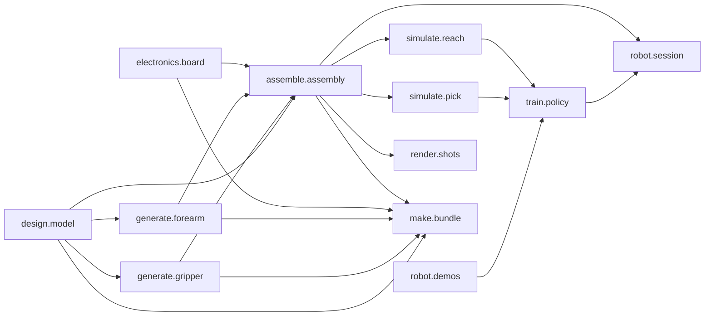

Note: `robot.demos` feeds `train.policy`, and `train.policy` feeds `robot.session`. This is not a cycle
because `robot.demos` and `robot.session` are separate artifacts. `validate()` must still pass.

### 5.3 Revisions, status, jobs

Already implemented in `core/src/flow` (keep the behaviour, extend only):

- Revision fields: `number`, `seen`, `summary`, `source` (build, promote, edit), `from`, `fingerprint`, `data`, `at`.
- `produce` returns New, Amended, Unchanged or Restored.
- Status: Current, Empty, Stale, Running, Failed. Stage shows its worst non-empty artifact.
- `reason()` gives text ("Frame v12 replaced v11"), `action()` gives "Re-run on X", "Retry" or "Build".
- Jobs: one per artifact, progress and ETA captions, pause, resume, cancel. Jobs are not saved.

Extensions:

| ID | Extension | Phase |
|---|---|---|
| F-1 | `Job.location`: `local` or `cloud`, plus `cloud_run_id` and `cost_usd` | 5 |
| F-2 | Cloud jobs survive app restart: on open, the app reattaches to runs listed in `flow.json` `cloud_runs` | 5 |
| F-3 | `Revision.origin`: `user`, `agent:<plan id>` for audit | 8 |
| F-4 | Stage `robot` and graph preset `arm()` | 2 and 7 |

---

## 6. App shell and design system

Chosen direction: **Hybrid Pipeline with Pro Ribbon chrome** (v2 synthesis, section 3), with one
change decided on 2026-11-07: **the stage switcher is a workspace dropdown at the left of the ribbon,
not a pipeline bar across the top of the window** (decision D-10). It follows the desktop reference
layout in `docs/ui-reference.md` ("workspace menu on the left"). Today's code puts a PipelineBar in
`apple/Desk/ProjectWindow.swift` (toolbar principal) and a pipeline strip in
`apple/Touch/TouchRootView.swift`; task P1-0 replaces both. This section fixes the rules; per-stage
content is in section 7.

### 6.0 Workspace dropdown (stage switcher)

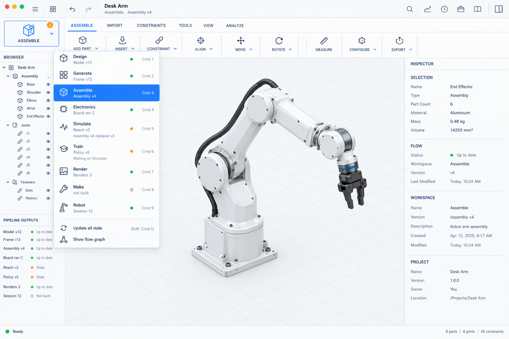

Closed state, at the far left of the ribbon row, under the toolbar:

- One large button, 72 to 96 pt wide: active stage icon (24 pt), stage name in caps under it
  ("ASSEMBLE"), a chevron.
- A small badge on the button corner counts other stages that need attention: orange number for stale,
  red for failed, a spinner ring when a job runs in another stage. No badge when all is current.

Open state (click, or Cmd-0), a menu anchored under the button, one row per stage in pipeline order:

| Column | Content |
|---|---|
| Icon | Stage icon |
| Name | "Design", "Generate", ... "Robot" |
| Revision | Active revision of the stage's main artifact, grey ("Assembly v4") |
| Status | Dot: green current, orange stale, red failed, spinner running, hollow not built |
| Reason | Second line on stale or failed rows only, grey ("Frame v12 replaced v11") |
| Shortcut | Cmd-1 to Cmd-9, right aligned |

Menu footer: "Update all stale (Shift-Cmd-U)" when any stage is stale, and "Show flow graph" which
opens the dependency graph popover. Keyboard: arrows move, Return opens, Esc closes, typing filters.

What carries the flow now that the bar is gone:

1. PIPELINE OUTPUTS at the bottom of the browser (status, reason, action per row), unchanged.
2. Inspector FLOW section (consumes, produces) for the selection, unchanged.
3. Stale banner on the canvas of a stale stage ("Assembly v4 uses Frame v11 . Re-run on Frame v12").
4. The dropdown badge and the rows above.
5. Flow graph popover from the menu footer or the toolbar graph button.

### 6.1 macOS window zones

| Zone | Content | Rules |
|---|---|---|
| Toolbar, leading | Sidebar toggle, data grid, undo, redo, project title, subtitle "Stage . Active revision" | Title is the product name, never a file name with extension |
| Toolbar, principal | Empty, or the job capsule while a job runs | No stage chips in the toolbar (D-10) |
| Toolbar, trailing | Command search (Cmd-K), flow graph, history, jobs (badge), libraries, BOM, inspector toggle | Jobs badge counts running local and cloud jobs |
| Sidebar | BROWSER tree (eye, lock), PIPELINE OUTPUTS (status, reason, action per row) | Width 230 to 280 pt |
| Ribbon | **Workspace dropdown** (section 6.0) at the far left, then tabs in capitals, grouped tool buttons with captions, `MORE` overflow, Done button during commands | 48 pt high in compact mode on 13 inch; the dropdown keeps its width, panels fold into `MORE` first |
| Canvas | Metal viewport, PCB canvas, charts or galleries per stage. View cube, triad, nav pill, context pill, job capsule | Context pill never covers the selection |
| Bottom panel | Per stage: feature timeline (Design), outcomes (Generate), motion study (Assemble), telemetry (Simulate, Train, Robot), render queue (Render) | Toggle Opt-Cmd-B |
| Inspector | SELECTION, FLOW (consumes, produces), stage sections | Command dialog replaces the inspector while a command is open |
| Status bar | State dot, short text, units, counts, core status | Never contradicts the job capsule |

### 6.2 Touch (iPad, iPhone)

Top capsule (workspace dropdown button with active stage name, chevron and attention badge, then
title, revision, undo, redo, Items or History, view cube, jobs, share). The dropdown opens as a
popover on iPad and a sheet on iPhone, with the same rows as section 6.0. No pipeline strip. Left tool groups (44 pt minimum targets), right 320 pt inspector
card, context pill under the selection. iPhone: sidebars become sheets, tool column becomes a bottom bar.

### 6.3 Design tokens

Defined in `apple/Shared/UI/Theme.swift`; Electron mirrors them in CSS variables.

| Token | Light | Dark |
|---|---|---|
| `bg.window` | `#F5F5F7` | `#1C1E22` |
| `bg.canvas.top` / `bottom` | `#E9ECF1` / `#FFFFFF` | `#24272D` / `#1A1C20` |
| `accent` | `#2F6BFF` | `#4C82FF` |
| `status.current` | `#2EA44F` | `#3FB950` |
| `status.stale` | `#E08A00` | `#F0A020` |
| `status.failed` | `#D93025` | `#F85149` |
| `status.running` | accent | accent |
| `danger` (e-stop) | `#E5251B` | `#FF3B30` |
| Font | SF Pro, captions 11 pt caps with 0.6 tracking, body 13 pt, inspector values 13 pt monospaced digits | same |

Icons: SF Symbols plus ViaForm's own ribbon icon set. All UI text passes WCAG AA contrast in both themes.

### 6.4 Interaction rules

- One accent colour for primary buttons. Stage accent colour only on the workspace dropdown icon.
- Every long operation is a job: visible in the job capsule with verb, count and ETA ("Generating 74 of 120 . 3 min left").
- Every stale artifact offers exactly one primary action: "Re-run on <input revision>".
- Destructive or outward actions (export overwrite, robot motion, cloud run) use a sheet with explicit confirm.
- Keyboard: Cmd-0 opens the workspace dropdown, Cmd-1..9 stages, Cmd-[ and Cmd-] step stages, Cmd-Return runs the stage main action,
  Shift-Cmd-U updates stale stages, Cmd-K palette, S opens palette, Opt-Cmd-I inspector, Opt-Cmd-B bottom panel,
  Shift-Cmd-B BOM, Shift-Cmd-L Libraries, Cmd-. stops the current job, **Esc twice or Space in Robot stage = e-stop**.

---

## 7. Workspaces

Each stage below lists: purpose, inputs, outputs, screen, commands, states and acceptance criteria (AC).
Existing screens (Design, Generate, Electronics, Simulate) are documented in the v2 concept images
(`docs/design-proposals/v2/hybrid-pipeline/concepts/`) and implementation screenshots
(`docs/design-proposals/v2/impl/`). New screens have mockups in `docs/specs/visuals/`.

### 7.0 Project start

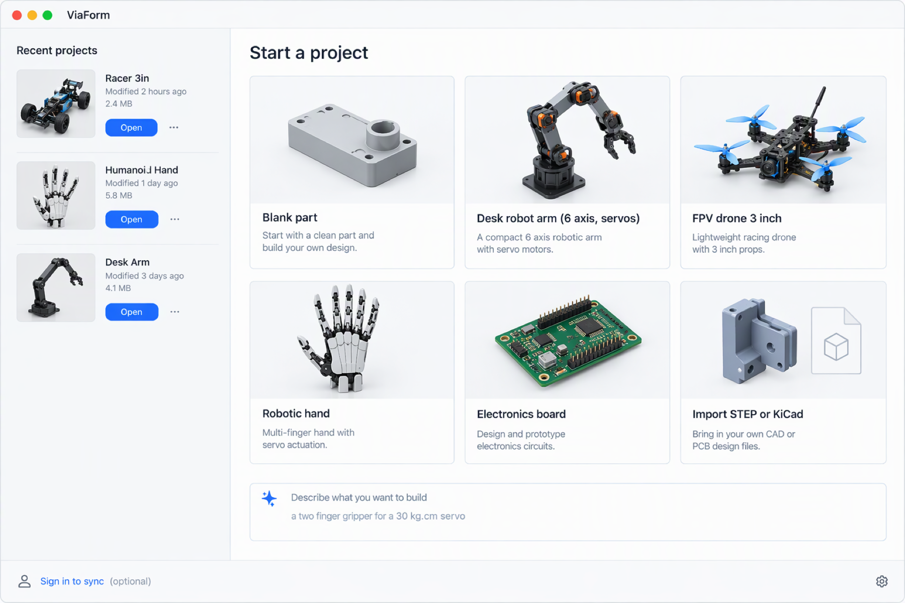

- Recent projects with thumbnails, Open.
- Templates: Blank part, Desk robot arm, FPV drone 3 inch, Robotic hand, Electronics board, Import STEP or KiCad.
- "Describe what you want to build" field: starts the design agent with a plan (section 8.3).
- Optional "Sign in" (accounts from phase 6, task P6-6; project sync and sharing from phase 10), never required.

AC:
- Template "Desk robot arm" opens a project with graph `arm()`, an assembly with 6 joints and motors, a BOM with priced-later lines, scenario Reach and task Reach point. Opening takes under 3 s on an M-series Mac.
- Without network, every template opens and every local stage works.

### 7.1 Design

Purpose: parametric part modelling. Existing (`ProjectWindow`, `StageDetail`, Metal viewport).

- Inputs: none, or imported STEP.
- Outputs: `design.model`.
- Ribbon tabs: BODY, FREEFORM, FOLD, MOLD, FRAMES, IMPORT, CHECK.
- Bottom panel: feature timeline with playhead roll-back.
- Context pill verbs: Push / Pull, Fillet, Sketch on face, Use as preserve region (opens Generate).

AC (additions over today):
- Drag handles on faces and extrude profiles (IMPROVEMENTS front end 1).
- Profile picking for extrude (IMPROVEMENTS 2).
- Sketch dimensions editable on canvas (IMPROVEMENTS 3).
- Scene build off the main thread; a 200-body STEP import keeps the UI at 60 fps during build (IMPROVEMENTS 4).

### 7.2 Generate

Purpose: lighter, stronger parts by topology or frame optimisation. Existing (`apple/Shared/Generate`, `generative/`).

- Inputs: `design.model` (preserve, obstacle, design space), load cases (manual or from simulation).
- Outputs: `generate.<part>` via `promote` ("Use as Frame").
- Study setup in inspector: Preserve, Obstacles, Load cases, Objectives (min mass, max stiffness), Material, Process (FDM, SLS, CNC, carbon plate).
- Bottom panel: outcomes gallery with trade-off chart (mass vs max stress).
- Cross-stage verb: "Stress here" from Simulate imports the crash load at time t as a load case.

AC:
- A study with 24 outcomes runs locally as one job with pause and cancel.
- Phase 5: "Run on cloud" sends the same study to Azure (CPU batch), results identical within 1 percent mass for the same seed.
- "Use as Frame" creates a new revision and marks every downstream artifact stale with reason.

### 7.3 Assemble (new screen)

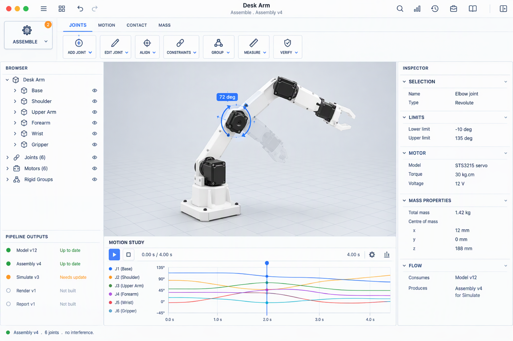

Purpose: joints, motors, limits, motion study, mass properties. Source of the physical model for simulation and the robot.

- Inputs: `design.model`, `generate.*`, `electronics.board` (mounted board).
- Outputs: `assemble.assembly`.
- Ribbon tabs: JOINTS (revolute, slider, ball, wheel (diff drive, mecanum), leg templates (2 or 3 DOF per leg), rigid group, as-built; see 7.10.7), MOTION (motion study, drive joint), CONTACT (interference, contact sets), MASS (properties, overrides).
- Bottom panel: motion study timeline with joint angle curves and playhead.
- Inspector: joint type, components, axis, limits, motor (from Libraries, with torque, speed, gear ratio, backlash), damping, friction; MASS PROPERTIES total mass, centre of mass, inertia tensor.

Data (`assembly.json`, `viaform-asm` v1):

```json
{
  "format": "viaform-asm", "version": 1,
  "joints": [{
    "id": "elbow", "type": "revolute",
    "parent": "upper_arm", "child": "forearm",
    "origin": [0, 0, 188], "axis": [0, 1, 0],
    "limits": {"lower_deg": -10, "upper_deg": 135, "velocity_dps": 300, "effort_nm": 2.9},
    "motor": {"part": "lib:feetech/STS3215", "gear_ratio": 1, "backlash_deg": 0.3, "bus_id": 3},
    "damping": 0.02, "friction": 0.05
  }],
  "mass_overrides": [{"component": "gripper", "mass_kg": 0.12}],
  "poses": [{"id": "home", "q_deg": {"shoulder_pan": 0, "shoulder_lift": -30, "elbow": 90, "wrist_pitch": -60, "wrist_roll": 0}}],
  "grasps": [{
    "id": "cylinder_30", "object": {"shape": "cylinder", "size_m": [0.03, 0.08]},
    "fingertips": [{"frame": "thumb_tip", "point_m": [0.0, -0.015, 0.04], "normal": [0, 1, 0], "priority": 1}],
    "q_deg": {"thumb_cmc": 35, "index_mcp": 50}, "actuators": {"index_tendon": 0.42}
  }],
  "paths": [{
    "id": "pick_place",
    "waypoints": [{"pose": "home"},
                  {"cartesian": {"pos_m": [0.2, 0.0, 0.1], "rpy_deg": [180, 0, 0]}, "segment": "line", "blend_m": 0.01},
                  {"plan_to": {"pose": "place"}, "segment": "plan"}],
    "limits": {"max_lin_vel_mps": 0.2, "max_lin_acc_mps2": 1.0}
  }]
}
```

`poses` are named joint configurations ("Save pose", 7.10.4), `grasps` are saved hand grasps (7.10.5) and
`paths` are saved waypoint lists (7.10.6). They are written by the ops `asm.save_pose`, `asm.save_grasp`
and `asm.save_path` (section 11.1), each one undo step.

AC:
- Template arm has 6 revolute joints; dragging a joint moves the chain in real time (60 fps).
- Dragging the end effector solves IK live (RUST-ENGINES 4.3) at 60 fps.
- Mass properties match SolidCraft's own mass query within 0.1 percent.
- Interference check over a motion study lists colliding pairs with first time of contact.
- Export to MJCF and URDF (`vf_asm_export`) for interchange, validated against XML schemas and a round-trip import test.

### 7.4 Electronics

Purpose: schematic, board, routing, checks, link to 3D. Existing (PCBCraft, `DeskPCBView`, `PCBCanvas`).

- Inputs: none. Outputs: `electronics.board` (Letter scheme).
- AC additions: KiCad library parts (symbol plus footprint plus STEP) placed from Libraries; DRC summary capsule; "Show in 3D" from component inspector; keep-in region from the frame revision (`vf_link_keepin`).

### 7.5 Simulate

Purpose: test the product in its world before building.

- Inputs: `assemble.assembly`, scenario. Outputs: `simulate.<scenario>`.
- Today: quad flight sim in `sim/` (weather, sensors, mapping, race mode).
- New: **articulated-body simulation** for arm and hand.

Decision D-2 (changed 2026-11-07, see RUST-ENGINES E-1, E-2): articulated bodies run on ViaForm's own
Rust physics crate `phys` (Featherstone dynamics, parry collision geometry, soft contacts). The drone
models move into `phys` with a parity test against today's `sim`. MJCF and URDF stay as export
formats only, for interchange.

Scenario file (`viaform-scenario` v1):

```json
{
  "format": "viaform-scenario", "version": 1,
  "id": "pick", "engine": "phys",
  "world": {"table": {"size_m": [0.8, 0.6], "height_m": 0.0},
            "objects": [{"id": "cube", "shape": "box", "size_m": 0.03, "mass_kg": 0.02, "pose": "random_in:[0.15,0.3]x[-0.1,0.1]"}]},
  "sensors": ["joint_pos", "joint_vel", "motor_current", "camera:wrist:84x84"],
  "randomise": {"mass_pct": 10, "friction_pct": 20, "latency_ms": [5, 25], "backlash_deg": [0, 0.5]},
  "duration_s": 10, "rate_hz": 1000, "control_hz": 50
}
```

- Screen: viewport with HUD, scenario card (lists upstream revisions), telemetry panel (Swift Charts, shared playhead), episode list, "Re-run on Assembly vN".
- Cross-stage verbs: "Stress here" (to Generate), "Use as training scenario" (to Train).

AC:
- Arm "Reach" scenario runs in real time or faster on an M-series Mac at 1 kHz physics (the default; 500 Hz is the iPad and batch training option, RUST-ENGINES 6.2).
- Same seed gives identical trajectories (determinism test).
- Sim-to-real parameters (randomise block) are visible and editable in the inspector.

### 7.6 Train (new screen)

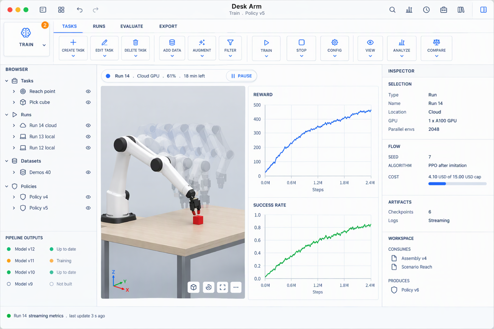

Purpose: controllers and policies by imitation and reinforcement learning, locally or on Azure.

- Inputs: `simulate.*` scenarios, `robot.demos`, task definition. Outputs: `train.policy`.
- Ribbon tabs: TASKS, RUNS, EVALUATE, EXPORT.
- Browser: Tasks, Runs (local and cloud, with state), Datasets, Policies.
- Canvas: 3D view of parallel episodes (ghosts) beside charts (reward, success rate, loss).
- Inspector: run config, seed, algorithm, compute (Local or Cloud), cost so far and cap, artifacts, FLOW.

Task file (`viaform-task` v1):

```json
{
  "format": "viaform-task", "version": 1,
  "id": "pick_cube", "scenario": "pick",
  "observation": ["joint_pos", "joint_vel", "cube_pose"],
  "action": {"type": "joint_position_delta", "limit_deg": 5},
  "reward": [{"term": "distance", "to": "cube", "weight": -1.0},
             {"term": "lifted", "height_m": 0.05, "weight": 10.0},
             {"term": "action_rate", "weight": -0.01}],
  "success": {"lifted_height_m": 0.05, "hold_s": 1.0},
  "pipeline": [{"stage": "imitation", "dataset": "robot.demos", "epochs": 50},
               {"stage": "rl", "algorithm": "ppo", "steps": 5000000, "envs": 2048}]
}
```

Training engine:

- One Rust runner: the binary `viaform-train` of the `train/` crate (built on the `learn` crate and burn): wgpu backend on the Mac, CUDA backend on Azure. One code path, two locations (RUST-ENGINES section 7).
- On the Mac, local training runs that same binary as a helper process bundled in the app, for crash
  isolation (FRONTEND-SPEC 6.6). `learn.train_start` launches and supervises the helper; it does not
  train in-process.
- The quad's existing CEM and ES training stays available as an algorithm option.
- Policy format: burn record `policy.mpk` plus `policy.json` (observation and action spec, normalisation, source revisions).

AC:
- "Reach point" trains locally to 95 percent success in under 30 min on an M-series Mac.
- "Pick cube" with 40 demos plus PPO reaches 80 percent success in simulation on one cloud A100 in under 2 h and under 15 USD.
- A cloud run streams metrics to the app with under 10 s delay and survives closing and reopening the app (F-2).
- Each policy revision records the exact assembly, scenario, task and dataset revisions it was trained on.

### 7.7 Render (new screen)

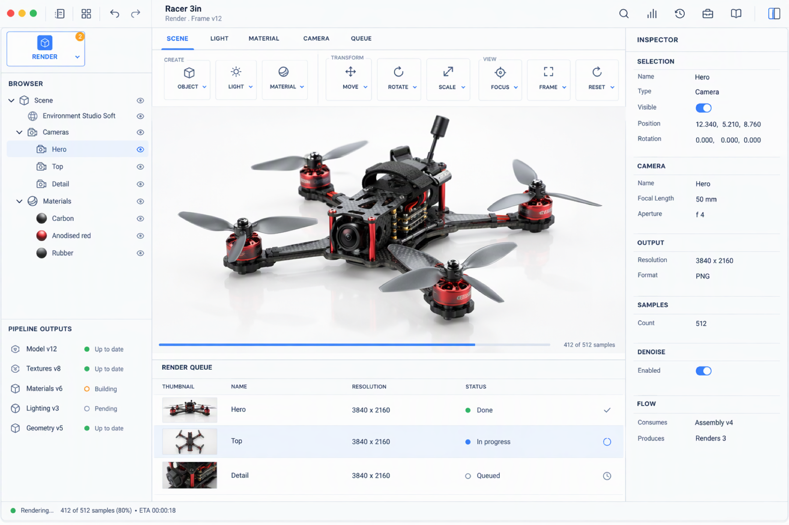

Purpose: product images for docs, sharing and the start window thumbnails. Local Metal path tracer.

- Inputs: `assemble.assembly`. Outputs: `render.shots`.
- Ribbon: SCENE, LIGHT, MATERIAL, CAMERA, QUEUE. Bottom panel: render queue (thumbnail, size, state).
- Materials library (carbon, anodised aluminium, PLA matte, PETG, rubber, FR4) mapped from Libraries part data.

AC: 3840 x 2160 at 512 samples in under 3 min on an M3 Pro; queue runs as jobs; renders saved to `<Project>.viaform-data/renders/` with revision tags.

### 7.8 Make (new screen)

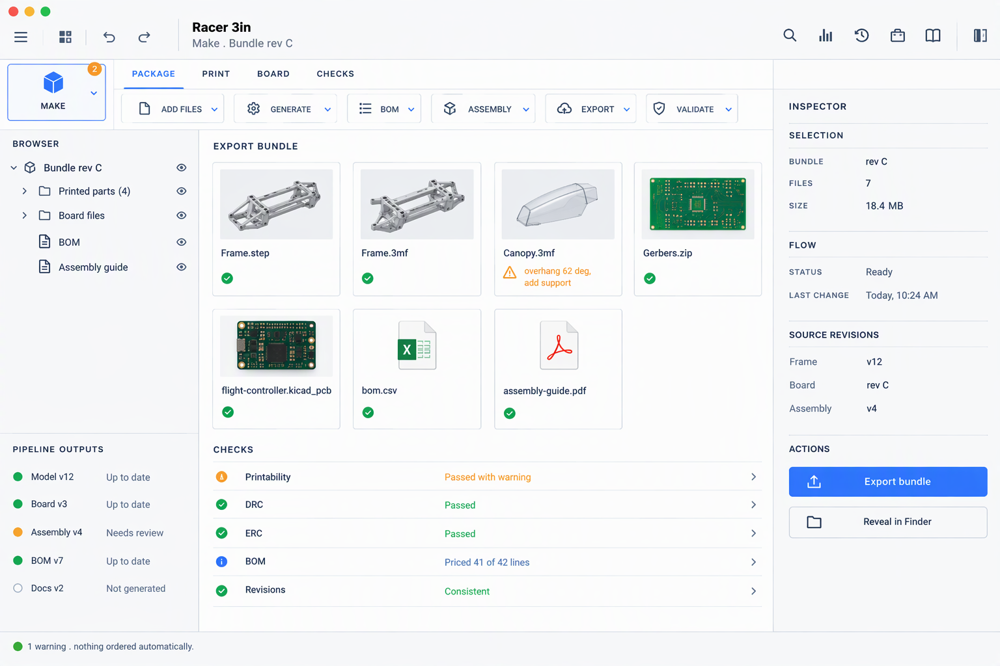

Purpose: one bundle with everything needed to build.

- Inputs: `generate.*`, `electronics.board`, `assemble.assembly`, `train.policy`, BOM. Outputs: `make.bundle`.
- Bundle contents: STEP per part, 3MF per printed part (with print profile hints), Gerbers and `.kicad_pcb`, `bom.csv`, assembly guide PDF (exploded views from Render, joint order), `policy.mpk` with `policy.json`, `manifest.json` (all source revisions and file hashes).
- Checks: printability (overhang, min wall, bed fit), DRC, ERC, BOM priced coverage, revision consistency.

AC:
- Export is blocked only by errors, never by warnings; warnings are listed with a fix hint.
- `manifest.json` reproduces the exact revisions: opening the bundle's project at those revisions gives identical file hashes.
- Status bar always shows "nothing ordered automatically" on this stage (R-1).

### 7.9 Robot (new stage)

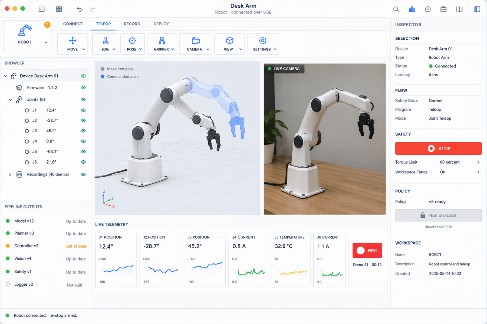
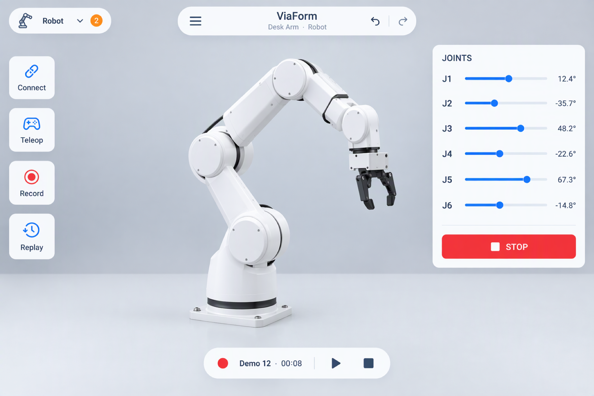

Purpose: connect the real robot, teleoperate, record demonstrations, run a trained policy safely.

- Inputs: `assemble.assembly` (joint map), `train.policy`. Outputs: `robot.demos`, `robot.session`.
- Ribbon: CONNECT, TELEOP, RECORD, DEPLOY (Run policy, Paths: the path editor of 7.10.6 for real runs).
- Canvas: live digital twin (measured pose solid, commanded pose ghost) beside camera feed.
- Bottom panel: telemetry sparklines (position, current, temperature per joint), record control.
- Inspector: device, latency, SAFETY (e-stop button, torque limit, workspace fence), POLICY (Run on robot, locked until confirm).

Connection (decision D-3): two link modes, specified in `docs/specs/robot-protocol.md` (task P7-2).

- Mode A, direct (first): the Mac speaks the Feetech STS servo bus protocol itself (half duplex,
  1 Mbaud) through a USB to TTL bus adapter. macOS only.
- Mode B, bridge (second, task P7-7): the Mac or iPad sends ViaForm binary frames (robot-protocol
  section 4, HMAC authenticated) over USB CDC or Wi-Fi to an ESP32-S3 running the ViaForm bridge
  firmware, which drives the servo bus. The only mode on iPad.
- Control loop 50 Hz default, 100 Hz max, telemetry at the control rate.
- Drone (decision D-26): ViaForm never drives motors. A flight controller running ArduPilot does
  the inner loops; ViaForm sends MAVLink velocity or attitude setpoints at 50 Hz through an
  ESP32-S3 on the drone (Wi-Fi). Robot-protocol section 9 covers link, failsafes and flight rules.
- `viaform-robot` v1 is only the name of the device profile format (`robot/device.json`), not of the
  wire protocol.

Safety (R-8), all mandatory:

1. Software e-stop: big red button, Space, Esc twice; sends torque-off to all motors within 20 ms.
2. Torque limit per joint, default 60 percent of rated.
3. Workspace fence: joint limits from Assemble plus a Cartesian box; violations stop motion.
4. Watchdogs: the host safety layer soft-stops if no telemetry arrives for 100 ms (both modes). In
   bridge mode the firmware also removes torque after 200 ms without a valid command or keepalive.
   Direct mode has no robot-side watchdog, so it requires a physical e-stop switch that cuts servo
   power; the app does not enable torque until the device profile confirms it is installed
   (robot-protocol section 1).
5. "Run on robot" needs a confirm sheet each session, shows policy revision and its sim success rate.
6. Teleop speed cap 30 percent until the user raises it in the session.
7. Drone: the pilot's RC transmitter is always connected and always wins (kill switch and mode
   switch to manual). Geofence and altitude cap set in the device profile. Link loss for 500 ms
   makes the flight controller hold, then land after 2 s. First flights in a net cage indoors;
   outdoor flights only after open question 4 (registration and local rules) is closed.

Leader-follower teleop (second arm as leader) and keyboard/gamepad teleop both record demos as
`robot.demos` (episodes with joint states, actions, camera frames, at 30 to 50 Hz) in LeRobot-compatible
format (decision D-4) inside `<Project>.viaform-data/demos/`.

AC:
- Connect, read all 6 joints and show the twin at 50 Hz with under 30 ms latency over USB.
- E-stop test: from any state, motors torque off within 20 ms (measured with firmware timestamps).
- 40 demos recorded and replayed in Simulate (sim replay of real demo) with joint error under 2 degrees RMS on the template arm.

### 7.10 Engine interactions in detail

Screens and gestures for the Rust engines in `RUST-ENGINES.md`. Each block names the engine ops it
calls, so UI and engine work can be split between agents.

#### 7.10.1 Generate: study setup

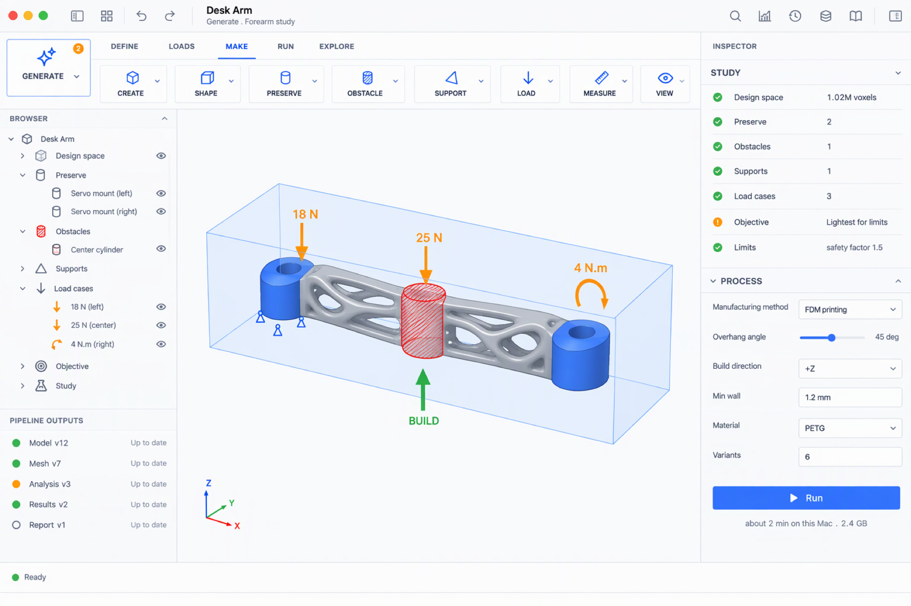

Ribbon tabs: DEFINE (Preserve, Obstacle, Design space, Bores), LOADS (Force, Torque, Acceleration,
From simulation), MAKE (Process), RUN (Local, Cloud), EXPLORE.

Inspector STUDY sections, top to bottom, each collapsible, each with a status icon (ok, missing, warning):

| Section | Controls | Engine field |
|---|---|---|
| Design space | Box or from body, voxel size slider with live voxel count and memory estimate | `min`, `max`, `voxel` |
| Preserve and obstacles | Region list (pick faces or bodies, offset), exact bores toggle | `keep_in`, `keep_out`, `bores`, `exact_keep_outs` |
| Supports | Fixed, pinned, sliding, picked on faces | `supports` |
| Load cases | List with name, type, magnitude, direction gizmo in canvas; "From simulation..." button | `cases` |
| Objective | Segmented: Stiffest for mass, Lightest for limits; mass target or volume fraction | `objective`, `mass_target_g`, `volume_fraction` |
| Limits | Safety factor, max stress, max displacement, min frequency, impacts | `safety_factor`, `max_*`, `min_frequency`, `dynamics` |
| Process | Picker: Free, FDM, SLS, Resin, CNC milling, Carbon plate; process-specific fields below | `manufacturing` (RUST-ENGINES G2) |
| Material | From Libraries materials | `material` |
| Variants | Count, seed | `variants`, `seed` |

Process fields:
- FDM: build direction (pick a face or axis, arrow in canvas), overhang angle slider 30 to 60 degrees, min wall.
- SLS and Resin: min feature, enclosed voids: Fill or Escape holes (diameter).
- CNC milling: tool directions list (add by picking a face normal, shown as arrows), tool radius.
- Carbon plate: thickness picker (1.5, 2, 3, 4, 5 mm), min slot, min bridge, extrusion direction.

Before run, a check line under the RUN button: "1.02M voxels . about 2 min on this Mac . 2.4 GB" or
"8.1M voxels . run on cloud (est. 0.60 USD)". Calls `study_check`. Run button disabled with a reason
while any section is missing.

Canvas during setup: design space as translucent box, preserve regions blue, obstacles red hatched,
supports as anchor glyphs, loads as arrows scaled by magnitude, build direction or tool directions as
big arrows. During run: density field as a live iso surface preview every N iterations (`vf_generate_preview`), job capsule "Optimising 42 of 100 . 1 min left".

AC: setup to run without leaving the Generate stage; every field has a tooltip with its unit; changing
voxel size updates the estimate within 100 ms.

#### 7.10.2 Generate: loads from simulation

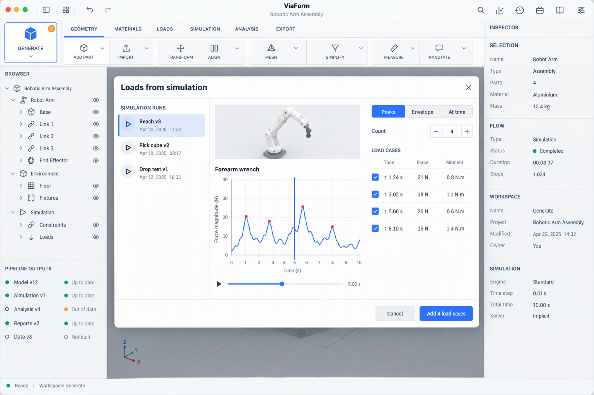

Sheet "Loads from simulation" opened from LOADS > From simulation, or from the Simulate timeline's
"Stress here" (which preselects At time).

- Left: run picker (scenario runs of the current assembly revision, with date and result).
- Centre: wrench magnitude chart over time for the part being generated, peaks marked with dots,
  playhead; small 3D thumbnail of the robot at the playhead.
- Right: Pick mode segmented control: Peaks (count), Envelope (count), At time. List of resulting load
  cases with time, force, torque, and a checkbox each.
- Bottom: "Add 4 load cases" primary button. Load cases keep a link to their run; if the run becomes
  stale the load cases show a stale badge and "Refresh from Reach v3".

Calls `loads_from_sim` (RUST-ENGINES G3).

#### 7.10.3 Generate: outcomes

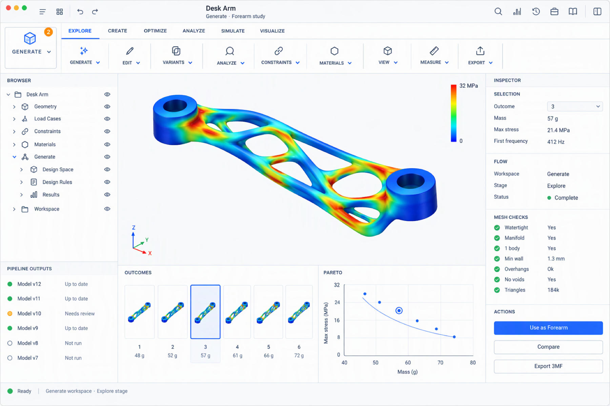

- Bottom panel: outcome gallery (thumbnails with mass, max stress, first frequency), sorted by a
  chosen metric; the Pareto front chart (mass versus max stress, bubble size by frequency) beside it;
  hover links chart dot and thumbnail.
- Canvas: selected outcome with stress colour map and legend; toggle overlays: overhang map (FDM),
  wall thickness map, tool access (CNC), voids.
- Inspector MESH CHECKS: watertight, manifold, bodies, min wall, overhangs, voids, triangles; each with
  pass or warning and "Show" (frames the problem in the canvas).
- Actions: "Use as Forearm" (promote, new revision), "Compare with current", "Export 3MF", "Export DXF" (carbon plate).

#### 7.10.4 Assemble: drag end effector (IK)

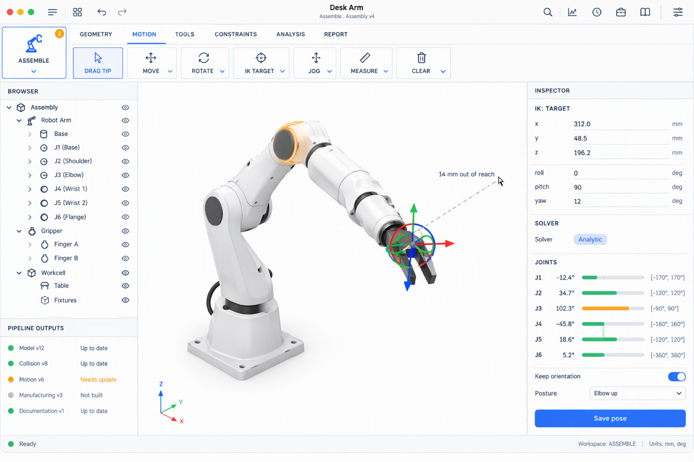

- Tool: MOTION > Drag tip (shortcut T). Hover the tool frame (gripper tip) shows a 6-axis gizmo
  (three arrows, three rings). Drag an arrow or ring, or free drag on the gizmo centre (moves in the
  view plane).
- The arm follows live (`vf_kin_drag_move`, binary path, 60 fps). Joints near a limit turn orange,
  at a limit red. If the target is out of reach, a dashed line from the tip to the cursor shows the
  remaining distance in mm.
- Inspector IK: target pose (x, y, z, roll, pitch, yaw, editable), solver (Analytic or Numerical,
  read-only badge), joint list with live angles and limit bars, toggles: Lock joints (click a joint
  to freeze), Keep orientation, Posture (Elbow up or down for analytic arms, Mid range for others).
- Release: "Save pose" adds a named pose to the assembly (`asm.save_pose`, stored in `assembly.json`
  `poses`, section 7.3; used by Robot and paths).

AC: drag at 60 fps on the template arm and the hand; Esc during drag restores the previous pose.

#### 7.10.5 Assemble: hand grasp editor

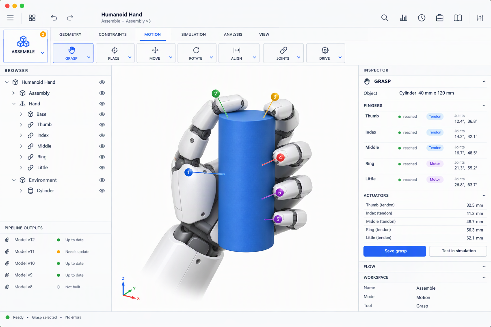

- MOTION > Grasp. Pick an object (or a primitive: cylinder, box, sphere with size fields).
- Fingertip targets appear as small coloured spheres; drag them onto the object surface (snaps to
  the surface, normal shown). Priority order shown as numbers 1 to 5 next to each fingertip.
- Solver runs multi-task IK with tendon couplings (RUST-ENGINES K5). Each finger row in the inspector
  shows reached (green) or distance left, and actuator (tendon) values next to joint values.
- Drive mode badge per finger: Motor per joint or Tendon.
- "Save grasp" stores the pose set (`asm.save_grasp`, `assembly.json` `grasps`); "Test in simulation" opens Simulate with a hold scenario.

#### 7.10.6 Robot and Assemble: path editor

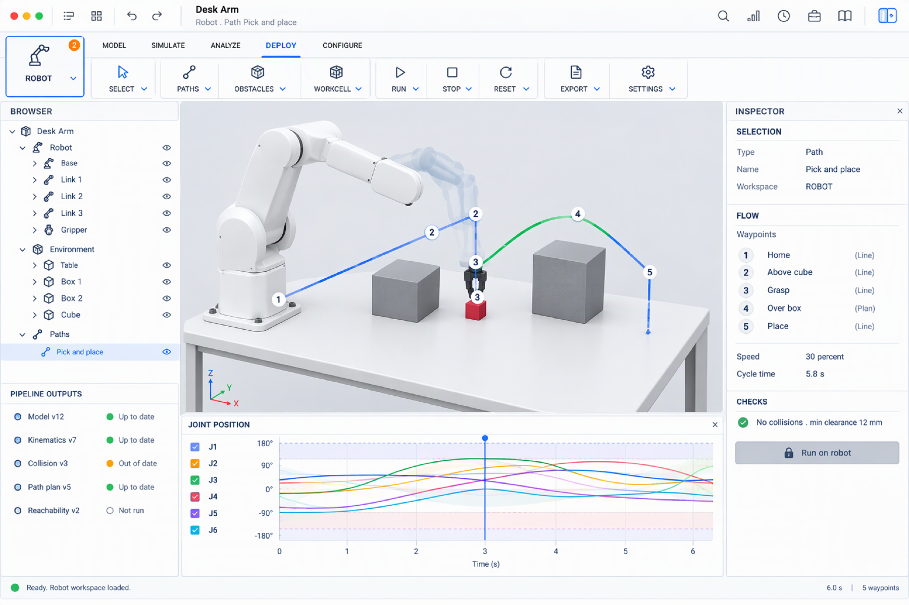

- MOTION > Paths in Assemble (design), DEPLOY > Paths in Robot (real runs). A path is a list of
  waypoints: saved poses, Cartesian targets, or "plan to" goals. Saved with `asm.save_path` in
  `assembly.json` `paths` (section 7.3).
- Segment type per waypoint pair: Line (Cartesian, RUST-ENGINES K6), Joint (interpolated), Plan
  (collision-free, PL2). Blend radius per corner.
- Canvas: tool path as a coloured tube (blue line segments, green planned segments), waypoints as
  numbered spheres, obstacles from the scenario, swept-volume ghost on hover, red markers where
  collision or limit errors were found.
- Bottom panel: joint position and velocity curves versus time with limits as shaded bands, playhead.
- Inspector: speed and acceleration limits, cycle time, check results ("No collisions . min clearance 12 mm").
- Robot stage: "Run on robot" uses the same path with the R-8 confirm sheet and speed cap.

#### 7.10.7 Mobile base

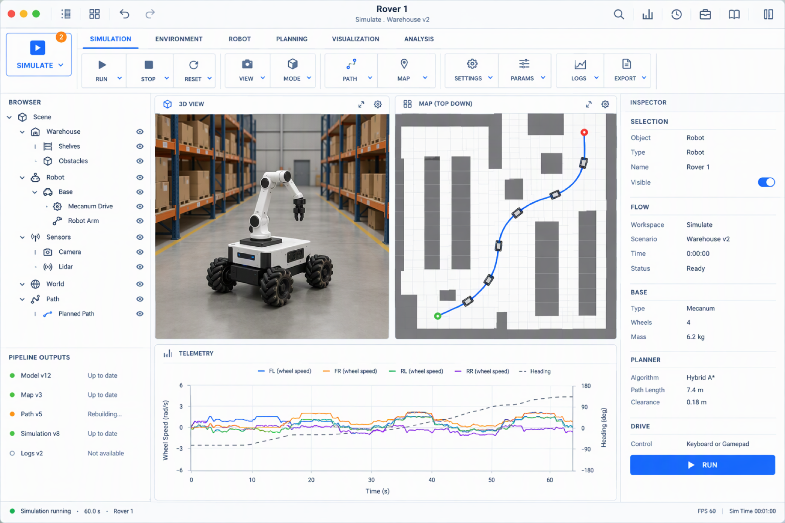

- Assemble: JOINTS > Wheel (diff drive, mecanum), Leg templates (2 or 3 DOF per leg).
- Simulate: top-down map with occupancy grid, planned path (hybrid A*) and the base's footprint
  along it; drive with keyboard or gamepad like the drone race mode.
- Train: locomotion tasks for legs (walk forward, turn, rough ground) with the same Train stage.

#### 7.10.8 Carbon plate output

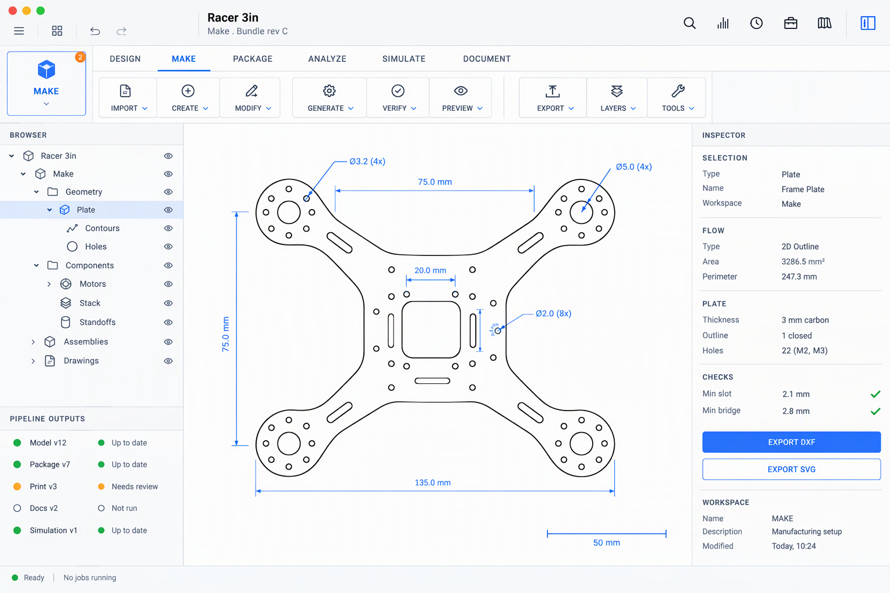

- Make stage card for plates: 2D outline preview on a sheet layout, thickness, min slot and bridge
  checks, holes listed with diameters, "Export DXF" and "Export SVG".
- Nesting on a stock sheet (size from the BOM line of the plate) is a later item.

---

## 8. Cross-cutting features

### 8.1 Libraries

Existing. Sources: KiCad, standard hardware, DigiKey, Mouser, Nexar, Amazon, AliExpress, eBay (official APIs), manual shops, pasted links.

Additions:
- Part record gets SIMULATION (actuator model: torque-speed curve, gear ratio, backlash, voltage, current) and SOFTWARE (protocol, driver) sections, per `parts-library.md`.
- Search by function ("servo 30 kg.cm 12 V") through the agent (section 8.3).
- Insert a part into the assembly with its mount points and joint axis.
- Optional pricing proxy in the cloud (section 10.6) so the user does not need personal developer keys; personal keys still work and take priority.

### 8.2 Bill of materials

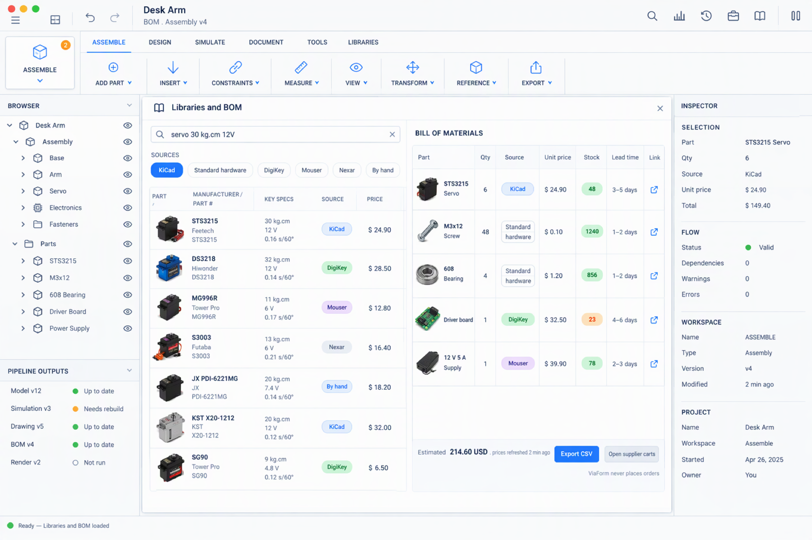

Existing crate `bom/` with rollup, price breaks, MOQ, one cart per supplier, CSV export.

Additions: BOM panel shows refresh time, stock badges and "ViaForm never places orders"; "Open supplier carts" opens each supplier's search or cart-import page in the browser with the list ready to paste (no API cart writes, R-1); price history per line (phase 6).

AC: Desk arm BOM prices 100 percent of electronic lines from DigiKey or Mouser when keys exist; CSV opens in Numbers and Excel without encoding errors.

### 8.3 Agents and the agent manager

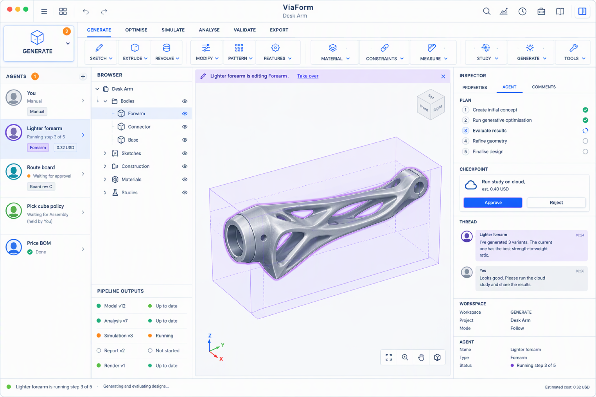
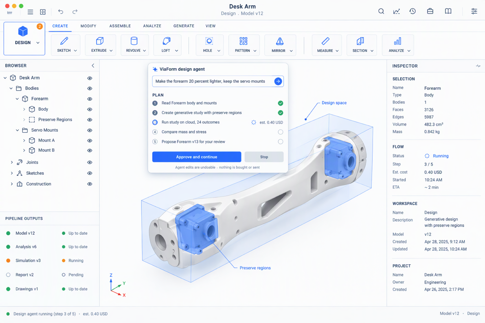

Purpose: agents turn goals into plans of commands and run them beside you, several at once, each on
its own artifacts, with approvals at checkpoints. Decided by the owner (D-16 to D-19).

**Layout: agents left, workspace right (D-16).**

| Zone | Content |
|---|---|
| AGENTS column (leftmost, 260 pt, collapses to a 56 pt rail of avatars) | First row "You". Then one row per agent: name or goal ("Lighter forearm"), state (Planning, Running step 3 of 5, Waiting for approval, Done, Failed), the artifacts it holds (chips such as "Forearm", "Board rev C"), cost so far, avatar ring colour. A badge on the column header counts approvals waiting. "New agent" button and a filter (active, done) |
| Workspace (centre) | The normal stage view (CAD, PCB, sim...). Selecting an agent switches the workspace to the stage and artifact that agent is working on, in **follow mode**: camera follows the agent's focus, its edits appear live with its colour ring, the ribbon is read-only for artifacts it holds. "Take over" pauses the agent and gives you the lease |
| Inspector, agent tab | Plan (numbered steps with state and cost), checkpoints with Approve / Reject, the conversation thread with the agent, diffs ("Forearm v12 to v13: mass 212 g to 168 g, max stress 18 to 21 MPa") |
| Selecting "You" | Your own manual workspace, as today |

On the Mac, any agent can also open in its own window (right click, Open in new window) to watch it
while you work elsewhere. On iPad the agents column is a sidebar that slides over.

**Parallel agents (D-17).** Many agents may run on one project at the same time. Each acquires leases
on the artifacts it will edit (same lease system as human collaborators, section 10.7). A plan that
needs an artifact leased by someone else waits at that step and shows "Waiting for Forearm (held by
You)". No merges: conflicts are prevented, not resolved.

**Autonomy (D-18): checkpoints.** Edits run freely (undoable, tagged with the agent). The agent stops
for approval before: any cloud spend, promoting a revision that other artifacts consume, exports, and
anything that touches another person's lease. Robot motion tools do not exist for agents.

**Where agents run (D-19): on the Mac (or iPad) inside the app.** Model calls go through the ViaForm
API to Azure AI Foundry (section 10.5); tools act on the open project. Closing the project pauses its
agents; they resume on open.

Agent engine:
- Model: Azure AI Foundry deployment on `temple-ai-provider` (default `gpt-5.6-sol`, configurable per agent).
- Tools: the merged command catalog (CommandBus, FRONTEND-SPEC section 3) with schemas, plus read-only
  queries (tree, selection, mass, BOM, sim results, flow status). No purchase tools (R-1), no robot motion.
- Loop: plan with steps and cost estimate, plan approval, run, checkpoints, propose result, accept or revert.
- Budgets: per-agent spend cap (default 2 USD of credits), per-day token budget per account.
- Context sent: schemas, tree summary, the agent's artifacts, flow status. Never keys; never whole files unless attached.
- Log: `agent/log.jsonl` per project, plus the agent thread stored with the project.

AC:
- Two agents ("Lighter forearm" on Forearm, "Route board" on the board) run at the same time on the
  template arm without blocking each other; a third agent that needs Forearm waits with a clear message.
- Follow mode shows an agent's edits live at 30 fps or better.
- Every checkpoint has an approval event in the log before the step runs.
- Reverting an agent restores every artifact it touched to the revision before it started.
- With network off, agents pause with "Needs a connection"; every manual feature works.

### 8.4 Command palette (Cmd-K)

Existing. Searches commands of all stages with one-key shortcuts. Addition: a top row "Ask the agent: <query>" when no command matches.

---

## 9. End-to-end flows

### 9.1 Idea to moving arm (golden path)

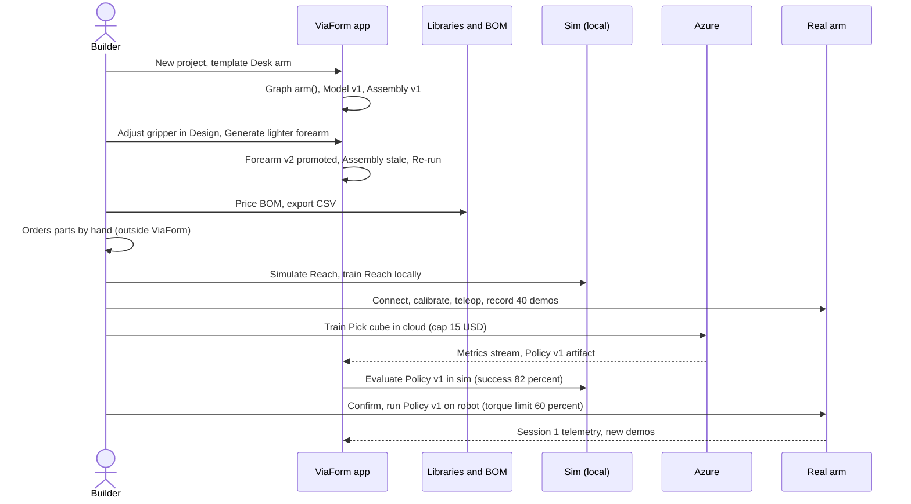

### 9.2 Stale propagation

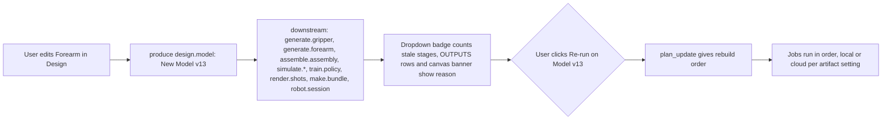

### 9.3 Cloud run lifecycle

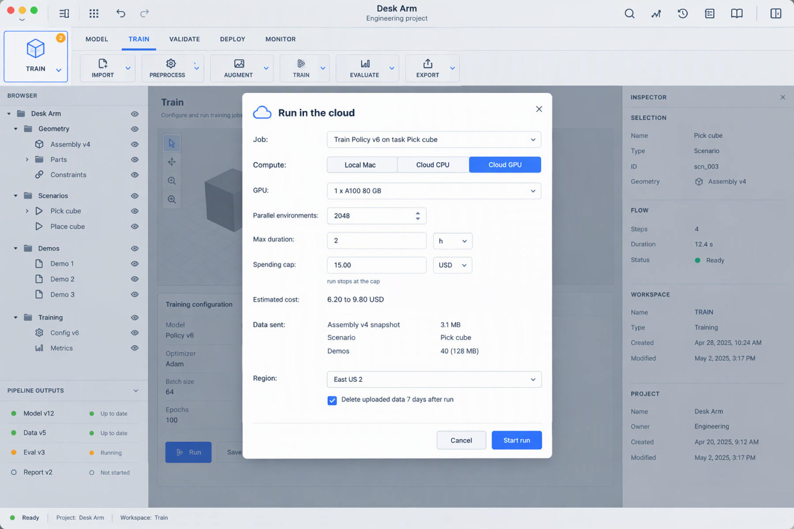

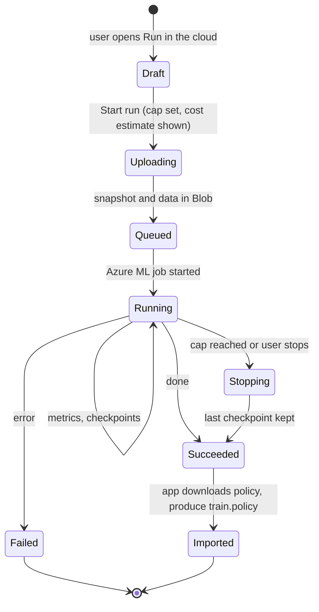

### 9.4 Agent loop

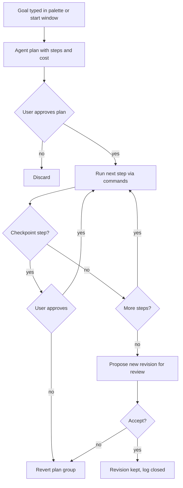

---

## 10. Azure cloud platform

### 10.1 Scope

Azure does these jobs. All are optional for local work; the app works signed out and offline (R-2).

| ID | Job | Phase |
|---|---|---|
| AZ-1 | GPU and CPU batch runs: training, large generative studies, sim sweeps | 5 |
| AZ-2 | Design agent model access (Azure AI Foundry, existing resource) | 8 |
| AZ-3 | Pricing proxy for distributor APIs (shared keys, cache, rate limits) | 6 |
| AZ-4 | Accounts (Sign in with Apple, Entra External ID) and backup (tasks P6-5, P6-6); project sync, which is the collaboration system with one member (section 10.7) | 6 (accounts, backup), 10 (sync) |
| AZ-5 | Real-time collaboration: operation log, leases, presence (section 10.7) | 10 |
| AZ-6 | Billing: credits ledger, App Store transaction verification (section 10.10) | 6b |
| AZ-7 | Opt-in analytics and crash reports (section 10.11) | 6b |

Spec visuals (this document) also use Azure image generation; that is a tooling use, not a product feature.

### 10.2 Architecture

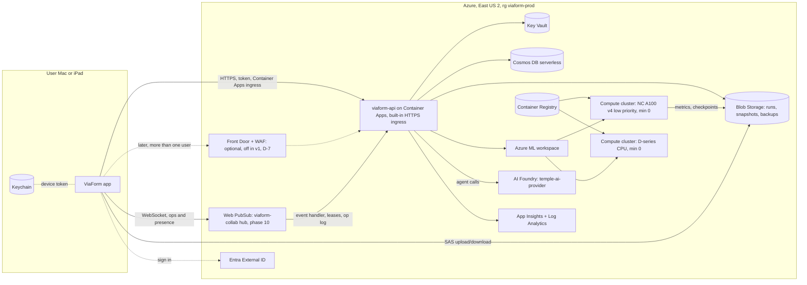

Service choices and why:

| Need | Service | Why |
|---|---|---|
| API | Azure Container Apps (consumption, scale to 0) | Cheap idle, container from ACR, managed identity |
| GPU training | Azure ML command jobs on compute clusters with `min_instances: 0`, low-priority VMs | Pay only while running, 80 percent cheaper than on demand, built-in job logs and retries |
| CPU batch (generative, sim sweeps) | Same Azure ML workspace, CPU cluster | One job model for all batch work |
| Run metadata | Cosmos DB for NoSQL, serverless | Near zero idle cost, simple documents |
| Files | Blob Storage, hot tier, lifecycle rules | Snapshots and datasets deleted after N days (default 7) |
| Secrets | Key Vault, RBAC | Distributor keys, Foundry access via managed identity (no key) |
| Model access | Existing AI Foundry resource `temple-ai-provider` | Already deployed models; managed identity from the API |
| Identity | Entra External ID (customer tenant), device code flow on Mac | Free tier covers a small user count; sign-in optional |
| Edge | v1: Container Apps built-in HTTPS ingress, IP rate limiting in the API (D-7). Later: Front Door Standard with WAF (optional module, off by default) | One public hostname, TLS, abuse protection once there is more than one user |
| Real-time collaboration | Azure Web PubSub, one hub `viaform-collab`, one group per shared project (phase 10) | Managed WebSocket fan-out; the API stays the authority for leases and sequence numbers |
| Observability | Application Insights, Log Analytics (30 days retention) | Traces from API and trainer |
| IaC | Bicep with `azd` (`infra/` folder) | Repeatable, reviewable |

Decision D-6 (recommended): Azure ML jobs over AKS. AKS gives more control but costs a cluster and
operations time; Azure ML clusters scale to zero and need no Kubernetes knowledge.

### 10.3 Identity and access

Phase 5 cloud runs authenticate with owner device keys only (no accounts). From phase 6 (task P6-6),
accounts are the default for any cloud use (D-15, section 10.7); the device key below then remains
only for internal development tools and CI.

- Single-owner v1: the owner's devices authenticate with Entra External ID (device code flow), token
  stored in Keychain. Before phase 6 (no sign-in), the app uses a **device key**: a random 256-bit key
  generated on first cloud use, registered once by the owner through `az`-backed admin CLI
  (`viaform-admin device add`), stored in Keychain, sent as `Authorization: Device <id>.<sig>` with
  HMAC request signing. Simple, no user system needed for one owner.
- API uses managed identity for Key Vault, Cosmos, Blob, Azure ML and AI Foundry. No keys in app settings.
- Blob access from the app only through short-lived (15 min) user delegation SAS URLs minted by the API, scoped to one run folder.
- RBAC: API identity gets `AzureML Data Scientist` on the workspace, `Storage Blob Data Contributor` on the runs container, `Key Vault Secrets User`, `Cognitive Services OpenAI User` on `temple-ai-provider`.

### 10.4 Cloud runs (AZ-1)

Run kinds: `train`, `generate`, `sim_sweep`.

Container `viaform-trainer` (in ACR):

- Base: NVIDIA CUDA runtime image with the Vulkan ICD, plus the Rust binaries `viaform-train` and `viaform-gen` (built for linux x86_64 in CI, feature `cuda`). No Python.
- Entrypoint: `viaform-train --spec run.json --in /mnt/in --out /mnt/out` (generative runs: `viaform-gen`).
- Writes: `metrics.jsonl` (every 10 s), `checkpoints/step_<n>/`, final `policy.mpk` and `policy.json`, `result.json`.
- Determinism: seed, image digest, and input hashes recorded in `result.json`.

Run spec (sent by the app, stored in Cosmos):

```json
{
  "kind": "train",
  "project_id": "p_7f3c", "artifact": "train.policy",
  "inputs": {"assembly": "sha256:...", "scenario": "sha256:...", "task": "sha256:...", "demos": "sha256:..."},
  "compute": {"tier": "gpu_a100", "priority": "low", "max_duration_min": 120},
  "cap_usd": 15.0,
  "retention_days": 7,
  "seed": 7
}
```

Compute tiers (app shows these names):

| Tier | SKU | Use | Default priority |
|---|---|---|---|
| `cpu_8` | Standard_D8as_v5 | Generative studies, sim sweeps | low |
| `gpu_t4` | Standard_NC4as_T4_v3 | Small policies, imitation only | low |
| `gpu_a100` | Standard_NC24ads_A100_v4 | RL with 2048+ parallel envs | low |

Cost control (R-7):

1. Estimate before start: `price_per_hour(tier, priority) x expected_hours` with a 1.5x range shown.
2. Hard cap: the API's cost watcher (timer every 60 s) computes `elapsed x hourly price`; at 95 percent of cap it asks the trainer to checkpoint (via a `stop.flag` blob), at 100 percent it cancels the Azure ML job. The last checkpoint is kept and importable.
3. Low-priority preemption: trainer resumes from last checkpoint automatically (Azure ML retry with `max_retries: 3`); preempted time is not charged.
4. Subscription budget: Azure Cost Management budget, default 100 USD/month, email alerts at 50, 80, 100 percent.
5. Clusters `min_instances: 0`, `idle_seconds_before_scaledown: 120`.

Metrics streaming: v1 app polls `GET /runs/{id}/metrics?after=<seq>` every 5 s (simple, works behind
any network). v2 option: Azure Web PubSub push.

### 10.5 Agent gateway (AZ-2)

- `POST /agent/chat` proxies to AI Foundry with managed identity, adds the system prompt and tool list version, enforces per-day token budget (default 2 million tokens) and per-plan cloud spend cap.
- Streams responses (server-sent events) to the app.
- Logs token usage per plan to Cosmos for cost reporting; does not log prompt content by default (privacy setting to enable for debugging).

### 10.6 Pricing proxy (AZ-3)

- `GET /parts/search?q=&sources=` and `POST /parts/offers` call DigiKey, Mouser, Nexar with ViaForm's keys from Key Vault, cache results 6 h in Cosmos, respect each API's rate limits and terms.
- Returns the same `Offer` shape as `bom/src/model.rs`. The app prefers personal keys if present.
- Decision gate: check each distributor's terms allow a server-side proxy for this use before enabling (task P6-2).

### 10.7 Accounts, sync and real-time collaboration (AZ-4, AZ-5)

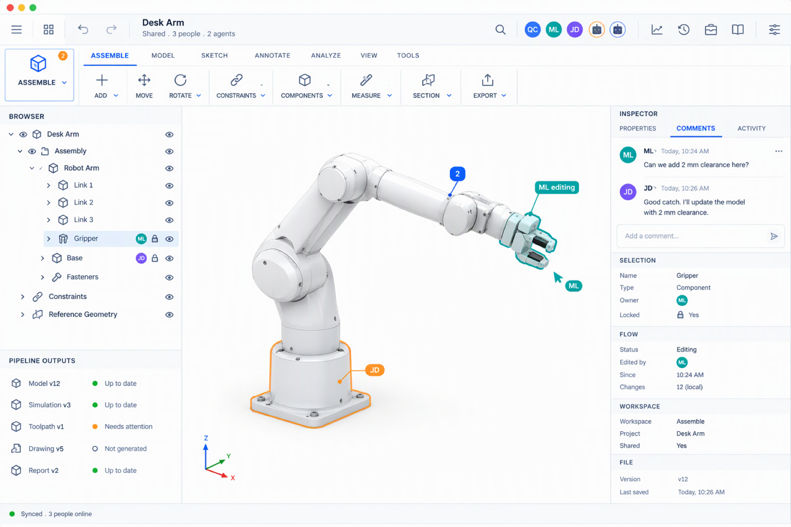

Accounts: Sign in with Apple (required by App Store rules when other sign-in exists) and email via
Entra External ID. Signing in is needed only for cloud runs, agents, sync and sharing.

**Model: server-ordered command log with leases (D-15).**

1. A shared project lives in the cloud as a snapshot (Blob) plus an ordered operation log (Cosmos DB).
   An operation is a `Command` (FRONTEND-SPEC section 3) with author, lease id and the revision it was made on.
2. **Leases.** Before editing, a client (person or agent) takes a lease on an artifact or a sub-part
   of it: a component or sketch in Design, a region or net class in Electronics, a scenario, a task.
   Leases are exclusive for writing, renewed every 10 s, expire after 30 s without renewal, and can be
   requested from the holder ("Ask to edit"). Anyone can view everything live.
3. **Ordering.** Clients send operations to `viaform-collab` over WebSocket (Azure Web PubSub). The
   service checks the lease, assigns a sequence number, appends to the log and broadcasts. Clients
   apply operations in sequence order. Because a lease gives one writer per sub-part, local optimistic
   application never conflicts with others' operations on the same sub-part.
4. **Determinism requirement.** Engines must give the same result when the same commands are
   replayed on any client (macOS and iPadOS, arm64). Across platforms, results are compared by
   fingerprint within tolerance, not bitwise (RUST-ENGINES E-11): the fingerprint is a hash of the
   geometry quantised to 1e-6 m and 1e-6 rad, plus exact topology counts and exact parameter values.
   Command replay tests across both platforms are part of CI. Long jobs (generative studies, training) are not replayed: their results are content-addressed
   blobs shared by hash and promoted with a command.
5. **Late join and recovery.** Load the latest snapshot, then replay the log after it. The service
   writes a new snapshot every 500 operations or 10 minutes.
6. **Offline.** Offline edits are only allowed on leases you hold; if a lease expires while offline,
   your operations become a "conflict copy" branch that you can compare and copy from manually.
7. **Undo** is per author: Cmd-Z undoes your last operation (an inverse operation appended to the log), never someone else's.
8. **Presence.** Avatars on the artifacts each person or agent holds, coloured selection outlines,
   other users' cursors and camera frusta in 3D (optional), "Follow" a person like following an agent,
   comments pinned to geometry.
9. **Permissions.** Owner, editor, viewer per project; share by invite or link (viewer only).
10. **Security.** TLS in transit, encryption at rest with Microsoft-managed keys. Private (non-shared)
    projects can keep end-to-end encrypted backup (AES-256-GCM, key in iCloud Keychain); shared projects
    are not end-to-end encrypted in v1 (the service must read leases and sequence operations).

Sync for single-user projects is the same system with one member.

Granularity limit in v1: two people cannot edit the same sketch or the same component at the same
time. Fine-grained merging inside one parametric feature history is a later research item.

### 10.8 Environments and IaC

| Env | Resource group | Notes |
|---|---|---|
| dev | `viaform-dev` | Same Bicep, CPU tier only, budget 20 USD |
| prod | `viaform-prod` | GPU tiers, budget 100 USD |

`infra/main.bicep` modules: `containerapps.bicep`, `ml.bicep` (workspace, clusters, environment), `storage.bicep` (lifecycle rules), `cosmos.bicep`, `keyvault.bicep`, `frontdoor.bicep` (optional, off by default: parameter `enableFrontDoor = false`, D-7), `webpubsub.bicep` (phase 10, collaboration hub), `monitoring.bicep`, `budget.bicep`, `roles.bicep`.
`azure.yaml` for `azd up`. GitHub Actions workflow `cloud.yml` deploys API on push to `main` when `cloud/` or `infra/` change, using OIDC federated credentials (no secrets in GitHub).

### 10.9 Monthly cost estimate (one builder)

Assumptions: 20 h of A100 low-priority training, 40 h CPU batch, API mostly idle, 50 GB Blob, agent 10 M tokens.
Prices below are approximations to verify with the Azure pricing calculator at phase 5 start.

| Item | Estimate (USD) |
|---|---|
| A100 low priority, 20 h x 0.735 | 14.70 |
| CPU batch D8as v5 low priority, 40 h x about 0.08 | 3.20 |
| Container Apps (scale to 0) | 0 to 5 |
| Cosmos DB serverless | under 2 |
| Blob 50 GB hot + transactions | about 1.50 |
| Front Door Standard base (optional, off in v1, D-7) | about 35 |
| Web PubSub (collaboration), Standard 1 unit (phase 10 only, excluded from v1 total) | about 50, Free tier while testing |
| Log Analytics 2 GB | about 5 |
| Agent tokens (model dependent) | 10 to 60 |
| **Total v1 (no Front Door, no Web PubSub)** | **about 35 to 90** |
| Total with Front Door (more than one user) | about 70 to 125 |

Front Door is the largest fixed cost. Decision D-7: start without Front Door (Container Apps built-in
ingress with HTTPS and IP rate limit in the API), add Front Door when there is more than one user.
The v1 floor is therefore about 35 to 90 USD per month; Front Door adds about 35, and Web PubSub
(phase 10) about 50 more.

### 10.10 Billing (AZ-6)

- Credits are consumable in-app purchases (StoreKit 2) on Mac and iPad, required by App Store rules
  for digital services used in the app.
- The API verifies each transaction with the App Store Server API and adds credits to a ledger
  (Cosmos DB, append-only, idempotent on transaction id).
- Cloud runs and agent tokens debit credits at a published rate: Azure cost times a margin that covers
  Apple's commission (15 percent in the Small Business Program) and overhead. Margin 1.6x (decided 2026-11-07 by the owner, D-28); review after the first 50 paying users.
- The per-run cap (R-7) is in credits; a run cannot start without enough balance for its cap.
- Owner and test accounts can be marked "internal" (billed at cost to the Azure subscription, no credits).

### 10.11 Analytics and crash reports (AZ-7)

- Off by default. A first-launch sheet asks for two separate opt-ins: crash reports, and anonymous usage analytics.
- Crashes: MetricKit diagnostics uploaded to the API, stored in Blob, symbolicated in CI.
- Analytics: a fixed list of events (stage opened, command id used, job kind and duration, errors by
  code), no file content, no names, no geometry; random install id, reset from Settings. Sent to
  Application Insights through the API in batches.
- App Store privacy labels list exactly these.

---

## 11. Interfaces

### 11.1 Bridge C ABI additions

Convention kept: opaque handles, JSON in and out, strings freed with `sc_string_free`, panics caught.
One header per domain in `bridge/include/`.

| Header | Functions | Phase |
|---|---|---|
| `viaform_asm.h` | `vf_asm_open(flow)`, `vf_asm_call(h, json)` with ops `joints`, `set_joint`, `remove_joint`, `drive`, `motion_study`, `mass_props`, `interference`, `export_mjcf`, `export_urdf`, `save_pose`, `save_grasp`, `save_path` (command ids `asm.save_pose`, `asm.save_grasp`, `asm.save_path`, writing `poses`, `grasps`, `paths` in `assembly.json`); `vf_asm_free` | 2 |
| `viaform_kin.h`, `viaform_plan.h`, `viaform_phys.h`, `viaform_learn.h` | See RUST-ENGINES section 9.2 (replaces the earlier `viaform_simd.h` plan) | 2 to 4 |
| `viaform_cloud.h` | `vf_cloud_open(config)`, `vf_cloud_call(h, json)` ops `estimate`, `create_run`, `upload`, `start`, `status`, `metrics`, `stop`, `import`, `list_runs`; `vf_cloud_free` | 5 |
| `viaform_robot.h` | `vf_robot_list_ports`, `vf_robot_open(port, profile)`, `vf_robot_call(h, json)` ops `read`, `command`, `torque`, `estop`, `calibrate`, `record_start`, `record_stop`, `run_policy`; `vf_robot_close` | 7 |
| `viaform_agent.h` | `vf_agent_tools(flow)` (merged tool schemas), `vf_agent_exec(flow, call_json)` (runs one tool call inside an undo group), `vf_agent_group_begin/end/revert` | 8 |

Rules: `vf_robot_*` lives in its own crate `robot/` with no dependency on the cloud crate. `vf_robot_call`
with `run_policy` returns an error unless a confirm token from the current session is passed (R-8).

### 11.2 Cloud REST API (`cloud/api`, v1)

Base `https://<api-host>/v1`. JSON. Auth header per section 10.3. Errors: `{"error": {"code", "message"}}`.

| Method | Path | Purpose |
|---|---|---|
| GET | `/health` | Liveness |
| GET | `/tiers` | Compute tiers with live hourly prices and availability |
| POST | `/runs/estimate` | Body run spec, returns `{low_usd, high_usd, eta_min}` |
| POST | `/runs` | Create run (state Draft), returns `run_id` and upload SAS URLs per input hash not yet stored |
| POST | `/runs/{id}/start` | Validates inputs present, cap set, starts Azure ML job |
| GET | `/runs/{id}` | State, cost so far, cap, timestamps, error |
| GET | `/runs/{id}/metrics?after=` | Metrics rows after sequence number |
| GET | `/runs/{id}/artifacts` | List outputs with download SAS URLs |
| POST | `/runs/{id}/stop` | Graceful stop (checkpoint then cancel) |
| GET | `/runs?project_id=` | List runs |
| POST | `/agent/chat` | SSE stream, body messages and tool list version |
| GET | `/parts/search` | Pricing proxy search |
| POST | `/parts/offers` | Offers for a list of MPNs |
| GET | `/usage` | Month to date spend per category |
| POST | `/auth/apple` | Exchange a Sign in with Apple identity token for a ViaForm session token |
| POST | `/auth/entra` | Exchange an Entra External ID token (email sign-in) for a ViaForm session token |
| POST | `/auth/refresh` | Refresh the session token |
| GET | `/me` | Account, plan flags, credit balance, internal flag |
| DELETE | `/me` | Delete account and all cloud data (App Store requirement), confirmed by a second call with a code |
| POST | `/credits/transactions` | Body: StoreKit 2 signed transaction (JWS). Verified with the App Store Server API, credited once per transaction id |
| GET | `/credits/ledger?after=` | Credit movements (purchases, run debits, agent debits, refunds) |
| POST | `/backups` | Start a backup upload (body: project id, content hash, size); returns `backup_id` and a write SAS URL for the encrypted blob (task P6-5) |
| GET | `/backups?project_id=` | List backups (versions) with time, size and content hash |
| GET | `/backups/{id}` | Backup metadata and a read SAS URL |
| POST | `/backups/{id}/restore` | Prepare a restore: returns read SAS URLs for the backup and its manifest; decryption and the file write happen on the device |
| POST | `/projects` | Create a shared project from an uploaded snapshot hash |
| GET | `/projects` | Projects the user is a member of |
| GET | `/projects/{id}` | Members, roles, latest snapshot, op sequence head |
| POST | `/projects/{id}/members` | Invite by email or create a viewer link; roles owner, editor, viewer |
| DELETE | `/projects/{id}/members/{uid}` | Remove a member |
| POST | `/projects/{id}/negotiate` | Returns the Web PubSub client URL with a short-lived access token for this project's group |
| GET | `/projects/{id}/ops?after=` | Operations after a sequence number (catch-up without WebSocket) |
| GET | `/projects/{id}/snapshots/latest` | SAS URL of the latest snapshot and its sequence number |
| GET/POST | `/projects/{id}/comments` | Comment threads pinned to geometry |
| POST | `/telemetry/events` | Batched opt-in analytics events (fixed schema, 10.11) |
| POST | `/telemetry/crashes` | Opt-in MetricKit diagnostic payloads |

WebSocket messages (Web PubSub, JSON subprotocol), per project group:

| Direction | Type | Body |
|---|---|---|
| client to server | `op` | `{client_op_id, lease_id, base_seq, command}` |
| server to clients | `op` | `{seq, author, client_op_id, command, at}` |
| server to client | `op_rejected` | `{client_op_id, code, message}` (no lease, stale base, invalid) |
| client to server | `lease_acquire`, `lease_renew`, `lease_release` | `{target}` (artifact id plus sub-part path) |
| server to clients | `lease` | `{target, holder, expires_at}` or `{target, holder: null}` |
| client to server | `lease_request` | `{target}`, forwarded to the holder as "Ask to edit" |
| both | `presence` | `{user, focus, selection, camera}` at most 10 per second per user |
| server to clients | `snapshot` | `{seq, url}` when a new snapshot is written |

Inputs are content-addressed (`sha256`), so re-running with the same assembly does not re-upload.

### 11.3 Repository layout additions

```
robot/              crate viaform-robot: serial, protocol, safety, recording
gpu/ kin/ plan/ phys/ learn/ train/ render/ pcb/   Rust engines, see RUST-ENGINES.md section 1
cloud/api/          viaform-api service (Rust, axum) and Dockerfile
cloud/admin/        viaform-admin CLI (device keys, budgets)
infra/              Bicep modules, azure.yaml
firmware/bridge/    ESP32-S3 bridge firmware (task P7-7)
docs/specs/         this spec, robot-protocol.md, visuals/
```

Decision D-8 (recommended): API in Rust (axum) to share types with `bom`, `library` and `flow` crates.

---

## 12. Build plan

Each phase is sized for one agent session or a small set of parallel sessions. A phase is done only
when every AC passes and `cargo test --workspace`, Apple self-tests and CI are green. Work in the main
checkout (no git worktrees). Commit per task with conventional messages.

Order note (2026-11-07): the owner chose **generative first** (RUST-ENGINES E-5). Run RUST-ENGINES
items G0 to G6 right after phase 0, before phase 2; K1 to K3 may run in parallel in another session.

### Phase 0: Baseline (1 to 2 days)

| Task | Steps | AC |
|---|---|---|
| P0-1 Commit the working tree | Review untracked crates (`bom`, `library`, `sim`, `generative`, `core/src/flow`), Apple files, Xcode project; split into logical commits | `git status` clean, CI green on all 3 OS |
| P0-2 Workspace tests | Add `cargo test --workspace` to `ci.yml`; add bridge smoke tests (call each `vf_*_new/free`) | Tests run in CI |
| P0-3 Electron decision applied | Apply D-1: mark Electron maintenance in README; keep CI building it | README states platform policy |

### Phase 0.5: Licence path (starts now, runs in parallel, 3 to 4 months)

| Task | Steps | AC |
|---|---|---|
| P0.5-1 Authorship audit | List every contributor and copied code in ViaForm; confirm the owner can relicense | Written result in `docs/specs/LICENSING.md` |
| P0.5-2 Clean-room PCB engine | RUST-ENGINES section 3B, by sessions that never open `engines/pcbcraft` | Parity checklist passes on the drone flight controller sample |
| P0.5-3 Swap and relicense | Replace `pcb_*` bridge backend, remove the submodule, relicense MIT OR Apache-2.0 | `cargo deny` shows no GPL; App Store build archives |

### Phase 1: Shell completion (1 week)

| Task | Steps | AC |
|---|---|---|
| P1-0 Workspace dropdown (D-10) | macOS: new `apple/Desk/WorkspaceDropdown.swift` at the left of `StageRibbon`, remove PipelineBar from `ProjectWindow` toolbar, move job capsule to toolbar principal, add Cmd-0, add stale banner on canvas. iPad and iPhone: replace the pipeline strip in `TouchRootView` with the dropdown button, popover on iPad, sheet on iPhone. Keep `PipelineStrip` code only if another view still uses it | Section 6.0 rows, badge and footer work; no stage chips anywhere in the toolbar; VoiceOver reads "Workspace, Assemble, 2 stages need update"; screenshots at 1280, 1440, 2560 pt both themes and iPad landscape |
| P1-1 Ninth stage scaffolding | Add `robot` stage id in `core/src/flow`, `Workspace` enum 9 cases, Cmd-9, Robot row in the dropdown | Screenshots in `docs/specs/screens/` |
| P1-2 Project start window | `apple/Desk/StartWindow.swift`, templates list from `core` presets | Section 7.0 AC |
| P1-3 Design ACs | Drag handles, profile picking, sketch dimensions, background scene build | Section 7.1 AC |

### Phase 2: Assemble (2 weeks)

| Task | Steps | AC |
|---|---|---|
| P2-1 `assembly.json` model | Types, persist in zip, flow artifact | Round-trip test |
| P2-2 `vf_asm_*` | Joints over SolidCraft joints, motion study, mass props, interference | Unit tests per op |
| P2-3 MJCF and URDF export | Generator plus schema validation and round-trip import | Template arm round-trips with 6 joints |
| P2-6 Kinematics in Assemble | RUST-ENGINES K1 to K4 (model, FK, IK, drag end effector) | 60 fps drag |
| P2-4 Assemble screen | Ribbon, motion study panel, inspector per section 7.3 | Mockup `01-mechanics.png` matched in layout |
| P2-5 `arm()` preset and template | Graph, sample project, BOM lines | Section 7.0 AC for arm |
| P2-7 Hand grasp editor | RUST-ENGINES K5 (multi-task priority IK, couplings and tendons in kin), MOTION > Grasp per section 7.10.5, `asm.save_grasp`; FRONTEND-SPEC FE-11. "Test in simulation" stays disabled until phase 3 | Grasp pose test; saved grasp round-trips in `assembly.json` |

### Phase 3: Articulated simulation (3 to 4 weeks)

| Task | Steps | AC |
|---|---|---|
| P3-1 `phys` crate | RUST-ENGINES PH1 to PH6 (dynamics, contacts, actuators, tendons, drone port, batching), scenario loader, randomisation | RUST-ENGINES 6.4 tests |
| P3-2 Simulate screen for arm | Scenario card, telemetry, episodes, Re-run | Section 7.5 AC |
| P3-3 Demo replay | Replay `robot.demos` episode in sim | Uses synthetic demo until phase 7 |
| P3-4 Loads from simulation | RUST-ENGINES G3 (`loads_from_sim`, `Pick`, unit conversion) on `phys` wrench history; sheet per section 7.10.2 and "Stress here"; FRONTEND-SPEC FE-8 | RUST-ENGINES G3 AC; load cases show stale badge when their run is stale |

### Phase 4: Local training (3 to 4 weeks)

| Task | Steps | AC |
|---|---|---|
| P4-1 `learn` and `viaform-train` | RUST-ENGINES L1 and L2 (env trait, task compiler, PPO and BC on burn, runner) | Reach point to 95 percent locally |
| P4-2 Planning | RUST-ENGINES PL1, PL2, K6 (collision world, RRT-Connect, Cartesian paths) | 98 percent solved under 200 ms |
| P4-3 Train screen | Section 7.6 layout, local runs only | Charts update live |
| P4-4 Mobile base (wheeled) | RUST-ENGINES PH7 (wheel joints, mecanum friction, 2D planner `plan_base_2d`); Assemble JOINTS > Wheel and Leg templates (leg templates are kinematic only in v1; legged physics PH8 is post-v1); Simulate top-down map and drive per section 7.10.7; FRONTEND-SPEC FE-13, FE-28 | Mecanum strafe test (RUST-ENGINES 6.4); diff-drive base follows a hybrid A* path in sim |
| P4-5 Simulated cameras | RUST-ENGINES R0 (`render` crate: headless wgpu raster of the scenario, RGB and depth, intrinsics from the camera part, noise and exposure randomisation) and L5 (ACT and diffusion policies with vision inputs) | Wrist camera images match the viewport within tolerance; pick cube with camera trains in sim |

### Phase 5: Azure runs (2 weeks)

| Task | Steps | AC |
|---|---|---|
| P5-1 **GPU quota request** | Request NC A100 v4 and NC T4 v3 quota (low priority and dedicated) in East US 2; fallback region if refused | Quota at least 24 vCPUs A100 low priority |
| P5-2 `infra/` Bicep + `azd` | Modules per section 10.8, budget alerts | `azd up` on dev from scratch under 20 min |
| P5-3 `viaform-trainer` image | Dockerfile, CI build to ACR, linux Rust binaries, CUDA and Vulkan (RUST-ENGINES L3) | Image runs `viaform-train --help` and `viaform-gen --help` in Azure ML |
| P5-4 `viaform-api` runs endpoints | Section 11.2 runs routes, cost watcher, SAS minting, owner device keys only (no accounts in phase 5, section 10.3) | Integration test on dev creates, runs, stops, imports a CPU run |
| P5-5 `vf_cloud_*` and run sheet | Mockup `08-cloud-run-sheet.png`, F-1, F-2 | Section 7.6 cloud AC |
| P5-6 Generate on cloud | `generate` run kind | Section 7.2 cloud AC |

### Phase 6a: Render, Make, BOM, pricing proxy, libraries, electronics (2 weeks)

Tasks P6-1 to P6-4, P6-9, P6-10.

| Task | Steps | AC |
|---|---|---|
| P6-1 Render stage | Metal path tracer, queue, materials | Section 7.7 AC |
| P6-2 Pricing proxy terms check | Read DigiKey, Mouser, Nexar API terms for server-side use; record result in this spec | Written yes or no per source |
| P6-3 Pricing proxy | Routes and cache if P6-2 allows | Section 8.2 AC without personal keys |
| P6-4 Make stage | Bundle, checks, manifest | Section 7.8 AC |
| P6-9 Libraries additions | Part record SIMULATION (actuator model) and SOFTWARE (protocol, driver) sections; "Insert into assembly" with mount points and joint axis (section 8.1); FRONTEND-SPEC FE-25 | STS3215 record drives the `phys` servo model; inserting a servo into the arm template creates a joint with its motor filled in |
| P6-10 Electronics additions | Section 7.4 AC additions: KiCad library parts placed from Libraries, DRC summary capsule, "Show in 3D", keep-in from the frame revision (`vf_link_keepin`); FRONTEND-SPEC FE-26 | Section 7.4 AC |

### Phase 6b: Accounts, credits, telemetry, backup (1 to 2 weeks)

Tasks P6-5 to P6-8. Can run beside phase 6a; must finish before phase 9 (release gate).

| Task | Steps | AC |
|---|---|---|
| P6-5 Backup (optional) | Encrypted upload, version list, restore; `/backups` routes (section 11.2) | Restore gives identical file hash |
| P6-6 Accounts | Sign in with Apple and Entra External ID email sign-in, session tokens in Keychain; routes `/auth/apple`, `/auth/entra`, `/auth/refresh`, `GET /me`, `DELETE /me` (section 11.2); cloud runs move from device keys to accounts (section 10.3); FRONTEND-SPEC FE-23 | Sign in on Mac and iPad with both methods; `DELETE /me` removes all cloud data on dev |
| P6-7 Credits and billing | StoreKit 2 consumable products, App Store Server API verification, append-only ledger, run and agent debits (section 10.10); routes `/credits/transactions`, `/credits/ledger`, `/me` balance; FRONTEND-SPEC FE-23 | Sandbox purchase credited exactly once (replaying the same transaction id is a no-op); a run without balance for its cap is refused |
| P6-8 Telemetry | Opt-in crash reports and usage analytics (section 10.11): consent sheet, MetricKit upload, fixed event list; routes `/telemetry/events`, `/telemetry/crashes` to Application Insights; FRONTEND-SPEC FE-23 | Nothing is sent before consent (network test); events and a test crash appear in Application Insights on dev |

### Phase 7: Robot, arm and drone (4 to 5 weeks, parts in hand)

| Task | Steps | AC |
|---|---|---|
| P7-1 Reference arm parts | SO-101 class arm (D-9): check the design's licence (hardware and printed parts), pick the exact revision, print or order parts, order one leader and one follower set of STS3215 servos and the bus adapter, record in `robots.md` | Licence recorded; parts ordered in week 1 |
| P7-2 `robot-protocol.md` | Commands, telemetry frame, errors, watchdog | Reviewed spec |
| P7-3 `robot/` crate | Serial, servo bus driver, safety layer, recording | E-stop 20 ms test on hardware |
| P7-4 Robot screen Mac and iPad | Mockups `06-robot.png`, `10-ipad-robot.png`. Mac part uses mode A (direct bus); the iPad part depends on P7-7 (bridge mode is the only link on iPad) | Section 7.9 AC |
| P7-5 Demos to training | LeRobot-compatible dataset, used by `learn` behaviour cloning | Pick cube with demos trains in cloud |
| P7-6 Run policy on robot | burn inference in app (`vf_learn_act`), confirm sheet, limits | First policy-driven movement (north star) |
| P7-7 ESP32-S3 bridge firmware | `firmware/bridge/`: robot-protocol section 4 frames (`HELLO`, `ARM`, `GOALS`, `STATE`, `ESTOP`, `CLEAR`, `FAULT`, `PING`) over USB CDC and UDP, 200 ms firmware watchdog (torque off and latch), pairing with a 6-digit code, HMAC-SHA256 per frame, e-stop in the receive interrupt path; `robot/` mode B transport | Mode B watchdog test (robot-protocol section 8: torque off under 250 ms after pulling Wi-Fi); frames with a bad MAC are rejected; iPad connects over Wi-Fi |
| P7-8 Drone hardware and flight controller | Build the 3 inch reference drone with the ViaForm flight controller board (or a stock ArduPilot board first), ArduPilot firmware, RC receiver; record parts in `robots.md` | Bench test props off: arming, motor order, RC kill switch cuts motors |
| P7-9 Drone link | `robot/` drone device: MAVLink 2 over UDP through the ESP32-S3 (`firmware/bridge/` drone build as MAVLink router, signing on), telemetry into the twin, setpoint streaming at 50 Hz, failsafe parameters checked on connect (robot-protocol section 9) | Link loss test: hold then land in sim (SITL) and on the bench |
| P7-10 Drone sim-to-real | `phys` drone model gets the ArduPilot inner-loop model (rate and attitude controllers) so trained policies output setpoints, not motor commands; system identification from flight logs | Same policy flies hover and waypoint task in ArduPilot SITL within tolerance of `phys` |
| P7-11 Drone flight tests | Net cage indoors: manual flight, then policy hover, then waypoint task; robot screen shows flight mode, battery, geofence | Policy holds hover 30 s within 0.3 m in the cage; every flight logged |

### Phase 8: Design agent (2 weeks)

| Task | Steps | AC |
|---|---|---|
| P8-1 `/agent/chat` gateway | SSE proxy to Foundry, budgets | Token budget enforced |
| P8-2 Tool layer | `vf_agent_tools`, `vf_agent_exec`, undo groups, F-3 | Unit test: plan revert restores fingerprints |
| P8-3 Agent panel | Mockup `07-agent.png`, checkpoints, log | Section 8.3 AC |
| P8-4 Start window prompt | "Describe what you want to build" starts a plan | Gripper example produces a valid part |
| P8-5 Search parts by function | Libraries search box accepts a function query ("servo 30 kg.cm 12 V"), answered by the agent over library and pricing tools (section 8.1); FRONTEND-SPEC FE-27 | The example query returns at least 3 matching servos with specs and offers; no purchase tool is called (R-1) |

### Phase 9: Polish and release gate (1 week)

Release path (D-29): TestFlight beta first (internal, then external testers on Mac and iPad, at least 2 weeks and 20 testers), then App Store. TestFlight builds may start before the relicence; App Store submission may not.

Legal review of labels and glyphs (R-6), VoiceOver on browser and workspace dropdown, UI tests on 13 and 27 inch,
`DocumentGroup`, performance budget checks (section 13), App Store submissions for macOS and iPadOS (needs phase 0.5 done and the MIT OR Apache-2.0 relicence), App Privacy labels, StoreKit products.

### Phase 10: Collaboration (4 to 6 weeks, after phase 8)

| Task | Steps | AC |
|---|---|---|
| P10-1 Project sharing and membership | `/projects` and `/projects/{id}/members` routes, invites by email, viewer links, roles owner, editor, viewer; uses the phase 6 accounts (P6-6) | Owner invites an editor; a viewer link opens the project read-only |
| P10-2 `viaform-collab` | Web PubSub hub, lease service, op log, snapshots | Load test: 5 clients, 20 ops per second, ordered |
| P10-3 Replay determinism | Cross-platform command replay tests (Mac and iPad simulator) | Fingerprints match within tolerance: geometry quantised to 1e-6 m and 1e-6 rad hashes equal, topology counts and parameter values exactly equal (section 10.7, RUST-ENGINES E-11) |
| P10-4 Client | Lease UI, presence, follow, comments, offline conflict copy | Two Macs and one iPad co-edit the arm template |
| P10-5 Agents on leases | Agents use the same lease service | Parallel agent AC (8.3) |

Parallelism: phases 2 and 5 (infra only, tasks P5-1 to P5-3) can run at the same time; phase 6a Render
can run beside phase 4, and phase 6b can run beside phase 6a. Phase 7 starts when parts arrive; P7-1 should be done in week 1 so parts can ship.

---

## 13. Non-functional requirements

| Area | Requirement |
|---|---|
| Performance | 60 fps viewport with 200 bodies on M1; stage switch under 150 ms; stale propagation under 50 ms for 500 artifacts; app launch to start window under 2 s |
| Memory | Under 2 GB for the arm template with sim running |
| Offline | All stages except cloud runs, agent, pricing refresh, backup |
| Security | No secrets in projects or logs (R-4); SAS tokens 15 min, single run scope; API rejects unsigned requests; dependency audit (`cargo audit`, `npm audit`) in CI |
| Privacy | Analytics and crash reports opt-in, separate switches (10.11); agent prompts not stored server side by default |
| Reliability | Cloud run survives app quit and low-priority preemption; autosave every 60 s via `doc.recovery_*` |
| Accessibility | VoiceOver labels for every toolbar item, chip and tree row; full keyboard path through every stage; WCAG AA contrast |
| Licensing | Target MIT OR Apache-2.0 for app and engines (D-13). No GPL, LGPL or AGPL code linked; `cargo deny` licence allow-list in CI. KiCad libraries are loaded from the user's install at run time, never bundled |
| Robot safety | R-8 list; safety code has 100 percent branch coverage in `robot/` |

---

## 14. Testing strategy

| Level | What | Where |
|---|---|---|
| Unit | Rust crates, each op of each `call()` | `cargo test --workspace` |
| Golden files | `.viaform` round trip, MJCF/URDF output, bundle manifest | `core/tests`, `bom/tests` |
| Determinism | Same seed same trajectory (quad sim, phys, viaform-train short run) | CI |
| Physics validation | RUST-ENGINES 6.4 test list (energy, ABA versus RNEA, stacking, grasp, determinism) | `cargo test -p viaform-phys` |
| App self-test | `ViaForm --selftest` extended per stage (create, run, check status) | macOS CI job |
| UI screenshots | Every stage, both themes, 1280/1440/2560 pt, iPad landscape | `docs/specs/screens/`, reviewed per phase |
| Cloud integration | Dev environment: create, run (CPU tier), cap stop, import | Nightly workflow, budget 1 USD per night |
| Hardware in the loop | E-stop timing, watchdog, teleop latency | Manual checklist per release, results in `docs/specs/hil/` |
| Agent evals | 10 fixed goals on the template projects, success and spend recorded | `learn/evals/agent/` run on demand |

---

## 15. Decisions, open questions, risks

### Decisions (recommended; confirm or change)

| ID | Decision | Recommendation |
|---|---|---|
| D-1 | Platforms | Native Apple apps primary. Electron in maintenance (builds, no new stages) until a Windows user exists |
| D-2 | Articulated sim engine | Decided: own Rust `phys` crate (RUST-ENGINES E-2) |
| D-3 | Robot link | USB serial servo bus first, ESP32-S3 bridge firmware second |
| D-4 | Demo dataset format | LeRobot-compatible |
| D-5 | Agent model | Azure AI Foundry `temple-ai-provider`, via API gateway, model configurable |
| D-6 | Batch compute | Azure ML compute clusters, low priority, scale to zero |
| D-7 | Front Door | Not in v1; add with more users |
| D-8 | Cloud API language | Rust (axum) |
| D-9 | Reference arm | Decided 2026-11-07 by the owner: an SO-101 class open 6 DOF arm (leader and follower pair) on Feetech STS3215 servos, LeRobot compatible. Task P7-1 checks its licence, picks the exact revision and orders parts |
| D-11 | Minimum OS | macOS 26, iPadOS 26, iOS 26; Liquid Glass |
| D-12 | PCB engine | Replace PCBCraft with a clean-room Rust PCB engine (RUST-ENGINES section 3B) to remove GPL |
| D-13 | Licence | MIT OR Apache-2.0 after D-12; owner confirms sole authorship of ViaForm code before relicensing |
| D-14 | Business | Free app, paid cloud credits via StoreKit |
| D-15 | Collaboration | Real-time co-editing with leases and a server-ordered command log |
| D-16 | Agent UI | Agent manager: agents column left, workspace right, follow mode |
| D-17 | Parallel agents | Yes, on separate artifacts via leases |
| D-18 | Agent autonomy | Checkpoints |
| D-19 | Where agents run | In the app on the Mac or iPad |
| D-20 | Theme | Follow system |
| D-21 | Mouse | Desktop CAD style default, presets in Settings |
| D-22 | Languages | English v1, String Catalog from day one |
| D-23 | Telemetry | Opt-in analytics and crash reports |
| D-24 | iPad | Full touch-first app |
| D-25 | Azure subscription | Decided 2026-11-07 by the owner: use the current subscription ("Azure subscription 1", the one the Azure CLI is signed in to) for both dev and prod, in separate resource groups `rg-viaform-dev` and `rg-viaform-prod` with separate budgets. The owner must hold the Owner role on it and receive the budget alerts |
| D-26 | Drone in v1 | Decided 2026-11-07 by the owner: full v1 scope, simulation, training and real flight (robot-protocol section 9, tasks P7-8 to P7-11) |
| D-27 | Hand hardware | Decided 2026-11-07 by the owner: the humanoid hand is designed, simulated and trained in v1; real hand hardware is post-v1. The Robot stage supports the arm and the drone in v1 |
| D-28 | Credit margin | Decided 2026-11-07 by the owner: Azure cost times 1.6 (section 10.10) |
| D-29 | Release path | Decided 2026-11-07 by the owner: TestFlight beta first, then the App Store (phase 9) |
| D-10 | Stage switcher | Decided 2026-11-07 by the owner: workspace dropdown at the left of the ribbon (desktop reference style), replacing the PipelineBar in the toolbar. Flow stays visible through PIPELINE OUTPUTS, inspector FLOW, the dropdown badge and canvas banners |

### Open questions

1. Robot exchange format beyond MJCF: also USD for rendering pipelines? (Not needed for v1.)
2. On-board compute for the arm ("brain"): postponed per notes; v1 runs policies on the Mac over USB.
3. Resolved by D-25: the current subscription hosts dev and prod.
4. Drone flight: FAA registration and local rules before any outdoor test (outside software scope, track in `robots.md`).
5. Pricing proxy legality per distributor (P6-2).

### Risks

| Risk | Impact | Mitigation |
|---|---|---|
| GPU quota refused or slow | Phase 5 blocked | Request in week 1; fallback region; T4 tier for imitation only; local MPS training |
| Sim-to-real gap on cheap servos | Policies fail on robot | Randomisation, system identification from recorded demos, imitation first |
| Low-priority preemption storms | Runs never finish | Checkpoint every 5 min, auto switch to on-demand with user consent if preempted 3 times |
| Own physics engine effort | Phase 3 slip | Grasp and stacking tests gate it; soft contacts at 1 kHz first; see RUST-ENGINES section 11 |
| Trade dress similarity | Legal | R-6 and phase 9 legal gate |
| Agent makes wrong edits | Lost work | Undo groups, checkpoints, propose-then-accept, log |
| Cost overrun | Money | R-7 caps, budget alerts, `GET /usage` in app settings |

---

## 16. Glossary

| Term | Meaning |
|---|---|
| Artifact | A named output of a stage (Frame, Board, Assembly, Policy) |
| Revision | One version of an artifact ("Frame v12", "Board rev C") |
| Stale | An artifact built from an older revision of one of its inputs |
| Promote | Turn a candidate (generative outcome, cloud checkpoint) into a revision |
| Job | A long operation with progress, local or cloud |
| Run | A cloud job on Azure ML |
| Cap | Maximum USD a run may spend; enforced by the API |
| Scenario | World, sensors and randomisation for a simulation |
| Task | Observation, action, reward and success for training |
| Demo | A recorded episode from teleoperating the real robot |
| Policy | A trained controller saved as a burn record with `policy.json` |
| E-stop | Software emergency stop that removes motor torque |
